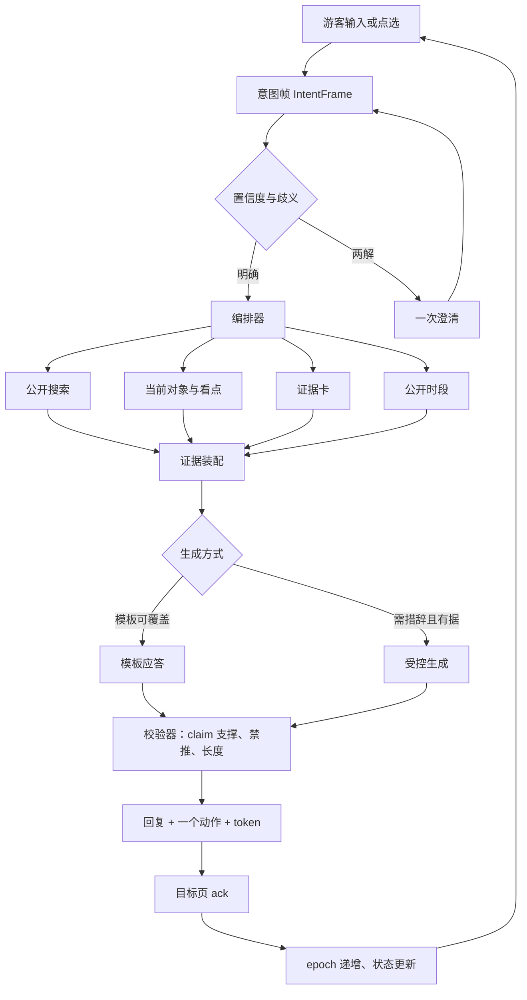

# 洛笙一体化 AI 向导｜终版优化方案

2026-11-21 · v3.0 终版 · 目标能力 L3，L4 明示延后

本版接替 [2026-11-21-luosheng-unified-visitor-guide.md](2026-11-21-luosheng-unified-visitor-guide.md)，后者保留为评审历史。相对上一版有三处结构性改动：

1. 把“首批自由追问”拆成 **1a（入口与状态）/ 1b（预览问答与模型接线）**，避免验收写了、路径没有。
2. 把“卡片状态机”从文档约束变成 **代码约束**，修掉候选包已经 `PUBLISHED` 的治理漏洞。
3. 把“单一输入框”落成 **单一问答引擎 + 展签只读呈现**，并把这笔重构成本写进估算。

---

## 0. 结论

**做，但按能力阶梯做，不按页面改版做。** 洛笙现在的问题不是“入口不够多”，而是四层能力同时缺位：理解层只会命中词、状态层跨页即失忆、内容层未签核、暴露层没有线上样本。只补任何一层，游客感知都不会变。

终版把首批目标定在 **L3：多轮话语 + 证据约束生成 + 动作闭环**。这不是把正则写长一点，而是四件事同时成立：

- 游客说“另一只”“我说的是脚”“它以前断过吗”，系统能落到具体看点、具体图版、具体证据；
- 每条回答先回应困惑，再给一个能亲手验证的动作，最后才展开依据；
- 没有证据就明确说缺什么，绝不借上一轮出处；
- 换话题、去预约、再回来，位置和话题都还在。

L4（语音、跨设备续看、个性化路线、多展品对比）明确延后，触发条件见 §2。

---

## 1. 现状：8 句里 6 句失败，四层原因

下表沿用上一版的固定对照。我按代码路径逐条复算过，结论一致。

| 游客原话 | 现在给出的结果 | 终版应看到 |
| --- | --- | --- |
| 我只有五分钟，带我看一件 | 馆藏、展厅、预约、文创四个入口 | 一件展品、推荐理由、一个到具体看点的按钮 |
| 不想预约，只想看青铜鼎 | 先预约，再鼎 | 只推荐鼎，下一步直达展品 |
| 这里可以预约吗 | “这里”命中页面介绍，四个入口 | 回答在哪预约，给预约入口 |
| 它是什么年代的 | 四类站内服务 | 按当前藏品取证，标明参考实物还是数字模型 |
| 另一只在哪 | 四类站内服务 | 已确认鼎耳给俯视，已确认三足给背视，否则澄清一次 |
| 明天还有名额吗 | 预约操作步骤 | 按日期读公开时段，区分有、空、越窗、失败 |
| 在哪能看 3D | 数字展厅 | 保留 |
| 怎么预约参观 | 预约说明与入口 | 保留，无需查余量 |

四层原因，各有代码证据：

| 层 | 受影响 | 代码证据 | 终版对策 |
| --- | --- | --- | --- |
| 理解层：否定、排序、优先级、时长约束 | 4 句 | [luoshengSiteGuide.ts](../../frontend/src/lib/luoshengSiteGuide.ts) 第 30 行页面指代先于意图；第 31–35 行扁平 OR、按 `Object.keys` 顺序输出；第 32–34 行鼎/展厅硬编码特判 | IntentFrame + 否定作用域 + 排除集 + 相关性排序 |
| 状态层：当前藏品、看点、话题、返回位置 | 2 句 | 函数签名只有 `(question, route)`；[LuoshengSiteGuide.vue](../../frontend/src/components/LuoshengSiteGuide.vue) 第 70–77 行切页无条件清空 | VisitContext + epoch + 单一写入者 |
| 内容层：签核卡、断代卡 | 2 句 | 候选四卡 `status: PUBLISHED`（写的是生成时刻），审稿单仍“待办理”；无断代卡；`GuideExhibitController.Entry` 只有 `cardId/revision/text/publicSource`，图版映射仍在前端代码里 | 卡片状态机 + 断代卡 + 服务端已审映射 |
| 暴露层：没有线上样本 | 全部 | [App.vue](../../frontend/src/App.vue) 第 48 行 `DEV || VITE_GUIDE_SITE_ENABLED`；后端 `preset-enabled` 默认 false；全仓无事件端点 | S0 起分级开关 + 匿名事件 |

**结论：`store` 是必要不充分条件。** 6 句失败里只有 2 句靠状态层就能解决，4 句卡在理解层。上一版把两类病合并成一个方案，是本轮返工的根因。

---

## 2. 目标：能力阶梯

| 级别 | 能力 | 游客感知 | 对应批次 |
| --- | --- | --- | --- |
| L0 | 导航壳 | 问什么都给四个入口 | 现状 |
| L1 | 上下文导航 | 否定、排序、跨页不再失忆 | S0 |
| L2 | 单轮取证问答 | 当前看点问一句，能被接住 | 1a / 1b |
| **L3** | **多轮话语 + 证据约束 + 动作闭环** | **指代、纠正、缺证、返回都成立** | **2 / 3（首批目标）** |
| L4 | 多模态与个性化 | 语音、跨设备、个性化路线、多展品对比 | 延后 |

L4 的启动条件（三条同时满足）：L3 的 24 题与 8 人试用达标；内容侧能稳定产出已签卡；模型单轮成本与 p95 进入预算。任一条不满足，不做。

---

## 3. 游客能感知到的八种“高级”

架构的高级必须落成可观察的行为，否则只是复杂度。

| 行为 | 反面 | 怎么验收 |
| --- | --- | --- |
| 同一歧义只澄清一次 | 反复问“你到底想问什么” | 固定句「另一只呢」在鼎耳、三足、无看点三种语境各跑一遍 |
| 认得“它 / 另一只 / 刚才那个” | 换页就要求重说展品名 | 跨页往返样例要求重复说明藏品次数为 0 |
| 会接受纠正 | “我说的是脚”之后仍按耳朵答 | 纠正后首答改按三足，画面不动直到游客点切图 |
| 每条回答给一个可验证动作 | 只给一段说明 | 动作到达率 ≥95% |
| 敢说不知道，并说缺什么 | 用通用欢迎语兜底 | 缺证回复必须列出缺的资料类别 |
| 换话题后能接回来 | 去预约就丢掉刚才的看点 | 返回成功率 ≥90% |
| 主动给“下一眼”但不打断 | 每轮塞三个推荐 | 主动建议默认折叠在「更多」里 |
| 依据可展开、可核对 | 只给结论不给来源 | 无依据断言率 = 0 |

### 3.1 一段可验收的对话

这段对话同时覆盖指代、纠正、依据、断代四类风险，作为第 1b 与第 3 批的共同样例。

> **游客**（侧视图）：「我数来数去只有两条腿，是缺了一条吗？」
> **洛笙**：「在这张侧视图里，有一只足被挡住了。点「看背视图」，中间那只也能看见。」　〔主按钮：看背视图〕
>
> *游客点选，背视图在原位打开，图注标出第三足。*
>
> **游客**：「你怎么看出来的？」
> **洛笙**：「侧视和背视是同一模型的两个固定机位。侧视里一足被器身挡住，背视中间与两侧各可辨一足。两图差异可以用遮挡解释，不能据此判断原器缺损或修复。」　〔依据：LS-DING-FEET r1〕
>
> **游客**：「它是什么年代的？」
> **洛笙**：「你眼前是数字模型。它参考的那件实物，克利夫兰艺术博物馆的记录为商代安阳时期，约公元前 1250 至前 1046 年。」　〔依据：1962.281 公开记录；该断代在补齐 S2 卡并签核前不得公开回答〕

最后一句的括号是硬约束：断代卡未签时，只能回答“当前展签可核对参考藏品编号 1962.281，年代请查该馆记录”，不得直接给年份。

---

## 4. 设计原则

1. **证据先于表达。** 没有卡片支撑的句子不进入答案；宁可少说一句。
2. **程序先于模型。** 按钮、别名、日期、时段、路由都能确定性解决，不调用模型。模型只负责“把有据的话说得像人话”。
3. **单一写入者。** VisitContext 每个字段只有一个写者，杜绝客户端与服务端各记一份“当前话题”。
4. **一次澄清。** 同一歧义在本会话只问一次；第二次按最高置信执行，并说明假设。
5. **可降级。** 模型不可用 → 已审讲解 → 图版与图注 → 公开藏品页。每一级都能独立成立。

---

## 5. 系统架构

### 5.1 分层



### 5.2 一轮的编排

固定十步，任何一步失败都走降级，不重试生成：

1. 归一化：NFKC、全半角、去首尾空白。
2. 槽位优先：按钮、别名、日期、人数。
3. 规则帧：否定作用域、排除集、相关性排序。
4. 低置信补帧：仅当 `confidence < 0.75` 且候选 ≥2，调用受限分类器；分类器只返回枚举与槽位，不返回文案。
5. 工具计划：最多 3 次，按“对象 → 证据 → 时段”顺序，超预算直接降级。
6. 证据装配：三层证据（见 5.4），跨层不做推断。
7. 生成：模板优先；模型仅在证据齐备且需要措辞时参与。
8. 校验：claim 支撑、禁推清单、长度、语言、数字来源。
9. 交付：正文 + 一个主动作 + 一次性 token。
10. 记录：匿名事件，不写提问全文。

### 5.3 意图与话语

```ts
type GuideAct =
  | 'navigate' | 'find' | 'explain' | 'compare'
  | 'ask_fact' | 'ask_evidence' | 'check_slots'
  | 'correct' | 'resume' | 'decline' | 'chitchat'

interface IntentFrame {
  act: GuideAct
  target?: { kind: 'artifact' | 'exhibit' | 'lookpoint' | 'view' | 'service' | 'date'; id?: string; date?: string }
  referent?: { kind: 'explicit' | 'deictic' | 'ellipsis'; surface: string; candidates: string[] }
  constraints?: { minutes?: number; people?: number; date?: string }
  exclusions?: string[]
  pending?: Array<{ act: GuideAct; date?: string }>
  confidence: number
  source: 'slot' | 'alias' | 'rule' | 'model'
}
```

| act | 触发例 | 必需槽 | 允许动作 |
| --- | --- | --- | --- |
| navigate | 在哪能看 3D | service | `open_*` |
| find | 不看鼎，想看玉器 | query、exclusions | `open_artifact` |
| explain | 另一只在哪 | lookpoint 或 topic | `show_plate` |
| compare | 两只耳对照看 | lookpoints[2] | `show_plate` ×2 |
| ask_fact | 什么年代、多大 | claimType | `open_source` 或空 |
| ask_evidence | 你怎么看出来的 | topic | `show_evidence` |
| check_slots | 明天还有名额吗 | date、people? | `open_slots` |
| correct | 我说的是脚 | newTopic | `show_plate` |
| resume | 回到刚才那只耳朵 | anchorId | `resume_anchor` |
| decline | 我先自己逛 | — | `dismiss` |

**否定作用域规则。**

- 否定词与对象必须同一个小句，跨逗号不传递。
- “别错过鼎”里的“别”修饰“错过”，不排除鼎。
- “不看鼎，找玉器”排除鼎，目标玉器。
- 排除只作用于本轮，不写入长期偏好。

**排序规则。** 显式实体 > 显式动作 > 泛化推荐；排除项先剔除再排序；不再使用 `Object.keys` 顺序。

**澄清策略。** 候选 ≥2 且第一、第二置信差 <0.15 时澄清一次；澄清必须给具体选项；同一 topic 的同一歧义本会话只问一次。

### 5.4 证据与生成

三层证据，各自能支持什么、禁止什么，必须写进校验器：

| 层 | 来源 | 可支持 | 禁止推断 |
| --- | --- | --- | --- |
| S1 模型可见 | 当前视角图版、3D 就绪状态 | 几何、遮挡、可见轮廓、两图差异 | 年代、用途、搬运、受力、残损、寓意、原器颜色 |
| S2 参考实物 | 克利夫兰艺术博物馆 1962.281 公开记录 | 年代、尺寸、文化分期、出土地有无 | 模型细节、本馆收藏关系 |
| S3 项目立场 | 项目编辑说明 | 数字重制身份、非原器、非扫描、非官方复原 | 任何实物事实 |

**Claim 级约束。** 答案不再以“整段卡文”为单位，而是拆成原子 claim：

```ts
interface Claim {
  text: string
  cardId: string
  revision: number
  stratum: 'S1' | 'S2' | 'S3'
  span: [number, number]
}
```

校验器规则：

- 每条 claim 必须能解析到 `cardId + revision + span`，否则渲染前丢弃。
- 若首句依赖被丢弃的 claim，整条降级为 `INSUFFICIENT_EVIDENCE`。
- 数字与日期只能来自 S2 卡，禁止模型生成。
- 禁推 lint 命中即失败：用途、搬运、受力、寓意、年代、出土地、残损、所有权。

**冲突与缺证。** 沿用 [ADR-006](../decisions/ADR-006-luosheng-structured-evidence-conflict.md)：两卡矛盾时回 `DISPUTED_EVIDENCE`，并列两说，不选边；缺证时回 `INSUFFICIENT_EVIDENCE`，并列出缺的资料类别（修复史、出土地、用途、工艺）。

### 5.5 参观状态 VisitContext

| 字段 | 唯一写者 | 失效条件 |
| --- | --- | --- |
| `route` | 路由器 | — |
| `object`（artifactSlug / exhibitSlug） | 目标页 ack | 路由变化 |
| `focus`（已确认看点） | 游客手势，且仅手势 | 对象变化、显式切图 |
| `topic`（最近可引用话题） | 服务端本轮 ack | 对象、语言、卡包版本变化 |
| `pending`（待办任务） | 游客意图 | 完成或撤销 |
| `anchor`（返回位置） | 游客主动转场 | 对象撤回 |
| `epoch` | 上述任一变化 | 单调递增，不回退 |

三条硬规则：

1. **镜头不等于注视。** 转动 3D 不推断游客在看哪个部位，只有点击才算。
2. **迟到即作废。** 所有请求携带 epoch，响应 epoch 落后则丢弃，不提示。
3. **bfcache 重建。** `pageshow.persisted` 时按当前路由重建，不恢复旧动作 token。

生命周期：仅当前标签内存；刷新、新标签、语言变化、登录或退出、进入账户与后台即重建；`sessionStorage` 只保留邀请标记。

### 5.6 动作契约

| 动作 | 参数 | 前置 | 后置 | 失效 |
| --- | --- | --- | --- | --- |
| `open_artifact` | slug | 公开且可打开 | 页面 ack 对象就绪 | epoch 变化或 60 秒 |
| `show_plate` | artifactSlug, lookpoint | 图版就绪 | 焦点到图注或看点标题 | 同上 |
| `show_view` | exhibitSlug, view | 3D 就绪 | 视角切换完成 | 同上 |
| `open_slots` | date, people? | 预约页可预选 | 日期已填、页面复查 | 同上 |
| `resume_anchor` | anchorId | 对象仍公开 | 回到原看点 | 对象撤回 |

动作只接受受限类型，任何 URL、选择器、脚本都不属于动作输入。目标页回报 `{token, objectId, ready}` 才算“已到达”；未消费的 token 到期即废。

### 5.7 接口契约

| 用途 | 路径 | 注册条件 | 生产构建 |
| --- | --- | --- | --- |
| 预览问答 | `POST /api/v1/guide/preview/turns` | `@Profile("guide-preview")` | **禁止出现**，由隔离脚本断言 |
| 正式问答 | `POST /api/v1/guide/turns` | `museum.guide.turns-enabled=true` | 允许 |
| 已审讲解 | `GET /api/v1/guide/exhibits/{slug}` | `museum.guide.preset-enabled=true` | 允许 |

现有前端夹具 [luoshengHttpFixture.ts](../../frontend/src/lib/luoshengHttpFixture.ts) 第 9 行指向 `/api/v1/__guide-test/*`，并校验 `data.synthetic`。1b 需同步改为预览路径、去掉 `synthetic` 断言，否则接线永远停在测试形态。

请求与响应：

```json
// POST /api/v1/guide/turns
{
  "requestId": "uuid",
  "epoch": 7,
  "locale": "zh-CN",
  "question": "我数来数去只有两条腿，是缺了一条吗？",
  "object": { "artifactSlug": "heluo-bronze-ding", "exhibitSlug": "heluo-bronze-ding-3d" },
  "lookpoint": "feet",
  "topicId": "t-3"
}
```

```json
{
  "kind": "GROUNDED",
  "lead": "在这张侧视图里，有一只足被挡住了。",
  "claims": [{ "text": "背视图中间和两侧各可辨一足。", "cardId": "LS-DING-FEET", "revision": 1, "stratum": "S1", "span": [24, 40] }],
  "action": { "kind": "show_view", "exhibitSlug": "heluo-bronze-ding-3d", "view": "back", "token": "a-9f2" },
  "citations": [{ "cardId": "LS-DING-FEET", "revision": 1, "publicSource": null }],
  "topicId": "t-4",
  "epoch": 7
}
```

| kind | HTTP | 游客看到 |
| --- | --- | --- |
| `GROUNDED` | 200 | 正文 + 一个动作 + 可展开依据 |
| `CLARIFY` | 200 | 一次具体澄清，两个选项 |
| `INSUFFICIENT_EVIDENCE` | 200 | 说明缺哪类资料，给公开藏品页 |
| `DISPUTED_EVIDENCE` | 200 | 并列两说，不选边 |
| `STALE_EPOCH` | 409 | 静默丢弃，不提示 |
| `RATE_LIMITED` | 429 | 稍后再问，当前讲解仍可读 |
| `BUDGET_EXHAUSTED` | 200 | 关闭自由问答，导航与讲解保留 |
| `RETIRED` | 200 | 引导重新找公开内容 |

**时段契约先修一处。** [AppointmentSlotController](../../backend/src/main/java/com/heluo/museum/appointment/AppointmentSlotController.java) 目前对越窗直接抛 `IllegalArgumentException`，被全局处理器转成 422 `VALIDATION_ERROR`，与真正的查询失败同码。终版要求：越窗返回 200 + `window: {from, to, timezone: "Asia/Shanghai"}` + `windowExceeded: true` + 空时段；只有日期格式错误才 422。“明天”由客户端按 `Asia/Shanghai` 计算后再请求，不能用设备本地时区。

### 5.8 取舍：为什么不是另外三条路

| 方案 | 优点 | 为什么不选 | 本方案仍取它什么 |
| --- | --- | --- | --- |
| 纯规则与关键词（现状） | 快、零成本、完全可控 | 8 句里 6 句失败；否定、指代、纠正都做不了 | 槽位、别名、日期、时段继续用规则 |
| 纯 RAG + 大模型直答 | 口语覆盖好、开发快 | 无法保证每条陈述有卡支撑；错断代、伪造出土的代价不可接受；成本与延迟不可预测 | 只让它负责措辞，不让它决定事实 |
| 全权 function calling | 灵活、可组合 | 参数由模型生成，越权与误动作风险高，审计困难 | 借工具编排的思路，但动作与参数由程序生成、服务端校验 |
| **本方案：规则优先 + 受限分类 + 证据约束生成** | 可控、可审计、可降级 | 开发量最大，需要内容与工程同时投入 | — |

结论：博物馆场景的失败代价不对称——答错年代比不回答严重得多。因此宁可牺牲覆盖率和开发速度，换取 claim 级可核对。

---

## 6. 内容流水线

### 6.1 卡片 schema v2

| 字段 | 说明 |
| --- | --- |
| `cardId` / `revision` | 稳定标识，修订号单调递增 |
| `stratum` | S1 / S2 / S3，决定可支持与禁推 |
| `exhibitSlug` / `artifactSlug` / `locale` | 适用范围 |
| `text` | 已审正文 |
| `supportedClaims[]` | 允许被引用的原子陈述 |
| `forbiddenInferences[]` | 该卡明确不支持的推断 |
| `plateRefs[]` | 关联图版与视角 |
| `publicSource` | 可公开外链，可空 |
| `approvedBy` / `approvedAt` / `digest` | 签核三件套 |
| `status` | 见 6.2 |

### 6.2 状态机

| 状态 | 谁能改 | 可服务 | 说明 |
| --- | --- | --- | --- |
| `DRAFT` | 内容负责人 | 否 | 起草 |
| `REVIEW_CANDIDATE` | 内容负责人 | 否 | 冻结字节、算 SHA-256，供审阅 |
| `APPROVED` | 签核人 | 否 | 写入 `approvedBy/approvedAt/digest` |
| `PUBLISHED` | 发布负责人 | 是 | 服务端校验 status、digest、approvedBy |
| `RETIRED` | 内容负责人 | 否 | 撤回，保留审计 |

**生成脚本只能产出 `REVIEW_CANDIDATE`。** `prepare-evidence-candidate.mjs` 不得再写 `PUBLISHED` 和生成时刻；`PUBLISHED` 只能由发布步骤在签核后写入。`GuideEvidenceReader` 增加 `approvedBy` 非空校验。这修掉当前“候选包已是 PUBLISHED、只差运维放一个 digest 文件”的漏洞。

### 6.3 内容缺口

- **断代卡缺失。** 第 3 节示例里的“商代安阳时期，约前 1250–前 1046”来自 `GuidePreviewKnowledge`（测试源）与 CMA 公开记录，尚无已签卡。第 3 批前必须补一张 S2 卡，写明馆藏号、分期、来源，并由签核人确认。
- **表述归属。** 示例中“馆方定为”应改为“参考藏品所属馆的记录为”，避免游客读成河洛的结论。
- **图版映射上收。** 视角、看点、适用展项由服务端已审映射提供；前端只按枚举解析。
- **推荐清单。** “什么兴趣推荐这件、理由从哪来”做成受版本控制的编辑配置，不写死在前端。

---

## 7. 页面与交互

**一个问答引擎，一个输入框，展签只读。** 展签保留图版、图注和讲解；问答区从 [LuoshengPreview.vue](../../frontend/src/components/LuoshengPreview.vue) 移除，交接、返回、历史、取消逻辑迁到 VisitContext 适配器。旧组件以 `VITE_GUIDE_LEGACY_PREVIEW` 仅开发可用，发布构建不含。

| 位置 | 第一眼 | 主动作 |
| --- | --- | --- |
| 首页、馆藏页 | 与所在页有关的邀请 | 输入兴趣或选推荐，每轮一个主动作 |
| 藏品、3D 页 | 作品优先，标题下一行“青铜鼎 › 鼎耳” | 问当前看点、看依据、显式切视角 |
| 专题、文创页 | 当前文章名或浏览帮助 | 查相关馆藏或回展品 |
| 预约页 | 日期、时段、查询时间 | 选某天或回看点，表单继续管人数与提交 |
| 无法回答 | 未签讲解 / 资料不足 / 服务暂忙 / 3D 未载入 | 分别给公开资料、现有出处、当前讲解、看图版 |

交互底线：桌面与说明同屏；手机底部面板可收起，与现有底部导航、配乐控件协调占位；软键盘出现时发送、关闭、返回可触达；控件 ≥44×44 CSS 像素；200% 缩放可读；减少动态时用静态标记；回答完成只播报一次；Esc 收起后焦点回触发处；“我先自己逛”保留手动入口。

---

## 8. 评测体系

### 8.1 题集

| 集合 | 数量 | 归属 | 用途 |
| --- | --- | --- | --- |
| 固定对照 | 8 | 文档 | 改版前后同句对比 |
| 留出题 | 24 | 测试人员，开发不可见 | 意图、依据、动作三项同时判分 |
| 反事实题 | 12 | 测试人员 | 同句换页面/话题，验上下文敏感性 |
| 红队题 | 10 | 内容与测试 | 错断代、模型当实物、伪造出土地、越权、跨展品引用 |

**先测基线。** 用当前构建跑一遍 24 题并留档，否则 ≥22/24 只是绝对值，无法证明“更好”。

### 8.2 指标

| 指标 | 定义 | 目标 |
| --- | --- | --- |
| 首答正确率 | 意图 + 依据 + 动作全对 | ≥22/24 |
| 追问正确率 | 8 道自然追问 | ≥7/8 |
| 无依据断言率 | 无卡支撑 claim / 总 claim | 0 |
| 到达率 | ack 成功 / 动作点击 | ≥95% |
| 返回成功率 | 对象与看点均核对 / 返回点击 | ≥90% |
| 澄清率 | 澄清轮 / 总轮 | ≤15% |
| 延迟 | 首字 / 完整正文 | p95 ≤5 秒 / 8 秒降级 |
| 单轮成本 | 输入输出 token × 单价 | 在日预算内 |

### 8.3 离线与线上

- **离线回放**：把 24 + 12 + 10 题冻结成 JSON，回放意图帧、claim、动作与到达结果；claim 引用校验自动化。
- **线上事件**：`POST /api/v1/guide/events`，匿名会话，采样上报，保留 30 天，不写提问全文。字段固定为 `act / kind / latencyMs / toolCalls / modelUsed / objectId / lookpoint / actionOffered / actionTaken / arrived / clarificationCount`。
- **放行判读**：同一构建、模型、提示词、卡包版本下，24 题、8 人联合试用、真机三项同时达标才放行。

---

## 9. 安全、隐私与运营

| 风险 | 处理 |
| --- | --- |
| 提示注入 | 游客文本永不进入工具参数；检索内容按数据处理，不按指令执行；动作白名单 |
| 越权与跨用户 | 服务端每次重查公开性与会话归属；前端不持有他人数据 |
| 费用失控 | 单轮 token 上限、单会话轮次上限、全局日预算、熔断 |
| 未签内容外泄 | 预览资料只在 `guide-preview` profile；生产隔离脚本扫产物 |
| 隐私 | 不存提问全文、不建长期画像；返回位置只在内存 |
| 故障 | 四级降级：模型 → 已审讲解 → 图版 → 公开页 |

**分能力停用开关**（每个独立生效，互不牵连）：

| 开关 | 关闭后 |
| --- | --- |
| `guide.nav.enabled` | 隐藏全站入口，原站导航不受影响 |
| `guide.evidence.enabled` | 只给导航与图版，不答事实 |
| `guide.model.enabled` | 自由问答降级为已审讲解 |
| `guide.slots.enabled` | 预约页照常，向导不再查时段 |

---

## 10. 分期交付

工作量按一位熟悉仓库的全栈开发者估算，内容签核、试用招募、发布窗口另计。

| 批次 | 交付 | 人日 | 通过门槛 |
| --- | --- | --- | --- |
| **S0 现状修复** | 指代判断移到意图之后；否定作用域；排除集与排序；去掉鼎/展厅特判；切页保留提问 | 1 | 8 句中 ≥6 句意图正确；不动 41KB 组件与现有回归面 |
| **1a 入口与状态** | App 壳共用输入框；VisitContext（单写者 + epoch）；藏品页与 3D 页登记对象；图版动作；替身回答 | 3 | 首页一次点击到鼎耳；分享直达能识别对象；换件旧看点失效 |
| **1b 预览问答** | `guide-preview` profile；预览 turns 端点；模型适配器；话语状态（指代/纠正）；生产隔离断言 | 3 | 8 道自然追问 ≥7/8；p95 ≤5 秒；生产包不含预览端点 |
| **2 跨页与时段** | 预约页日期预选；时段越窗契约；返回位置；已审讲解与出处；3D 同件接续 | 3 | 查三人时段 → 回原看点 → 代词追问全程通；越窗≠失败 |
| **3 正式问答与内容** | 卡片 schema v2；状态机与签核；断代卡；正式 `POST /guide/turns`；claim 校验；预算与开关；事件端点 | 4 | 24 题 ≥22/24；无依据断言 0；红队全过；停用演练通过 |
| **4 试用与发布** | 8 人联合试用；真机与读屏；发布清单；匿名看板 | 2 | 6/8 同时通过易用性与智能性；放行记录完整 |

合计工程 16 人日（上一版 8–14，增量来自预览端点、claim 校验与观测三处），另计内容签核与试用窗口。

**顺序原则。** S0 先上线换即时体验；1a 不带模型，先把“位置与动作”跑通；1b 才引入模型，模型失败不影响 1a 的价值；第 3 批才允许公开自由问答。

---

## 11. 风险登记

| 风险 | 触发信号 | 处理 | 负责人 |
| --- | --- | --- | --- |
| 断代卡签不下来 | 第 3 批前仍无 S2 卡 | 示例降级为“查参考馆记录”，首页承诺同步降档 | 内容负责人 |
| 展签重构超出估算 | 1a 第 2 天仍未抽出图版组件 | 冻结展签问答区，只做只读呈现，问答全部走共用面板 | 前端 |
| 模型措辞越界 | 禁推 lint 命中 | 该轮降级模板应答，记录样本进红队 | 后端 |
| 澄清率偏高 | 连续两周 >15% | 补别名与槽位，不改澄清策略；仍高则查指代模型 | 产品 |
| 时段契约改动影响旧页面 | 预约页回归失败 | 保留旧 422 分支一个版本，新客户端走 `windowExceeded` | 全栈 |
| 预览端点泄漏到生产 | 隔离脚本失败 | 阻断发布；预览端点改由 profile 注册，不打包 | 发布负责人 |

---

## 12. 验收清单

发布前逐条勾选，缺一不放行：

1. 首页「五分钟」一次点击到鼎耳图版，焦点落在图注。
2. 同一句「另一只呢」在鼎耳、三足、无看点三种语境分别给俯视、背视、一次澄清。
3. 「我说的是脚」纠正后按三足答，画面不动直到点击切图。
4. 问年代后再问出土地，第二问独立取证，不借上一轮出处。
5. 查明天三人时段：有、仅 1 人、空、越窗、失败五种结果各自正确。
6. 发送后换件、快速切看点、后退、进个人中心：在途请求取消，迟到内容不显示。
7. 模型超时、预算耗尽、卡包撤回、图版失败：四级降级各自成立，不重复计费。
8. 手机软键盘、200% 缩放、减少动态、键盘与读屏：可读图注、可发送、可收起、焦点可回。
9. 生产包扫描：无预览端点、无测试卡、无试用凭据。
10. 24 题、8 人试用、真机三项记录关联同一构建与卡包版本。

---

## 13. 变更记录

| 版本 | 主要变化 | 解决的问题 |
| --- | --- | --- |
| rev1 | 统一入口 + 参观状态 + 受限动作；自由问答排第 3 批 | 跨页失忆、动作不可靠 |
| rev2 | 首批纳入自由追问；联合计分 6/8；留出题归测试 | 产品定位偏导航、验收高估效果 |
| **v3 终版** | 拆 1a/1b；卡片状态机；claim 级证据；单一写入者；预览端点与隔离断言；时段越窗契约；基线测量与事件端点 | 排期与验收矛盾、候选包越权发布、双引擎未定、指标无落点 |

---

## 14. 待决事项

1. **展签问答区是否确认下线**（改为只读呈现）。这决定 1a 是 3 人日还是 5–8 人日。
2. **断代卡的签核人与时间**。没有它，第 3 批不能开自由问答，首页承诺需降档。
3. **自由问答的日预算与单轮上限**。没有数字，`guide.model.enabled` 无法设定熔断阈值。

三项确认后即可按 §10 开工；未确认前，S0 可独立执行，不依赖任何一项。
