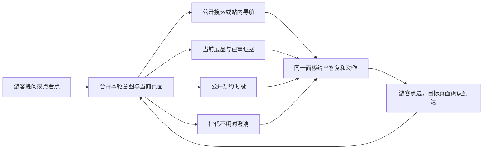

# 洛笙一体化 AI 向导｜从一句提问到一次看懂

2026-11-21 · 修订版 · 首批纳入自由追问，实施与产品验收待开展

**建议把洛笙做成贯穿中文公众页面的同一位向导。** 游客可以从“去哪看”问到“我眼前的是什么”，中途问明天能否参观，再回到刚才的鼎耳。每一轮都让游客看得出洛笙指的是哪件东西、依据在哪里、点一下会发生什么。

首批面向第一次在线逛馆的人，也照顾从分享链接直接进展品的人。首页、馆藏和展厅列表支持找内容。具有已审讲解的展品支持看细节与追问。预约页提供公开时段。青铜鼎承担首件深度讲解的验证，其他公开藏品从第一批就能被找到和打开。覆盖关系见[原用户故事](../02-user-stories.md)、[需求追踪](../01-requirements-traceability.md)和[架构提案 ADR-007](../decisions/ADR-007-luosheng-visit-context.md)。

**第一批内测就交付自由追问。** 新游客从普通首页打开洛笙，可以说出想看什么，也可以点推荐。到达青铜鼎图版后，游客在同一输入框用自己的话描述疑问，洛笙根据当前看点回答，并给一个能亲手验证的动作。首批做深鼎耳和三足。最终产品把“说清困惑、得到对题的回答、自己找到并讲清细节”作为同一次参观来验收。[联合试用记录表](2026-11-19-luosheng-acceptance.md#unified-guide-trial)

## 1. 当前游客在哪里遇到断点

本轮在仓库根用 Node 直接调用全站入口实际使用的 `answerSiteGuide(question, route)`。以下 8 句记录全站导览的现状，可作为改版前的固定对照。

| 入口和游客原话 | 现有回答给出的结果 | 改版验收时应看到 |
| --- | --- | --- |
| 首页「我只有五分钟，带我看一件」 | 给馆藏、展厅、预约、文创四个入口 | 一件可看的展品、推荐原因、一个能到具体看点的按钮 |
| 首页「不想预约，只想看青铜鼎」 | 先给预约，再给鼎 | 只推荐鼎，下一步直接到展品 |
| 首页「这里可以预约吗？」 | “这里”先命中当前页介绍，显示四个入口 | 回答可以在哪里预约，给预约入口 |
| 藏品页「它是什么年代的？」 | 回到四类站内服务 | 根据当前藏品取证，交代年代属于参考实物还是数字模型 |
| 展厅页「另一只在哪？」 | 回到四类站内服务 | 已确认鼎耳就给俯视观察，已确认三足就给背视对照，均未确认才澄清 |
| 首页「明天还有名额吗？」 | 讲预约操作步骤 | 按日期读取公开可约时段，区分有结果、空结果和查询失败 |
| 首页「在哪能看3D？」 | 定位到数字展厅 | 保留这个简捷入口 |
| 首页「怎么预约参观？」 | 给预约说明和预约入口 | 保留直接回答，无需为流程说明查询余量 |

代码里有两个独立问题。第一，全站函数只收到问题和路由名，按命中词拼接目的地，处理不了否定关系，也不知道详情页载入了哪件藏品。第二，全站面板切页会清掉提问与回答。三站路线能记进度，显式开发入口能跳到鼎的模型预览，但没有交付游客的参观目标和当前所指。补几条问法能改善命中，跨页后仍缺这些信息。[全站匹配](../../frontend/src/lib/luoshengSiteGuide.ts) · [面板和切页逻辑](../../frontend/src/components/LuoshengSiteGuide.vue)

值得保留的基础已经存在。展签与同一件鼎的 3D 页之间有一次性看点交接，鼎耳有俯视热点，三足有侧视与背视图。展签问答已有范围变更取消、短期回看和依据复核。全站入口覆盖中文公众路由，生产构建和预设讲解各有显式开关。真实模型成功的记录属于本机受控预览，生产代码提供的是默认关闭的已审讲解读取接口。[现有交接](../../frontend/src/lib/luoshengPreview.ts) · [展签问答](../../frontend/src/components/LuoshengPreview.vue) · [预览验收记录](2026-11-20-luosheng-open-source-upgrade.md) · [预设讲解接口](../../backend/src/main/java/com/heluo/museum/guide/GuideExhibitController.java)

## 2. 四个博物馆案例，分别指导一个设计决定

2026-11-21 读取以下馆方原页。表中“馆方做法”来自原文，“河洛采用”和“取舍理由”是本项目的设计判断。

| 案例 | 馆方做法 | 河洛采用 | 取舍理由 |
| --- | --- | --- | --- |
| 故宫博物院「导览地图」 | 推荐路线明确分“两小时游、半日游、一日游”，游客能用自己知道的时间开始选择 | 识别“只有五分钟”这类约束，说明为什么推荐这件、第一眼看哪里，让游客一次点击开始 | 线上首次参观可以在一件器物上完成，实体馆的远近顺序和路线站数没有照搬价值。[馆方导览，见推荐路线](https://www.dpm.org.cn/Visit.html) |
| 克利夫兰艺术博物馆 ArtLens | 同一应用连接导览路线、馆内地图和作品详情。扫描在展作品可以打开该作品的详情，读屏可读出视觉描述 | 点击推荐就交给正确的展品与看点。图版旁写可以独立理解的观察说明，3D 不可用时仍能完成任务 | 在线页面本身已知展品身份，直接采用公开藏品标识即可。手机摄像头、室内定位和长期收藏给首版带来的额外收益有限。[ArtLens 官方介绍](https://www.clevelandart.org/artlens-app) |
| 旧金山现代艺术博物馆 Send Me SFMOMA | 馆方 2017 年项目文章记载，游客发关键词、颜色或 emoji，收到一件相关作品的图片和图注 | “我想看和鸟有关的东西”先给一件实际匹配的公开作品和一句匹配理由。另提供“看更多结果” | 馆方历史项目采用短信。河洛游客已经在网页看展，站内带图卡片可以直接接上藏品和后续提问。[馆方项目回顾](https://www.sfmoma.org/read/send-me-sfmoma/) |
| 达利博物馆 Ask Dalí | 馆方用一部呼应作品的电话邀请游客开口，明确说明回答来自 AI 对达利声音与个性的再现 | 把“问这个细节”放在图版旁。看点本身告诉游客能问什么，洛笙用自己的身份回答 | 馆藏事实需要可核对的来源。人格化适合邀请和观察提示，艺术家口吻、声音仿制和开放话题没有进入首批范围。[Ask Dalí 馆方说明](https://thedali.org/exhibit/ask-dali/) |

## 3. 游客实际会怎样使用

### 一段参观可以换话题，再接回来

下表是设计走查脚本。示例正文用于评审，公开展示时由对应的已签资料和当时的公开时段生成。

| 游客说或做什么 | 洛笙如何接话 | 页面实际发生什么 |
| --- | --- | --- |
| 首页「我就五分钟，想看个有意思的」 | “先看青铜鼎吧。它有一对很容易错过的耳朵，从上面看，两只都能找到。”主按钮「带我找鼎耳」 | 停在首页等游客选择。点击后直接抵达藏品图版，节省经过两个列表的操作 |
| 点「带我找鼎耳」 | 在图版旁显示“看鼎口两侧，立起来的这对就是鼎耳。” | 展品内容载入后对上藏品和图版。该点击已表达看图意愿，直接定位鼎耳图版，键盘焦点到图注或看点标题 |
| 「另一只在哪？」 | “沿着口沿看向对侧。俯视图里，两只耳在相对的两边。”给「对照两只鼎耳」 | 游客点后才标记图中两处。若想转模型，可再选「去 3D 看同一处」 |
| 「它是什么年代的？」 | “你眼前是数字模型。它参考的那件实物，馆方定为商代安阳时期，约公元前 1250 至前 1046 年。” | 依据区显示 Cleveland Museum of Art、馆藏号 1962.281 和相应资料。用本轮馆藏依据回答年代。[参考实物公开记录](https://www.clevelandart.org/art/1962.281) |
| 「对了，明天还能去馆里吗？」 | 用上海时区解析并显示完整日期。依据实际响应给出第一个可选时段或合适的空状态，主按钮「看这天的时段」 | 展品看点暂存为可返回的位置。打开预约页后重读公开时段，由游客自行决定是否预约 |
| 「回到刚才那只耳朵」 | 给「回到青铜鼎 · 鼎耳」。点击后重新核对公开性与图版可用性 | 回到原位置，按需重新读资料。游客无需重说展品名、重找图版或重新走三站 |

### 第一批内测中，游客怎样问一个看不懂的细节

游客打开三足的侧视图，自己输入“我数来数去只有两条腿，是缺了一条吗？”洛笙可以回答“在这张侧视图里，有一只足被挡住了。点「看背视图」，中间那只也能看见。”点击后，背视图在原图位置打开，图注指出第三足。游客可以边看图边接着问“你怎么看出来的？”洛笙应把刚才使用的侧视、背视图版摆在一起供他核对。这里能确定的是数字模型在两个固定视角下的外形，原器保存状况需要另外的资料。

| 游客此时的处境 | 他在同一输入框里打字 | 合格的回应和界面行为 |
| --- | --- | --- |
| 刚点过鼎耳 | “另外一个呢？” | 指向鼎口对侧，给「看俯视图」。游客点选后图版和文字一起标明位置 |
| 刚数过三足 | “另外一个呢？” | 按当前话题解释侧视遮挡，给「看背视图」。游客点选前保持原视图 |
| 从分享链接到鼎的详情，尚未选部位 | “另外一个呢？” | 问一句“你想找另一只耳，还是侧面看不清的那只足？”游客回答“脚”，即可接到三足图版 |
| 正在看鼎耳，主动纠正“我说的是脚” | 接着问“怎么就这两条？” | 改按三足取证并给可看的图。最近话题与画面可暂时不同，图注写清答案指向哪张图 |
| 问“它以前是不是断过？”而现有资料仅支持外形观察 | 继续用自己的话问，无须先挑问题类型 | 说明现有图版只能支持外形观察，给能查到的资料。需要修复史时明确指出欠缺的资料 |

上述问法供编辑和测试理解判分，参与者自己决定如何措辞。打开输入框即可提问，每条回答先用一两句回应困惑，给一个下一步。看图、软键盘收起或关闭依据后，图旁的“接着问”回到同一轮话题。输入框旁的一句例子可以帮助起步。

### 另两条同等重要的入口

- **游客直接从分享链接打开一件藏品。** 页面成功加载后主动点“问洛笙”，就可问“它是什么”。有已审资料时按这件讲，无深度讲解时仍能读该件的公开标题和摘要、打开藏品资料或找同类。“另一只”缺少看点时，只问一次具体问题。打开页面本身只建立页面上下文。
- **游客明确想找其他展品。** “不看鼎，我想找玉器”提取“玉器”为目标、“鼎”为本轮排除项。现有搜索匹配标题和摘要。若切词后仍无结果，可按馆方维护的“玉器 → 玉璧”等别名再查一次。仓库已有 `river-map-jade-bi` 概念展品，适合作为第二个验收样例。只在公开查询命中时推荐，并带上其“项目概念展品”身份。多件时提供“看更多结果”，无匹配时允许改词。[项目现有玉璧资料](../../backend/src/main/resources/db/migration/V19__expand_artifact_editorial_content.sql)

## 4. 页面上保留哪些控件

全站只有一个正在接话的洛笙和一个可提交的输入框。浮窗、展签上的「问这个看点」、预约旁的「问时段」都是进入同一段参观的入口。展签继续呈现图版和讲解。游客从图版发问时，页面把当前看点交给面板，焦点进入这一处输入框。

| 位置 | 游客第一眼看什么 | 主要操作 |
| --- | --- | --- |
| 首页、馆藏页 | 与所在页有关的一句邀请。首页给“五分钟逛一件”，馆藏页给“帮我找一件” | 输入兴趣或选择推荐。每轮一个明确的主动作，其他结果折叠在“更多”里 |
| 藏品、3D 页 | 展品本身优先，面板标题下用一行标出“青铜鼎 › 鼎耳”。回答先给观察方法，其次给图版或出处 | 问当前看点、查看依据或显式切视角。依据在站内展开，保留当前观察位置 |
| 文化专题、文创页 | 专题给当前文章名称，文创页给浏览商品的帮助。主动离开展品时可以保留刚才的公开返回位置 | 游客可查相关馆藏或回去看展品。涉及个人订单的操作交给原有账户页面 |
| 预约页 | 日期、可用时段、查询时间。若带着展品过来，保留一行“返回青铜鼎 · 鼎耳” | 选择查看某天或回到看点。预约表单继续掌管人数、登录、确认和提交 |
| 暂时无法回答 | 说清是未签讲解、资料不足、服务暂忙，还是 3D 没载入 | 分别给“读公开藏品资料”“看现有出处”“读当前讲解”或“看图版”，不回到通用欢迎语 |

桌面沿用馆站现有展签、字体和深浅主题，优先让作品与说明同时可见。手机使用可收起的底部面板。点“看图”时让出画面，在图旁保留“接着问”。软键盘出现时发送、关闭和返回仍可触达。控制目标至少 44×44 CSS 像素，200% 缩放可读，减少动态效果时以静态标记定位。回答完成时只礼貌播报一次，Esc 收起后焦点回触发处。游客选择“我先自己逛”后保留手动入口，遵循已有免打扰约定。[现有展签交互](2026-11-20-luosheng-interactive-plates.md) · [邀请与设备约定](2026-11-19-luosheng-ai-guide.md)

## 5. 技术如何接进现有项目

沿用 Vue 3、Pinia、Vue Router、Spring Boot 和现有数据。建议新增一个浏览器内的参观状态，由现有全站面板呈现。页面只登记它了解的公开对象与当前可用动作。查询和生成由各自有权读取资料的一侧执行。详见[拟议架构及取舍](../decisions/ADR-007-luosheng-visit-context.md)。

### 一轮问题怎样决定交给谁

1. **先看游客显式表达的事。** “我不想预约，只看鼎”把否定挂在预约上，“别错过鼎”里的“别”也不能把鼎排除。“这里可以预约吗”由预约这个明确动作优先。点选看点或目的地本身已经给出结构化意图。
2. **再补缺少的信息。** “它的年代”先取页面成功载入的藏品。“另一只”依次检查本轮明确提到的部位、服务端最近确认的话题和游客确认的视觉看点。参观目标只用于推荐，不得作为断代或出土事实依据。多个同等可能的指代就呈现一次具体澄清。
3. **混合问题逐项兑现。** “先看鼎，再看看明天有没有票”先给看鼎动作，保存一条待办“看明天的时段”。“别预约了”即撤销这条待办。“它多大、哪里出土”只回答有依据的部分，并单独标明另一问缺什么资料。
4. **给口语追问一条直接的处理路径。** 首页的时间、否定范围和展品名称用于选目的地。到达支持讲解的展品后，游客亲自输入的观察、纠正和依据问题，连同当前对象、已选看点及最近话题进入展品取证。清楚的显式问题优先，指代确有两解才澄清。用独立编写的口语改写检验“只看到两条腿”一类说法。命中已登记导航、预约或停止意图时交给相应能力，目标页重新核对动作参数。

| 能力 | 数据与实现入口 | 它能给游客的结果 |
| --- | --- | --- |
| 找馆藏、选一件 | 复用 `GET /api/v1/search`。搜索只传提取出的公开检索词，结果页已有 `/explore?q=…`。短程推荐优先满足游客明确条件，再考虑有已审看点的策展顺序，候选撤回即移除 | 一件真实返回且可打开的藏品、与提问有关的一句理由、更多结果。[搜索控制器](../../backend/src/main/java/com/heluo/museum/content/SearchController.java) · [馆藏页](../../frontend/src/views/ExploreView.vue) |
| 看图版或 3D | 藏品详情与展厅页载入后上报 `artifactSlug`、`exhibitSlug`、可用看点、图版和 3D 就绪状态。沿用现有鼎耳俯视、三足背视对照和纹样局部映射 | 一次点击只执行按钮写明的动作。模型加载、失败或弱设备时优先给可读图文。[藏品页](../../frontend/src/views/ContentDetailView.vue) · [展厅页](../../frontend/src/views/ExhibitDetailView.vue) |
| 讲解、追问出处 | 现有 `GET /api/v1/guide/exhibits/{slug}` 读取已发布讲解。事实问答复用 `GuideQuestionTurn`、公开性检查及当前版本证据。遇到矛盾时按既有 ADR 告知资料冲突 | 图版观察引用模型图，年代归属引用参考藏品，缺证和内容冲突分别说明。无公开外链时给可识别的图版名或来源编号。[取证链](../../backend/src/main/java/com/heluo/museum/guide/GuideQuestionTurn.java) · [事实冲突规则](../decisions/ADR-006-luosheng-structured-evidence-conflict.md) |
| 查公开时段 | `GET /api/v1/appointment-slots?dateFrom=YYYY-MM-DD&dateTo=YYYY-MM-DD`，按 `Asia/Shanghai` 解析。当前接口仅返回开放、未满且未开始的时段，受 14 天窗口约束 | 返回有时段、当前没有公开可约时段、超窗或查询失败四种结果。人数明确时按 `remainingPeople` 筛。拟给预约页增加可校验的日期预选，页面复查后由游客选择时段。[时段控制器](../../backend/src/main/java/com/heluo/museum/appointment/AppointmentSlotController.java) · [预约页](../../frontend/src/views/AppointmentView.vue) |

**建议的交接格式。** 每轮面板结果包含答复类型、正文、当前对象、本轮依据、一个可选主动作。动作用受限类型表达，例如 `openArtifact(slug)`、`showPlate(artifactSlug, lookpoint)`、`showView(exhibitSlug, view)`、`openSlots(date)`、`resumeArtifact`。前端用已注册路由和就绪组件解析，任意 URL、选择器和脚本不属于动作输入。目标页面确认匹配的对象与内容已就绪才记“已到达”。切页或改选即作废旧动作与迟到回复。

**首批就约定提问接口。** 共用输入框将本轮问题、`requestId`、`locale`、公开对象标识、已选择的看点和上下文版本提交给问答服务。服务端绑定匿名短时会话，重查可见性和当前资料，返回正文、依据、本轮话题及可建议的动作。回复要能区分有依据、需澄清、资料不足、资料冲突、已停用或暂不可用。重复请求去重，旧版回复失效。第 1 批在隔离内测构建接现有受控问答适配器，由构建配置选择，游客从普通首页进入。替身校验接线，获准的真实模型用新措辞检验回答。第 3 批将同一约定接入拟议的正式同源 `POST /api/v1/guide/turns`，生产构建执行现有 `/api/v1/__guide-test/` 隔离检查。[现有模型预览](2026-11-20-luosheng-model-preview.md) · [正式 API 设计](../05-api-design.md)

## 6. 洛笙在什么时候该记住，什么时候该放下

| 事件 | 带到下一步的信息 | 可观察的行为 |
| --- | --- | --- |
| 首页推荐，游客尚在考虑 | 暂存提议的展品、看点和目的地 | “带我找鼎耳”仍是可选操作。游客转问其他题目时，洛笙按新问题回答 |
| 游客点选，同一展品在详情与 3D 之间切换 | 保留目标和亲自选过的看点，目标页载入后重新确认展品、版本和可用视图 | 回到相同看点。看到一个图版、转动镜头都不能直接推断游客正在注视哪个部位 |
| 聊鼎耳时发问“三只脚怎么看” | 当前回答的话题转为三足，画面仍停在鼎耳，直到游客点击切图 | 接着问“另一只呢”按三足接话。若游客重新点鼎耳，同句回到鼎耳 |
| 从看点转问预约 | 暂存一个返回位置，仅包含公开藏品、展项和明确看点 | 预约页的“它”有歧义时先问清。主动点“回到刚才的鼎耳”后，才恢复并重新核对展品 |
| 主动看另一件、页面 404 或展品撤回 | 换件时清掉旧部位和旧依据。页面失败时撤销待执行动作，仍可公开检索 | 新展品上问“它呢”指新对象。原件失去公开资格时，返回入口引导重新找公开内容 |
| 收起、结束、刷新或进入账户区域 | 收起只保留本次公开参观的位置，取消在途轮次。结束清除参观状态。刷新、新标签、语言变化、登录或退出及进入私密页时重建上下文 | 拒绝邀请标记沿用现有同标签免打扰设置。收起后可手动接回，刷新或从私密区域回来只按当前公开页面开始 |

首版把短时参观信息保存在当前标签的内存，沿用 `sessionStorage` 中已有的邀请标记。来源按 `cardId + revision` 重验。自由输入仅在明确提交的那一轮用于回答。日志只记匿名事件类别、耗时和结果。页面地址只携带原站需要的公开检索词或日期，提问全文、访客信息和返回位置由各自的内存状态管理。

内容上先维护两份很小的编辑清单。一份写“什么兴趣可以推荐这件，推荐理由从哪里来”，支持馆方在后台能力就绪前以受版本控制的配置维护。另一份沿用展品证据卡，写明公开标识、适用语言、版本、图版或来源、允许支持的事实、撤回方式。新增一件深讲展品时，内容负责人准备一个可说明白的看点，并核对实物、模型与图版的关系。前端凭能力清单显示入口。未准备深讲的藏品也有公开详情和检索入口。

**年代答复需要补一张证据卡。** 当前送签候选四卡分别覆盖鼎耳、三足、纹样和来源。“来源”卡写明参考藏品编号与出土地资料的边界。商代安阳时期的断代记在本机预览资料里。要兑现第 3 节的年代回答，内容负责人还须把断代连同馆藏号和来源编入下一版候选包并签核。若仅来源卡已签，可回答“当前展签可核对参考藏品编号 1962.281，年代请查这件参考实物的馆藏记录”。整包待签时引导游客读普通公开藏品页。现有预设讲解接口返回卡号、修订号、正文和公开出处。可执行的图版、视角和适用展项由审核过的映射提供。[送签候选四卡](luosheng-eval/ding-zh-CN-0.3.0-release-candidate.json) · [本机预览资料](../../backend/src/test/java/com/heluo/museum/guide/GuidePreviewKnowledge.java)

## 7. 分期交付、工作量与风险

工作量按一位熟悉仓库的全栈开发者估算，内容签核、试用招募和发布窗口另计。第 1 批交付一段能实际问、看、再问的内部体验。第 2 批接上公开服务，第 3 批将已验证的问答接入正式候选环境，扩大讲解覆盖。

| 批次 | 主要交付与影响范围 | 谁负责、预计工作量 | 完成标准 |
| --- | --- | --- | --- |
| 准备现状对照 | 保留第 1 节的 8 句、现状回答和入口步数。测试人员另拟 24 道留出题并锁定题目、预期动作和依据。其中 8 道考看点与自然追问 | 产品、内容、测试，0.5–1 人日 | 记录构建、设备、图版与卡号。开发使用第 3 节示例，留出题由测试人员保管 |
| 第 1 批 · 统一入口和自由追问内测 | 全栈接通 `App.vue` 共用输入框、内存参观状态、图版和现有受控问答。普通首页到鼎耳、切三足、自己的话追问、点图核对和继续提问走同一会话。分享直达、第二件公开藏品与默认构建隔离一并回归 | 全栈、测试，3–5 人日 | 用获准模型和本机预览资料，从首页手输连续两轮不同措辞。鼎耳、三足、无看点三种回应全部正确。8 道独立追问题至少 7 道同时答对意图、依据和动作，核对实际图版或可访问图注。记录模型与资料版本。替身先验证接线，模型待测时本批语义验收记待测 |
| 第 2 批 · 跨页查时段再回到看点 | 在 `AppointmentView.vue` 接日期预选与公开时段，保留返回位置。复用 `luoshengPreview.ts` 的显式交接与 `luoshengTurns.ts` 的取消逻辑，将首批追问接到同件展品 3D。加入已审讲解读取和出处查看 | 全栈、内容，2–3 人日 | 游客查某天三人的时段，再回到刚才的部位，继续用代词追问。接口失败、日期过窗、图版失败和换件均给出对应结果 |
| 第 3 批 · 扩充内容和正式问答 | 后端接入正式同源问答路由、已签卡包、去重、预算与停用控制。内容负责人复核来源、跨看点回答及新增断代卡，测试人员执行新措辞盲测与证据抽查 | 后端、内容、测试，2–4 人日，另计内容盲审 | 正式候选构建从普通首页、分享链接都能自由追问，生产包隔离检查通过。真实模型、证据和时段的质量达到第 8 节标准 |
| 游客试用与发布 | 在已批准的候选环境用真实手机和桌面完成 8 人同程试用。内容、测试和发布负责人记录版本、证据、缺陷与放行结论 | 工程验证 1–2 人日，另排试用和发布窗口 | 联合试用达标，完成签核、故障恢复与停用演练。获准发布后，从实际入口复走首页、追问、预约时段和原看点返回 |

**范围映射。** 游客邀请、拒绝、统一入口归 LS-01。展品接续、图版与真实到达归 LS-02 / F-03 / F-05。指代、切话题与打断归 LS-03。依据、身份、撤回归 LS-04 / LS-05 / N-01。公开找物和只读预约分别关联 F-01 / F-02、F-06。响应、手机和辅助技术归 LS-06 / N-03，评测归 LS-07，预算及停用归 LS-08 / N-06。

**主要工程风险和处理方式。**

- 路由导航成功时，展品可能仍在加载。目标页以实际载入对象和图注的就绪事件完成交接。请求版本同时绑定看点、语言、展品和本轮编号，旧结果即使迟到也失效。
- 默认构建对开发资料有隔离要求。沿用 `VITE_GUIDE_SITE_ENABLED`、`VITE_GUIDE_PRESET_ENABLED` 与服务端预设开关的既有职责。模型发布能力另设服务端停用机制。新增环境变量时同步示例、部署文档、权限校验和实页检查。待签卡、测试控制器和试用凭据继续留在隔离环境。
- 展品撤回或签核指纹变化时，重新校验新回答、回看和返回位置。已停用生成时可以保留仍有效的已审讲解，卡包失效时退回常规公开藏品页。先用两个标签和浏览器后退验证回放，再演练恢复。
- 明确外部模型的数据范围、每日调用与金额上限后再开启自由问答。导航、日期查询、固定讲解无需模型调用。费用按实际输入输出量核算，单进程计数只用于内部试点。公开部署需与实际实例数、重启和供应商额度对账。阶段性停用演练可复用[既有验收包](2026-11-19-luosheng-acceptance.md)。

**首页按当时可用能力邀请游客。** 仅有公开馆藏时，按钮写“看青铜鼎藏品页”。公开图版和对应讲解已签且可读时，按钮可写“带我找鼎耳”。自由问答可用时，同一面板承接“另一只在哪”。第 1 批可以在标明预览的隔离环境验证完整交互。公开版本使用签核内容，产品放行按下节的真实游客和运行证据判定。

## 8. 验收怎样说明游客真的用得更好

**从普通首页开始联合试用。** 给每位首次使用者同一项任务。「你有五分钟逛这座博物馆。找一个你想看清的细节，用自己的话问问洛笙。看到它的回答或图以后，再问一句你自己还想弄明白的。最后，指给我看或告诉我，你从哪里看出来的？」参与者自行选藏品、打字、看图或听图注。主持人记录首次到达具体看点的时间、两次自拟输入的结果，以及参与者最后能讲清的细节。之后再请他查明天适合三人的公开时段，并回到原处。藏品详情入口的基础试用按原量表单列。[首页联合试用主持脚本和空表](2026-11-19-luosheng-acceptance.md#unified-guide-trial)

| 怎样判断 | 建议门槛与判分方法 |
| --- | --- |
| 同一个人能否既接到对题回答，又借它看懂 | 建议 8 位首次使用者至少 6/8 同时通过两项。易用性看能否独立从首页到具体看点、发现输入框、看图后接着问、核对图版或可访问图注并讲清。智能性看本人两次自由提问是否都接对部位、依据和下一步。清楚的问题看首答，确有歧义允许一次针对性澄清，由游客答复后解决那一问。汇总两项各自人数和同一行两项均通过人数。产品造成的中止计入分母，8 个有效席位齐备后判读 |
| 遇到新说法能否处理 | 冻结的 24 道题包括 8 道时间、否定与混合意图，8 道看点、指代与纠正，4 道证据边界，4 道时段与故障。正式候选的建议门槛为整体 ≥22/24 且追问子集 ≥7/8。关键事实、权限和误操作反例须全过。测试人按同一构建记录意图、支持它的依据、实际动作和到达结果。修复后用原错题回归，并补等义新题复核 |
| 操作有没有真的到位 | 从推荐按钮到具体看点只需一次游客确认，且目标图版可读、焦点可定位才算成功。3D 单独征得点击，桌面和手机各跑一轮。固定的跨页往返样例要求游客重复说明藏品的次数为 0 |
| 事实和用语能否信任 | 沿用 LS-07。标注可答题证据前三条命中率目标 ≥90%，语气人工均分 ≥4/5，非关键答非所问率 ≤10%。错断代、把模型当实物、伪造出土地、错报时段、跨展品引用或越权任一发生即暂停该能力 |
| 等待是否可接受 | 公开导航、已审讲解、实时模型分开计时。从发送到完整可读正文及对应依据出现。模型 Beta 沿用本地受控 P95 ≤5 秒、8 秒降级目标。报告样本数、冷/热、网络、设备和模型。8 秒降级后仍能查看当前讲解。现有手动预览的超时设置单独记录 |
| 运营能否定位问题 | 只按明确用户动作计数，记录意图类别、查询结果、目标实际到达、澄清与恢复、答复来源、延迟及模型轮数。指标“返回成功率”的分母为主动点返回次数，分子为原对象与看点均核对成功次数。用未到达率定位链接问题，用重复澄清率定位识别问题 |

**固定回归样例。** 每条从指定页面开始，检查页面与网络结果。推荐问法按钮、函数单测和真实自由输入各有独立记录。

| 场景 | 发布前应观察到的结果 |
| --- | --- |
| 首页从推荐去找鼎耳，途中放弃 | 确认前无跳转，取消后原页面和自助浏览可用 |
| 同句「另一只呢」用于鼎耳、三足、无上下文 | 依次得到俯视、背视和一次具体澄清。依据跟随本轮答案 |
| 「不看鼎，找玉器」且查询结果没有深讲卡 | 打开真实公开结果，展示该件可核对的标题与摘要 |
| 游客问年代后再问出土地 | 第二问独立取证，缺证时明确说明，不能借用上一轮的年代出处支持出土判断 |
| 查明天 3 人的余量，接口分别返回有足够名额、只有 1 个名额、空、失败 | 只列满足人数的时段。其余分别提示人数不匹配、当前无公开可约时段、查询暂不可用。进入表单后重查 |
| 发送问题后换件、快速切看点、后退或进入个人中心 | 取消在途请求，迟到内容不显示。账户、预约记录和管理数据不会进入导览上下文 |
| 模型超时、预算用完、卡包撤回、图版或 3D 加载失败 | 分别回到仍有效的讲解、公开藏品或文字说明。没有基于旧资料继续作答或自动重复计费 |
| 手机软键盘、200% 缩放、减少动态、键盘和系统读屏 | 仍能读图注、发送、收起、回到触发处。手机图版与操作可分别到达，回复只播报一次 |

**工程验收顺序。** 先跑意图与会话单测、证据和时段契约测试，再走首页与分享链接的浏览器端流程。前端运行 `pnpm typecheck`、`pnpm test`、`pnpm build` 和相关 Playwright 路径。后端运行导览定向测试和 `mvn test`。发布候选需验证 Docker 服务、`/api/v1/health` 与 `/api/v1/ready`，实际打开搜索、展品、3D 和预约页面，在 390px 深色、1440px 浅色及交换主题下检查，再用真机验证软键盘和系统读屏。正式关闭时复跑现有生产隔离脚本，受控开启时使用已签资料走正常入口。[项目测试计划](../06-test-plan.md) · [生产隔离脚本](../../frontend/scripts/luosheng-production-check.mjs)

**产品放行依据。** 内容负责人签核实际使用的卡和图版。测试负责人核对同一候选版本的 24 题、8 人联合试用和手机实测。发布负责人核对真实模型的响应时间与费用、公开时段数据、一次停用及恢复记录，并在批准的部署入口复走主流程。记录关联同一构建、模型、提示词与卡包版本。有错引、跨用户带入资料、错误余量或未经确认执行的动作时，暂停受影响能力，定位并修复，再复跑相关路径。实际投放后复查“未到达看点”“连续澄清”和“返回失败”的匿名计数，将高频卡点变成下一次回归题。

## 9. 本次方案交付记录

**日期澄清接续（F-06 / LS-03）。** 在同一面板、同一上下文的下一轮，把游客刚给的公开人数带到补充日期的答复；明确改报人数则以新人数为准。只认可独立日期或明确的时段问法，普通展品追问仍走原取证。收起、换页或换看点不继承这一轮澄清。影响导览轮次、时段解析与回归，不读预约表单，不改 API。

验证：Chrome／Spring／H2 的 390px 深色、1440px 浅色候选手输「明天或者后天三个人有时段吗」并补答「那就明天吧」，按确认日期发起一次查询，只有 1 席时显示 3 人余量不足。单测核对新报人数优先、普通展品追问不触发时段、旧轮和上下文切换不传上一答复。候选及默认关闭集成 9/9，前端 523 项、两个构建、类型和预算通过。本轮没有使用正式场馆余量、真实模型或真机。

**公开时段的口语日期（F-06 / LS-03 / LS-07）。** 支持「11 月 23 日」和带年份的中文日期。无年日期优先匹配上海时区当前开放窗口内的同月同日（含跨年）；缺日期或给出多个候选日期时请游客明确一天，不调用接口、不预选。保留「明天」、标准日期、越窗校验和先看展再查时段。变更限导览意图、面板和测试，不影响预约表单或 API。

验证：单测覆盖上海年末、保留明确年份、日历与相对日期一致及范围澄清。390px 深色和 1440px 浅色 Chrome 候选以「月 日」发送当天夹具对应的单日参数，显示足够三人的时段；「明天或者后天」只澄清，不调用时段接口、不提供预选。越窗、同源种子时段及原看点返回继续通过。候选与默认关闭集成 9/9，前端 521 项、类型、两个构建和预算通过。未使用正式时段或真实模型。

**公开时段按完整人数筛选（F-06 / LS-03 / LS-07）。** 影响人数解析和候选浏览器回归。原单字匹配会把「十一人」截成一人，可能误报余量。先完整识别中文十位和阿拉伯数字；范围、冲突、小数及超出 1–30 人的请求先请游客确认，不查余量、不预选。只改只读导览，不改预约表单、接口或上限。用实际同源种子时段和浏览器夹具核对余量不足及不发请求的反例。

验证：Chrome / Spring / H2 在 390px 深色和 1440px 浅色注入 1 席和 3 席，确认「十一位」只报告 11 人余量不足；「三到五人」提示确认且不发时段请求、不给日期预选。三人仍通过同源种子库查余量、预约页复查和原视角返回。前端 520 项、类型、默认与候选构建、预算及脚本语法通过；候选及默认关闭态集成 9/9。不计入实际场馆数据、模型或真人验收。

**预约页就地问时段（F-06 / LS-01 / LS-02 / LS-06）。** 在公众预约时段区接入「问时段」入口，聚焦既有洛笙输入框，用预约场景引导提问；不自动查、不读表单、不新增第二处输入。Esc 应回到该入口，从预约仍能回到原图版。影响预约视图、统一面板和浏览器回归。上线开关关闭或切换英文时不显示入口；验证两档候选、默认关闭和原时段往返。

验证：Chrome／Spring／H2 开启候选在 390px 深色和 1440px 浅色验证按钮宽高均至少 44 CSS px，Enter 打开并聚焦空输入框，Esc 回到原按钮；核对同源时段和原鼎耳、三足侧视／背视返回。默认关闭浏览器断言预约页无入口。聚焦时预约表单不参与导览。定向集成 9/9，前端 518 项、默认构建（含类型和资源预算）、候选构建通过。本次未在预约页单独走语言切换，未复跑 Docker、真机或正式环境。

**公开找物故障恢复（F-02 / LS-02 / LS-06）。** 影响统一面板和候选浏览器脚本；搜索失败应清除上一轮结果、明确区分故障与空结果，并允许手动重试原问题，不自动补发，不跨页面保留操作。封面加载失败不得挡住匹配理由和打开条目的主动作。用同源成功请求、浏览器注入的暂时故障、真实空结果分别验证；不改服务端、公开权限、预约或模型逻辑。

Chrome / Spring / H2 候选 390px 深色、1440px 浅色均通过：浏览器注入一次搜索 503，撤下旧推荐且仍在首页；显式重试恢复同一关键词的真实搜索并回焦输入框。封面请求中断后图片退场，匹配理由仍在，仍可打开概念展品。真实空结果仅提示未找到，不展示故障重试。候选及默认关闭态集成 9/9；前端 518 项、默认构建（含类型检查及资源预算）、候选构建、脚本语法检查通过。未调用真实模型或改正式环境；扩展六卡预检仍报草稿、待签或待发布。

**公开兴趣推荐补齐（F-01 / F-02 / LS-02）。** 在公开找物模块生成基于本轮搜索结果的推荐理由，在同一面板展示公开摘要和可用的本站封面。不把英文匹配或编辑别名说成中文原文；图片缺失或损坏仍能打开条目。保留五分钟到鼎耳的主动作、排除项及默认关闭。验收步骤：先做理由和资源边界单测，再由普通首页手输独立鸟主题问法，核对实际检索词、理由、封面、概念展品详情和原有玉璧流程。

验证结果：前端全量 78 文件／518 项，类型检查、默认构建和资源预算、候选构建通过。Chrome / Spring / H2 候选与关闭态集成 9/9。候选在 390px 深色与 1440px 浅色手输「我想看看和鸟相关的藏品」，确认同源查询参数为「鸟」，返回水鸟青铜雕塑，面板显示公开标题匹配理由，本站封面已解码，点开为「概念展品」。同轮回归保留五分钟到鼎耳及排除鼎找玉璧。没有在实页另注入封面失败；未调用外部模型、未改正式部署。

**统一入口浏览器计时基线。** 关联 LS-06 / LS-07。在现有候选浏览器脚本上，从表单实际提交到页面出现本轮正文与对应依据入口或主动作分别计时。先覆盖公开找物、固定已审答复、公开时段测试替身，样本按视口和主题单列。当前脚本只跑合成候选，不用它给真实模型打分，也不拿小样本算正式 P95。影响范围仅候选测试脚本与验收记录，不增加站点埋点或提交额外问题。

同源计时补验关联 F-06 / LS-02 / LS-06：在开启候选的浏览器集成测试专用 H2 数据库预置上海时间后天的一人和六人开放时段，浏览器穿过真实 HTTP 接口，核对三人查询选择有余量的时段、预约页复查和按原图版返回。每个布局应记录三足侧视、背视两次未拦截样本。只改测试；不依赖 Docker 或改动正式库。

本轮最终复跑候选及关闭态集成 9/9 通过。未拦截同源样本（背视返回／侧视返回）：390px 深色 14／22 ms，1440px 浅色 21／21 ms，均确认跳过 09:00 的 1 席并采用 09:30 的 6 席。配合合成时段故障测试保留独立类别。初次复跑发现默认时段与夹具重叠，另一次在图版失败后重开首页超时；最终夹具使用不重叠时段，故障拦截在下一次导航前完成。无外部模型、正式数据或 Docker 新样本。

Chrome / Spring / H2 本机候选合成数据各测一次（公开搜索／固定答复和依据／拦截时段，毫秒）：390px 深色 18／88／11，1440px 浅色 16／44／34。计时包含断言轮询和脚本开销，不推定纯渲染时间或正式延迟。Maven 候选和默认关闭集成共 9/9，脚本语法和 diff 检查通过。新增同源种子时段计时分支需在隔离 Compose 另跑；本轮启动命令未获执行，未把此前的同源查询证据当作本轮计时。真实模型无样本。

**生成与降级的运行证据。**

关联 LS-06 / LS-07 / LS-08。当前 `guide_turn` 日志计时只覆盖已返回的答复，`generated` 只标记交付成功的生成结果，不能作为发起轮数。正式候选在本地预算放行后、模型适配器入口处记录发起数，按固定结果类型汇总已返回问答的服务端耗时。验证普通澄清不消耗额度、首次生成失败仍记一次、后续预算拦截不重复累加。影响仅限正式问答控制器及测试；不开放新端点或增加游客数据，不用本地计数推算供应商收费，也不以服务端耗时代替浏览器可读耗时。

验证结果：Maven 全量 153 通过、5 按开关跳过；启用 Chrome 后开启候选套件及默认关闭隔离合计 9/9 通过。故障用例只访问本机回环空端口，核对一次发起与相应失败和额度拦截日志。本增量未重新构建 Docker 或调用真实模型。

- 看点增量的开启态 Docker 复验（2026-11-21）：独立项目 `heluo-luosheng-context-qa` 使用新构建后端镜像 `sha256:9cbeecf4c641ac0515da911e5e58a8e980b6d602386a0042fa3209656ef20679`，Nginx 只读挂载开启候选静态包，绑定本机回环。健康与就绪均为 HTTP 200 / UP；经原管理接口在隔离 MySQL 创建上海时间 11 月 23 日的六人开放时段，通过公开注册得到临时普通游客账号。Chrome 全门禁退出 0：390px 和 1440px 各跑深浅主题，核对真实同源余量和原图版返回；附加用例核对看点纠正、三种指代、主动切图、后退与私密页切换取消、回焦及 200% CSS 缩放。合成卡只读，模型地址为容器回环空端口。验后停服保留独立卷。六卡预检仍返回 2，ADB 设备列表为空；未复跑暂停标记演练或正式环境。

- 看点续问补验（2026-11-21）：服务端分别记游客点选的图版、最近确认的单一话题和本轮引用。单测先复现多卡回答后错误澄清，再验证可回退到已选图版且出处仍列本轮两张卡。Chrome 用开启候选产物和合成签核包实测「鼎耳 → 我说的是脚 → 另一只呢」提示背视并引用三足卡，图注仍是鼎耳；重新点鼎耳后同句恢复俯视，结束参观后同句澄清，主动点背视才换图。候选套件 7/7，默认关闭隔离 1/1。此项不涉及外部模型或生产部署。
- 本轮后端全量 157 项，152 项通过、5 项按开关跳过。以浏览器开关合跑时，首批替身浏览器进程在输出两种布局通过后异常退出（`-1073740791`），单独复跑该用例 1/1 通过，未确认初次退出原因。Docker 尚未重跑本次看点增量。

- 中文输入保护的构建产物复验。开启候选构建的 `GuideExhibitIntegrationTests` 7/7 通过，含两档视口的统一入口与预约返回。默认关闭构建的 `GuideProductionBrowserTests` 1/1 通过，覆盖静态隔离门禁和公众导航。本机 Spring/H2 提供测试数据。正式环境与真机仍待验。

- 中文输入补验（LS-01、LS-03、LS-06）。统一面板在输入法组合期间拦截表单提交，Esc 交给输入法，完成选字后恢复常规发送。Chrome 以 390px 深色和 1440px 浅色模拟组合事件、Esc、表单提交和选字完成后的 Enter，核对输入焦点、未发送时的面板状态和随后正常抵达鼎耳。定向浏览器集成 1/1，前端 516 项、类型及默认构建与资源预算通过。使用开启的 Vite 开发环境、本机 Spring/H2 和合成卡，未复跑 Docker。ADB 无已连接设备，真机软键盘、原生输入法与系统读屏待验。

- 预约页意图补验（F-01、F-06、LS-02、LS-03）：原返回规则只要匹配「接着看」就使用保存点，因而会把「接着看玉器」带回鼎耳。改为只匹配明确返回用语和同一个看点；否定请求、不同部位和新藏品不冒用保存点。Chrome 从普通首页进入鼎耳、查看公开时段，在预约页手输「接着看玉器」，确认出现公开玉璧但不跳页，再手输「回到刚才那只耳朵」，点击后焦点恢复到原图版标题。390px 深色与 1440px 浅色的开启候选浏览器用例 1/1 通过；前端 516 项、类型、默认及开启候选构建、资源预算通过。本轮后端未改，仅跑定向浏览器集成；使用 Spring/H2 与合成卡，未复跑 Docker、真机或正式发布。

- 六卡送签准备（LS-04、LS-07、LS-08）：原工具只接受四张基础卡，新增独立 `--extended` 模式，核对冻结四卡、两份补充稿和图版源文件，生成发行号 3 的送签候选；验签登记检查六卡及相同字节指纹，不复用旧版签核。证据审稿与会话评估离线测试 62/62，含补充稿变更、漏签、同指纹字段重算但正文偏离冻结内容、拒绝覆盖候选和旧四卡兼容。正式六卡预检依旧待签；本轮未部署、未进行真实模型或真人验收。[六卡审核登记](2026-11-19-luosheng-evidence-cards.md#一体化向导扩展候选--六卡送签)

- 本机开启态 Compose 补验：使用上轮 Spring 镜像、独立 MySQL、新初始化数据，Nginx 只读挂载开启前端构建，回环接口健康与就绪均为 200 / UP。原候选浏览器脚本首次通过四组页面主路径后，在账号隔离分支因库中没有写死的 H2 测试账号中止；脚本改为只允许回环部署，并通过环境变量接收隔离库的临时普通游客账号，实际公开注册返回 201。全量重跑退出 0：390px 深色、1440px 浅色、390px 浅色、1440px 深色均通过；后退、登录态账户页和语言切换取消旧轮次，Esc 后续问、结束后重建、故障回讲解及 200% CSS 缩放通过。每组均在三足侧视/背视查后天三人时段，核对未经拦截的同源响应与显示余量，并返回原图版。对运行实例创建暂停标记，问答由 `LOOKPOINT_SOURCE` 转为 `QUESTIONING_DISABLED` 且无依据，移走标记恢复，期间五条合成讲解持续可读。模型地址限定在容器内无服务的回环端口，无外部模型和费用。本地覆盖、合成卡、种子余量和 CSS 缩放都不替代正式卡包、真实模型、正式时段或真机验收。测试完成后停止本次隔离容器，保留卷。

- 最新工作树默认关闭态本机 Compose 复验（LS-08、F-01、F-03、F-05、F-06、N-06）。前后端镜像均重建成功。首次复用旧隔离卷时数据库拒绝应用账号，Nginx 返回 502；未修改或删除旧卷，停止该实例后用同一对镜像、独立新卷和临时初始化凭据复验。回环 Nginx 的健康、就绪均为 HTTP 200 / UP；正式讲解 GET 和问答 POST 均 404，隔离测试问答 POST 未向匿名请求开放（401）。隔离脚本逐一核对实际提供的静态文本与容器副本，390×844 Chrome 触控模拟走过首页、公开搜索、鼎详情、3D 海报、返回和预约页；读到 3 条本机种子时段，浏览器异常与导览请求均为 0。镜像标识前端 `sha256:b14d3758901ebb65e89d1c307929ba9891f3f7e15409a5582e4b71ce887a86cd`、后端 `sha256:6e5a77d470d9208862e690cc31629dead476edfe6e667db53a57a52e9c286e18`。验后停止隔离服务，保留容器及卷。本次未验证开启态 Compose、真实模型、正式时段或获准入口。

### 当前工作树的验证结果

- 预约日期交接补验（F-06、LS-02、LS-06）。同页改查日期时撤下旧时段；复查失败不展示旧时段，重试成功只预选新日期。保留未确认预约用原幂等键核对的路径。Chrome 候选两档视口从鼎耳点开次日预约，核对公开列表已重新请求且未选时段。1440px 浅色再从同一面板查后天，注入预约页公开列表 503 并点击重试，核对旧时段消失、成功后只预选后天，再回原鼎耳图版。单测覆盖迟到响应和旧时段不可提交。前端 515 项、类型检查、构建与预算通过，候选和默认关闭定向浏览器 2/2。公开数据来自本机种子，本次未重跑后端全量或获准部署。

- 首页找物补验（F-01、F-02、F-06、LS-01、LS-03）。将明确拒绝与正向搜索分开，只发送正向检索词；本轮卡片筛掉排除项，有排除项时不提供无法保留排除条件的通用「更多结果」链接。开启候选用 Chrome 从普通首页验证「不想预约只想看青铜鼎」无预约按钮，「不想看青铜鼎」不再推荐鼎，以及「先看青铜鼎再看看明天三个人还有没有票」先到鼎耳并可撤回待查时段，撤回前 `/api/v1/appointment-slots` 请求为零。两档视口均走完公开搜索、玉璧详情及「它是什么」的公开概念展品答复。使用本机 Spring/H2 公开种子数据。候选和默认关闭浏览器定向测试 2/2 通过，前端 514 项、类型、生产构建和预算检查通过。不是独立留出题或真实模型验收；本次未重跑后端全量或正式部署。

- 补验 LS-04、LS-06、LS-08。正式候选在已选看点区分模型超时、额度用尽、繁忙、服务不可用、暂停和网络故障。无响应时客户端按 8 秒超时处理。Playwright 在三足背视依次注入五种服务结果、网络失败和无响应，确认清除旧依据，点击「读当前讲解」会重新请求公开讲解，焦点到三足图版标题且保持背视；每轮只提交一次问答。该故障用例在本机桌面候选运行，主路径仍覆盖 390px 深色及 1440px 浅色。候选与默认关闭浏览器用例 2/2 通过，前端 510 项、类型检查、生产构建及预算通过。未调用真实模型，本次未重跑后端全量或正式部署。

- 补验 LS-01、LS-03、LS-04、LS-06。从普通首页进鼎耳，Esc 回到「接着问」，重开保持看点与 `visitId`。暂扣同源回复后按键选择「我先自己逛」，确认取消信号、回焦和旧依据丢弃。手动重开后 `visitId` 更新，原句「另一只呢」重新澄清。候选此前在已确认看点时会把这句话交给生成器，现改用当前已审的鼎耳或三足图版正文与依据，分别给俯视或背视动作。Chrome 与本机 Spring/H2 的候选及默认关闭定向复跑 2/2 通过。使用合成签核卡。前端 510 项、类型、构建和预算门禁通过。Maven 全量复跑 155 项通过，1 项跳过，候选浏览器用例与默认关闭隔离均通过。

- 正式候选补验语言切换边界。浏览器在藏品页暂扣本机服务返回的三足依据，切到英文后确认取消信号、导览隐藏及藏品 URL 保持原样。释放旧答复后切回中文，验证旧依据不显示、本轮 `visitId` 更新、`lookpoint` 为空，原句「另一只呢」重新得到针对性澄清。合成签核卡生产构建的定向验证 1/1 通过。本机 ADB 当前没有连接设备，真机仍待验。

- 图版模块故障补验覆盖 LS-02、LS-04、LS-06 和 LS-07。模块请求失败或 8 秒仍未完成时改为展示当前已审看点说明。焦点定位到「鼎耳说明」，继续追问可核对原依据卡，Esc 回到「接着问」。图版尝试加一，到达数保持原值。开启候选包的 390px 深色浏览器保持模块请求未完成，1440px 浅色浏览器中断模块请求。两种故障均通过，使用本机 Spring/H2 与合成签核卡。前端 510 项测试、类型检查、默认生产构建及预算门禁通过。候选实页和默认关闭隔离合计 2/2 通过。

- 本轮重建的默认关闭前端产物通过本机 Chrome 隔离门禁。真实 Spring/H2 接口支撑首页、馆藏搜索、藏品、3D 海报、返回及预约时段回归，Maven 定向用例 1/1。

- LS-02、LS-04、F-05 补验 3D 降级。开启的生产候选从藏品鼎耳进入展厅，确认按钮「进入互动 3D」出现且此时未请求 GLB。主动点击后中断 GLB 请求，检查展项文字降级、鼎耳俯视图注、同一输入框及本轮依据卡 `LS-DING-EARS@3`。首轮合并用例使此前已接近限额的访次触发限额，改为从公开藏品开启独立访次后复跑，390px 深色及 1440px 浅色通过，Maven 定向用例 1/1。使用本机 Spring/H2 与合成签核卡。

- LS-02、LS-06、LS-07 补验图版就绪。已审展签等待匹配看点、视角和图注后才聚焦标题及记录到达。Playwright 从普通首页点击推荐，暂扣异步图版模块时确认图注尚未出现、看点未获焦、到达数为零，释放后确认图注可读、图片可解码并聚焦。再注入无法解码的图像，确认仍可读俯视图注并从「接着问」在同一输入框核对依据。开发运行和开启的生产候选包分别通过 Maven 定向浏览器集成测试 1/1，均覆盖 390px 深色和 1440px 浅色。前端 510 项全量测试、类型检查、默认构建和资源预算通过。使用本机 Spring/H2 和合成签核卡。

- 本机隔离 Compose 复验通过，覆盖 LS-08、F-01、F-03、F-05、F-06 与 N-06。镜像仓库恢复后，前后端均完整构建。通过绑定到本机回环地址的 Nginx 检查 `/api/v1/health` 和 `/api/v1/ready`，两者 `data.status` 均为 `UP`。生产隔离脚本支持 `LUOSHENG_PRODUCTION_ORIGIN` 与 `LUOSHENG_PRODUCTION_DIST`，逐个比对部署提供的 JS、CSS、HTML 和 JSON 与容器静态副本。390×844 Chrome 模拟触控走通普通首页、真实公开搜索、青铜鼎详情、3D 海报、浏览器返回和预约页。当次公开时段来自本机种子数据。浏览器页面异常和导览请求均为 0，产物扫描通过。验收后停止隔离项目并保留其容器和数据卷。候选开启态、本馆实际时段与获准部署入口仍待对应环境验收。

- LS-03／LS-08 跨页取消回归通过。独立桌面浏览器使用本机 Spring/H2 测试账号，从馆藏列表到三足图版后提交自由输入。脚本暂扣服务端实际返回的三足依据，分别走浏览器后退和个人中心导航，观察在途请求的取消信号，再释放旧答复。返回藏品后无旧依据，原句「另一只呢」需要澄清。进入个人中心后无全站导览，返回公众页使用新访次。问答请求未携带账户授权头，正文仅含问答契约规定的字段。Maven 候选集成测试 1/1 通过，同次复跑 390px 深色和 1440px 浅色的主流程。这一增量只改测试脚本与记录。

- 返回降级补验关联 LS-02、LS-06、LS-07。参观状态、藏品与展项详情及已审展签现在清理失败动作，并将焦点移回带有馆藏入口的洛笙面板。候选浏览器从预约页点击返回，分别注入讲解不可用及藏品 404。两种情况均清除返回动作与旧图版，每档记录 5 次返回尝试和 3 次实际到达。390px 深色、1440px 浅色及 Chrome 原生 200% 深浅主题通过，Maven 定向集成测试 1/1 通过。候选最后一次重建后，首次浏览器子进程异常退出，原配置复跑通过。前端 510 项全量测试、类型检查、默认构建及资源预算通过。同次默认关闭产物的预览标记扫描和公众路径浏览器回归通过（1/1）。

- 混合事实逐项取证。正式同源接口与 390px 深色、1440px 浅色候选浏览器验证「它多大、哪里出土？」显示 `LS-DING-SIZE@1` 的合成尺寸和 `LS-DING-SOURCE@2` 的缺证说明。模型以及鼎耳等局部尺寸走独立缺证回复。这一分支使用已审卡内容，无需调用模型。馆方开放记录给出参考实物整体尺寸 24.5 × 20 厘米，出土地字段为空。[馆方开放记录](https://openaccess-api.clevelandart.org/api/artworks/1962.281) · [待签尺寸草稿](luosheng-eval/ding-size-zh-CN-draft.json)
- 候选浏览器在两档视口暂扣已经由同源接口处理的三足回复。游客按 Esc 后焦点回到「接着问」，打开时无旧依据。续问仍以三足为看点，并发送更新的上下文版本。再切到鼎耳、释放暂扣的回答，仍显示鼎耳依据。前端类型检查及 510 项测试、默认生产构建与资源预算通过。

- 断代和出土地按轮取证。普通首页进入鼎耳后自由输入「它是什么年代的？」和「在哪里出土？」，390px 深色与 1440px 浅色均验证依据分别为 `LS-DING-PERIOD@1` 和 `LS-DING-SOURCE@2`，后者提示出土地缺证，鼎耳图版保持原位。候选使用四张合成签核卡。后端验证断代卡撤回后旧依据失效、来源卡在时引导核对、来源卡也不可用时提示缺证。当前后端全量共 154 项，149 通过，5 项按环境开关跳过；生产候选浏览器用例单跑通过。首跑浏览器测试子进程在第二档视口异常退出，同配置复跑完成两档。
- 本机 Docker 已恢复。Compose 配置校验通过，构建在拉取 Dockerfile 基础构建器时遇到镜像仓库 TLS 连接失败。改用缓存的 Java 镜像和当前 JAR 启动独立 MySQL，并用默认生产前端的 Vite 预览代理走实际 HTTP。容器接口 `health`、`ready` 均为 `UP`，青铜鼎搜索命中、详情与展厅接口为 200，返回三条本机种子公开时段。Chrome 关闭态门禁通过，扫描涵盖断代草稿与卡号。测试容器已停止，批准的部署入口仍待验。
- 生产候选通过 390px 深色和 1440px 浅色检查。Chrome 原生页面缩放 200% 下，深浅主题均走通同一候选流程，核对了输入、发送、关闭、证据、图版、时段和回焦。在预约页手输「回到刚才那只耳朵」会先给返回按钮，点击后焦点回到鼎耳图版标题。输入、发送和关闭的操作区域至少为 44×44 CSS 像素。前端 510 项测试及默认生产构建、首屏和配乐预算通过。真机软键盘和系统读屏待测。
- 候选实页使用同一输入框提交「明天还有三个人的名额吗？」。浏览器注入时段响应，核对三人可选时段、仅余一人、无时段和 HTTP 503 的四种提示。日期越窗时无接口请求和跳转入口。解除拦截后，预约页向本机 Spring/H2 服务重新读取时段并可返回原看点。定向 Maven 浏览器集成测试 1/1 通过，包含 390px 深色、1440px 浅色与原生 200% 深浅主题。
- 同源问答记录结果类别、是否生成、依据数量和服务端耗时。候选包在两个视口均收到一次图版尝试和到达、三次预约返回尝试和到达的回执。计数接口只接受四项分类，浏览器省略 Cookie 和来源页。跨实例采集、持久化及连续澄清的运营汇总仍待部署核对。
- 最新后端全量运行 156 项，155 通过，1 项按环境开关跳过。正式候选、默认关闭及旧隔离预览浏览器检查通过。旧预览显式切换单张三足图版，桌面点云检查等待实际构建完成后比对画面。延迟答复用例通过真实测试服务取得回复，并模拟浏览器在超时时中止等待。
- 在同一工作树单跑 `LUOSHENG_UNIFIED_CHECK=1` 的普通首页流程，390px 深色和 1440px 浅色均通过 Spring/H2 合成问答验证，同句指代分鼎耳、三足和无看点。Docker 独立构建复试仍在 Docker Hub 的 `docker/dockerfile:1` 清单请求收到 EOF，Compose 配置校验通过。

- 生产候选用两张合成签核卡复查三足图版。390px 深色与 1440px 浅色均验证手动选择背视或切回侧视，查次日三人公开时段后回到所选视角，并把焦点恢复到三足图版标题。浏览器暂扣真实同源接口生成的固定三足依据，确认切到鼎耳并收到新依据后，释放旧答复仍保留鼎耳依据。前端 510 项复测通过。

- 首批统一入口从普通首页接到公开藏品、图版和同一个输入框。390px 深色触控模拟与 1440px 浅色桌面均通过 Spring/H2、Chrome 与本机模型协议替身联调。同句「另一只呢」在鼎耳提示俯视，在三足提示背视，在无明确看点时请求澄清。核对了图注焦点、实际图片解码、续问依据、Esc 回焦和玉璧公开结果。真实模型质量及独立题集仍待测。
- 第 2 批接通公开时段及跨页返回。浏览器验证日期预选、预约页重新查询、返回原图版和继续问指代。时段契约覆盖足够名额、人数不符、无时段、查询失败及上海跨日和越窗。
- 第 3 批接好默认关闭的同源 `POST /api/v1/guide/turns`。开启向导的生产候选包在 390px 深色和 1440px 浅色通过 Chrome 与 Spring/H2 联调。合成签核包验证首页直达鼎耳、依据卡号及修订、混合任务暂存及撤销、预约和 3D 往返。产物未检出开发问答路由。MockMvc 验证暂停及恢复、同源检查、重复请求与旧上下文拒绝、撤回指纹和撤回展品。正式卡包尚待馆方签核。
- 前端 510 项测试通过。后端全量共 153 项，148 项通过、5 项按环境开关跳过。新增取证回归核对「脚」「我说的是脚」和「只数出两条腿」，缺少三足卡时不借用旧鼎耳卡。默认产物构建、首屏及配乐预算和生产关闭浏览器门禁通过。既有大包构建告警仍在。
- 内容负责人需签核四卡、图版及断代与尺寸草稿，并批准新版卡包指纹。模型和发布负责人需批准供应商、数据范围、凭据注入方式及调用与费用预算。测试负责人冻结 24 题并组织 8 位首次访客联合试用和真机软键盘、系统读屏。批准的候选环境仍需验证 `health`、`ready`、实际时段、性能费用及暂停恢复。[断代卡草稿](luosheng-eval/ding-period-zh-CN-draft.json) · [尺寸卡草稿](luosheng-eval/ding-size-zh-CN-draft.json)

### 第 1 批实施切片

关联 LS-01 / LS-02 / LS-03 / LS-04 / LS-06 / LS-08、F-01 / F-03。保留当前工作树已有展签和回环问答。新增开发环境显式开关，在公众应用壳接入同一输入框；公开搜索确认候选，藏品页上报已加载对象，展签负责显示图版和回焦。切页、换看点及收起使在途回答失效。沿普通首页和分享链接复跑三种指代、看图、键盘及生产隔离。历史上已存在的模型预览记录单列，当前版本结果待复验。

2026-11-21 初版核对 4 个馆方案例和 1 个参考藏品原页，并运行第 1 节的 8 句现状对照。本次修订将统一入口与两轮自由追问同时排入第 1 批内测，补齐首次使用者的联合计分、实页复核与发布条件。新排期的模型盲测、内容签核、真机、8 人试用及部署复验均待实际实施时填写结果。

本轮核对了方案、架构提案、首页试用表和需求记录的交付顺序与通过门槛，复算了两项分别达到 6/8、实际重合 4/8 的例子。现有上下文判分与证据审核工具的 60 项离线测试通过。游客和模型的成绩由后续试用填写。

### 第 2 批补充：预约页一步返回原看点

关联 F-06 / LS-02 / LS-06。预约时段旁仅在当前中文参观有返回位置时提供按钮，与面板共用导航和到达核对；不改表单、公开时段接口或预约写入。保持三足侧视与背视区别，失效时仍显示原有降级提示。验证两种视口、键盘、无返回位置和默认关闭构建。

验证：默认与开启候选构建通过；前端类型检查、资源预算及 523 项测试通过。Chrome + Spring/H2 合成候选在 390px 深色与 1440px 浅色验证预约页重查后一步返回三足原视角、44px 操作尺寸、Enter 与图注回焦、卡包不可读或藏品退出公开时的降级。直接进入预约页无返回位置；关闭构建无向导时段快捷操作。Maven 两个定向类 9/9，无跳过；本轮真实模型样本为 0，不计入正式联合验收。

扩展回归：同一构建补测交叉深浅主题和 Chrome 原生 200%，范围 LS-06 / F-06。只改本机合成测试：搜索至预约返回的实页流程需在每档完整执行并单独记录。修正组合运行时的布局计数和限时，默认快速门禁不变。

扩展结果：Maven 定向候选 1/1 通过；390px、1440px 各跑深浅色，1440px 窗口下原生 200% 再跑深浅色。六档各产生两条同源隔离库时段样本，均走完预约页重查、按钮进入视口、一步回到原三足视角及图注回焦。原生放大包含 Enter 操作，全部开启减少动态。本轮未改前端运行代码；浏览器模拟不计入真机或系统读屏，真实模型样本为 0。

### 正式候选交接

关联 LS-04 / LS-06 / LS-07 / LS-08、F-06。把内容、模型和试用分别交给实际负责人，不把本机合成回归当作待签包可运行的证据。交接顺序和同一候选批次的填写项见[联合验收的放行记录](2026-11-19-luosheng-acceptance.md#unified-release-record)。已复跑六卡预检：`0.4.0-draft` 的六项仍待签或待发布；不启用外部模型、不准备假凭据。

自行审核复验：前端 523 项、两种构建和默认预算通过；内容与评测离线工具 62 项通过。后端全量含浏览器 158 项中 157 通过、仅手动预览开关跳过 1 项；单独用本机协议替身补跑该项 1/1 通过（首次预览指定端口 0 被参数校验拒绝，改用 5197 复跑成功）。候选含全站主路径、四档主题／视口及原生 200% 深浅色；默认关闭和普通首页替身入口也通过。自审与本地冻结包见[证据卡记录](2026-11-19-luosheng-evidence-cards.md#2026-11-21-自行审核本地候选不登记为馆方签核)。不计为正式模型或真实访客样本。

### 普通首页手动预览

关联 LS-01 / LS-02 / F-06。复用只监听回环的手动测试入口，允许从普通中文首页进入统一面板、边看边问并用本机 H2 的演示时段返回原看点。只改测试入口；自动化模式、生产构建和正式数据不变。验收检查首页和同源时段响应，手动预览仍在 15 分钟后退出。

验证：回环首页 HTTP 200，同源时段读取到上海时间次日 10:00–11:00 的 6 席；用正在运行的手动实例跑统一主路径，390px 深色及 1440px 浅色通过，包括三种指代与预约后返回。本轮未重跑全量或启用外部模型。[启动方法](2026-11-20-luosheng-model-preview.md)。

补充 LS-04：本机手动统一预览改用项目内已自审的中文资料，图版观察显示本地图版依据，外部链接仅允许已核对的馆藏原页。自动回归仍用合成证据；默认产物不启用该路径。手动回答为固定取证，不计真实模型。

补充验证：390px 深色、1440px 浅色均从普通首页实测鼎耳中文答复、图版依据、年代答复的馆藏链接、预约返回和回焦。默认构建、类型及资源预算通过。

改动后全量复跑：前端 78 文件、523 项测试通过；离线评测和证据工具 62 项通过。默认及开启候选构建通过。`mvn -B test` 包含同源 Chrome 流程、候选的 390px／1440px 深浅色四档、桌面原生 200% 深浅色两档以及生产默认关闭隔离；158 项中 157 通过、0 失败、0 错误，仅手动预览按开关跳过 1 项。手动预览的中文资料路径已按上段另验；本机模型协议替身的独立冒烟记录见前节。正式签核、真实模型、实体设备、真人联合试用和正式部署仍未验收。

### 连续澄清计数

关联 LS-07 / LS-08。给现有匿名旅程计数增加普通澄清和连续澄清两类。只按面板实际接受的结果上报，不附问题、会话标识、来源页或 Cookie。取消、过期、切页和看点变化不能误计；用与预约、找物共用的面板验证连续与中断场景。

验证：前端全量 524 项、类型检查、默认关闭与开启构建及资源预算通过。Chrome 390px 深色和 1440px 浅色在无看点时连续问同句，确认 204 回执只有 `clarification-repeated` 类别，无 Cookie 或 Referer；单测核对过期、切换范围和失败不会串计。首轮定向运行在新增双视口用例通过后，Windows 浏览器子进程异常退出（`-1073740791`）；串行复跑 `mvn -B test` 成功，158 项中 157 通过、0 失败，1 项手动预览按开关跳过，含默认关闭隔离。使用本机合成证据；未更新部署镜像或运行正式环境。

### 候选容器配置

关联 LS-04 / LS-08。保留默认 Compose 关闭态，增加显式叠加配置以减少候选编排差错。涉及 Docker 前端构建参数、后端运行环境、证据目录只读挂载及部署说明。仅向后端注入模型凭据；签核缺失、模型地址或预算不合法时仍由既有运行门禁拒绝。验证默认关闭、候选映射、必填值失败及凭据不进入前端；实际部署仍须先取得放行授权。

结果：默认与叠加配置经 Compose 解析，14 项断言通过，包含关闭态无注入、两个构建开关、凭据仅在运行时后端、证据及暂停路径落在同一只读挂载、五个必填项缺失时拒绝。测试用不可解析的占位地址，未发起网络调用。当前 Docker Linux 引擎未运行，未用新配置构建或运行容器；正式环境仍须复核实际镜像、健康就绪、签核文件和停用恢复。[部署方式](../../deploy/README.md#洛笙全站导览)。

随后 Docker Linux 引擎恢复。用默认 Compose 构建关闭态前端，用显式叠加配置构建开启态前端和后端；在独立回环容器中运行实际的 Nginx、Spring 与 MySQL 8.4.11。关闭态、开启态的同源 `health` 和 `ready` 均返回 `UP`。关闭态脚本将容器静态文件与实际响应逐一比对，扫描无草稿或测试入口；Chrome 走完首页、搜索、藏品、展项和公开时段，无洛笙界面或请求。

开启态只读证据挂载故意不放签核文件。问答返回 `INSUFFICIENT_EVIDENCE`，无正文、引用或图版建议，日志无模型发起事件。Chrome 在 390px 和 1440px 从首页手输五分钟请求，仍能打开公开藏品，重新打开面板后预选日期，读到隔离库中次日上午的 6 个名额。首轮浏览器脚本未等待切页收起完成便读输入框而超时，改为等待并明确重开后两档均通过。没有签核，因此这次不验证问答成功和原看点返回；相关合成回归见前节。测试容器已停止，现有站点容器未改。

本机镜像摘要：后端 `sha256:04ea1cadd17507dc421c60db81545e78ee011df24321a03f71590092daadae18`；开启前端 `sha256:e7b21e1812961cb7e4d6f8aaedce6fd4599922c3c474597b344758ec4b7355ac`；关闭前端 `sha256:f01a6cf23d4a5c1ab79f2aa94b0336d77034c08f409ec1f451c66a4d9f91c725`。仅为本地验证，不是待签卡包或批准环境凭证。

本地容器运维演练：沿用上述开启镜像和隔离 MySQL，另挂载明确标为合成的两卡包，从 Nginx 同源向未选部位的铜鼎提交「另一只呢」。同一实例按顺序观察到 `CLARIFY` → 创建 `pause` 后 `QUESTIONING_DISABLED` → 移开暂停标记后 `CLARIFY` → 移开批准指纹后 `INSUFFICIENT_EVIDENCE` → 恢复指纹后 `CLARIFY`。五个状态均能读取六席隔离库时段；静态讲解在暂停期间可读，只在指纹撤回时不可用。实例重启次数为 0，日志无模型发起事件。测试容器已停止；不是正式签核、真实模型测试或批准环境的演练记录。

### 公开页面绕行后接续（LS-02 / LS-03）

后续核对（LS-01 / LS-03）：文化专题已能返回看点，但统一面板仍显示站名与泛用找物提示。复用页面成功加载的公开标题和摘要，回应「这篇讲什么」；文创给出浏览商品邀请。专题介绍不调用模型，不读取订单，不覆盖明确的预约、找展品和返回指令；离页、加载失败和语言切换后不得继续展示旧主题。

参观状态只在进入文化专题、馆藏索引（专题入口）、文创或预约页时保存已确认且图注可读的鼎看点和视角。统一面板在明确请求返回后显示按钮；专题加载失败取消暂存。保留目标页重新核对公开性与依据的规则，不在非展品页沿用旧回答。

结果：390px 深色和 1440px 浅色 Chrome 均从普通中文首页抵达鼎耳，手动选三足背视，再从主导航查看文创或经馆藏索引打开公开专题。提交「回到刚才的三足」时不离页；点击返回后恢复背视、图注和标题焦点。注入专题 404 后不再显示返回按钮。同批 524 项前端测试、类型检查、默认及开启候选构建、资源预算、62 项离线评测通过；Maven 全量 158 项中 157 通过、0 失败、手动预览 1 项按开关跳过，包括同源预约往返与默认关闭隔离。六卡送审预检仍为退出 2，未开展该批次的真实模型、真机、真人试用或正式部署。
