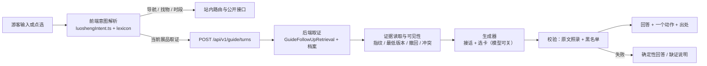

# 洛笙 · AI 向导（唯一事实入口）

> 本文件是洛笙的唯一活文档。决策见 [ADR-009](../decisions/ADR-009-luosheng-v1-convergence.md)，执行计划见 [评审与收敛方案](../plans/2026-11-22-luosheng-review-and-reset.md)。历史方案已归档至 `docs/archive/luosheng/`，只读不改。

## 1. 定位

**洛笙陪你看懂眼前这件鼎：听得懂你的大白话，指给你一处能亲眼核对的细节，说的每个事实都能点开出处。**

不变的原则（来自原始方案）：

- 游客可以从头到尾不理它；拒绝、关声音、离开不算失败。
- 程序管同意与执行，内容负责人管知识，模型管语言。
- 镜头不等于注视：转动 3D 不推断游客在看哪里，只有点击才算。
- 同意听讲不是同意录音：不申请麦克风。
- 没有依据就说缺什么，不借上一轮的出处。

## 2. v1 范围

| 项 | 范围 |
| --- | --- |
| 展品 | 青铜鼎：藏品 `heluo-bronze-ding`，3D 展项 `heluo-bronze-ding-3d` |
| 看点 | `ear`（鼎耳）/ `feet`（三足）/ `motif`（纹样） |
| 知识 | 8 张卡：SOURCE、EARS、FEET、MOTIF、RECORD-02、MODEL-02、PERIOD、SIZE |
| 界面 | 全站问答面板 `LuoshengSiteGuide` + 展签只读讲解 `LuoshengPreset` |
| 模型 | 接话 + 选卡（M3 后）；关闭时为确定性检索 |
| 语言 | 仅 `zh-CN`；英文界面不显示洛笙 |

**不做（v1）**：第二件展品、看点扩展、意图分类器、语音、跨设备、个性化路线、多展品对比、新的审签工具。

## 3. 架构

| 层 | 主要文件 |
| --- | --- |
| 前端意图与词表 | `frontend/src/lib/luoshengIntent.ts`、`luoshengLexicon.ts`、`frontend/src/assets/guide/lexicon.zh-CN.json` |
| 前端参观状态 | `frontend/src/stores/luoshengVisit.ts` |
| 前端界面 | `frontend/src/components/LuoshengSiteGuide.vue`、`LuoshengPreset.vue`、`LuoshengApprovedFigure.vue` |
| 后端接口 | `GuideTurnController`（问答）、`GuideExhibitController`（已审讲解） |
| 后端取证与证据 | `GuideFollowUpRetrieval`、`GuideRetrievalSession`、`GuideEvidenceReader`、`GuideEvidenceFileSource`、`GuideEvidenceVisibility`、`GuideProfile` |
| 后端生成与交付 | `GuideStructuredGenerator`（提示词 v6，M3 升为 v7）、`GuideAnswerDelivery`、`GuideVoice`、`GuideChatCompletionModel` |
| 文案源包 | `docs/plans/luosheng-copy/`（voice、ui、建议问题、提示词）；运行时副本须与源包哈希一致 |

## 4. 开关（现状 → M4 目标）

| 现状 | 作用 | M4 后 |
| --- | --- | --- |
| `VITE_GUIDE_SITE_ENABLED` + `VITE_GUIDE_TURNS_ENABLED` | 全站面板与问答 | `VITE_GUIDE_ENABLED` |
| `VITE_GUIDE_PRESET_ENABLED` | 展签只读讲解 | 并入 `VITE_GUIDE_ENABLED` |
| `DEV` / `VITE_GUIDE_UNIFIED_PREVIEW` | 开发预览组件 | 删除 |
| `museum.guide.turns-enabled` / `preset-enabled` | 后端接口注册 | `museum.guide.enabled` |
| — | 模型接话 | `museum.guide.model-enabled` |
| `museum.guide.pause-path` | 运维暂停文件 | 保留 |
| `museum.guide.daily-turn-limit` | 每日生成上限 | 保留，已定为 `200` 次/天 |
| `museum.guide.max-concurrent-generations` | 并发生成上限（M3 新增） | 有界线程池，默认 `4` |

部署细节见 [deploy/README.md](../../deploy/README.md#洛笙全站导览)。

## 5. 内容与签核（ADR-009）

- 内容负责人：用户本人。审阅 → 提交 → 打 tag 即发布。
- 运行时校验保留：卡包指纹、最低版本、可见性、撤回、ADR-006 冲突拦截。
- M2 起卡片使用 schema v3：`spoken`（念给游客）、`boundary`（问到才说）、`systemConstraints`（代码执行，不展示）。
- 缺来源的问题进入缺口清单，回答"现有资料不足以确认，缺的是……"，不用模型常识补。

## 6. 门禁

| 档位 | 必须通过 |
| --- | --- |
| PR 级 | 前端 `typecheck` + 相关单测 + `build`；后端相关测试类 |
| 里程碑级 | 全量前后端测试；v1 题集；2 个浏览器脚本 × 390 深色 / 1440 浅色 |
| 发布级 | 8 卡已签并打 tag；红队 10/10；选卡 ≥85%；50 条接话含事实 = 0；5 人中 ≥4 人完成北极星任务；真机一次；暂停与关闭演练；生产隔离通过 |

## 7. 当前状态（≤10 行，只写现在）

- 2026-11-22：ADR-009 已采纳，Phase 0（M0 止血收敛）已完成；历史计划、状态与追踪表已归档，`oracleJdk-27` 已移出仓库。
- 已确认参数：DeepSeek 每日上限 `200` 次/天；纳入并发池（默认 4）+ `temperature=0`、青铜鼎页大白话放行、5 轮轻量对话流三项修补。
- 生产仍默认关闭；8 卡为 0.5.0 候选，尚未按 schema v3 改写（Phase 2）。
- 下一步：执行 Phase 1（M1 真实模型摸底 + 修复 `GuideChatCompletionModel` 参数）。
