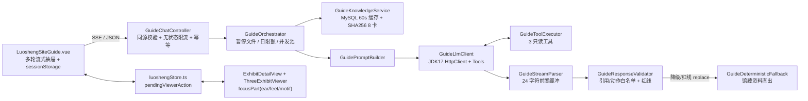

# 洛笙 · AI 向导 v2（唯一事实入口）

> 本文件是洛笙的唯一活文档。决策见 [ADR-010](../decisions/ADR-010-luosheng-v2-museum-agent.md)（取代 [ADR-009](../decisions/ADR-009-luosheng-v1-convergence.md) 部分条款，保留 [ADR-006](../decisions/ADR-006-luosheng-structured-evidence-conflict.md) 冲突拦截），架构改造方案见 [2026-11-23-luosheng-v2-architecture.md](../plans/2026-11-23-luosheng-v2-architecture.md)。

## 1. 定位与核心原则

**全馆实时知识 Grounded 的策展讲解员 + 3D 展柜交互副驾**——支持中英双语（D1）、SSE 真流式多轮对话（D2）、3D 展柜局部平滑聚焦联动，以及诚实的确定性馆藏直出降级。

不变的 5 条博物馆产品原则：

1. **控制权永远归游客**：绝不替游客自动旋转 3D、自动跳转页面、自动预约或下单；所有动作以明确标注意图的可点击按钮呈现，点击才执行；游客可随时无压力收起或清空对话。
2. **所有馆内事实可追溯**：回答基于数据库实时公开数据、青铜鼎 8 张已签核 Tier-1 证据卡（保留 SHA-256 指纹、最低版本防回滚与 ADR-006 冲突检测）与只读工具返回值；每条回答均附折叠「依据与边界」抽屉核对来源。
3. **先讲人话，边界分层**：主气泡优先给出清晰、可立刻对照观察的策展讲解；常规回答将边界收进折叠抽屉，问到边界问题时自然坦诚说明。
4. **镜头不等于注视**：被动读取 3D `viewerState (active / mode / view)` 仅用于避免重复提示，绝不臆测用户自由拖动镜头时正在盯哪处细节。
5. **零重依赖、可运营、低成本**：前后端零新增第三方 AI 框架；保留每日额度（`200` 次/天）、并发上限（`4`）、运维暂停文件、同源校验与无状态限流。

## 2. v2 能力范围（已拍板 D1–D4）

| 项 | v2 范围 |
| --- | --- |
| **覆盖范围** | 全馆已发布公开内容：全部藏品（6 件）+ 文化专题（4 篇，含参观与数字导览须知）+ 3D 展项（青铜鼎，编号 `01`）+ 文创商城（3 件）+ 未来 14 天公开预约时段；青铜鼎 Tier-1 签名证据卡升级至 v6 中英双语 9 卡（含点云观察卡与 4 项 ADR-006 `claim`） |
| **双语支持（D1）** | 中英双语自适应（`zh-CN` / `en-US` 均开放洛笙，跟随前端 `locale`） |
| **通信协议（D2）** | `POST /api/v1/guide/chat/stream`（SSE 真流式，`status`/`delta`/`replace`/`done`）+ `POST /api/v1/guide/chat`（JSON 自动兜底与评测入口） |
| **静态图版（D3）** | `LuoshengPreset.vue` 精简为青铜鼎只读 3 看点静态图版卡 +「向洛笙追问」+「3D 定位」（兼作无 WebGL 降级） |
| **模型与额度（D4）** | DeepSeek（`deepseek-chat`，OpenAI Chat Completions 兼容协议）；日上限 `200` 次/天、最大并发 `4` |
| **只读工具（3 个）** | `get_museum_item_detail`（支持 `artifact`/`article`/`exhibit`/`product`）、`search_museum_catalog`、`query_appointment_slots`（默认 7 天并自动附带 `nextAvailableSlots`；单轮最多 4 次工具往返，绝不写库） |

## 3. 系统架构与核心文件

| 层 | 核心文件 |
| --- | --- |
| 后端配置与安全内核 | `GuideProperties`、`GuideEvidenceFileSource`、`GuideEvidenceVisibility`、`GuideEvidenceReader`、`GuideDailyGenerationLimit`、`GuideRateLimiter` |
| 后端知识与工具 | `GuideKnowledgeService`、`GuideToolExecutor` |
| 后端编排、流式与护栏 | `GuideModels`、`GuidePromptBuilder`、`GuideLlmClient`、`GuideStreamParser`、`GuideResponseValidator`、`GuideDeterministicFallback`、`GuideOrchestrator`、`GuideChatController`、`GuideExhibitController` |
| 网关与安全配置 | `SecurityConfiguration.java`（`DispatcherType.ASYNC` + 新路由）、`frontend/nginx.conf`（`/api/v1/guide/chat/stream` 关闭 `proxy_buffering`） |
| 前端核心模块 | `guideTypes.ts`、`guideClient.ts`、`guidePresets.ts`、`luoshengStore.ts`、`LuoshengSiteGuide.vue`、`LuoshengPreset.vue`、`LuoshengApprovedFigure.vue`、`ThreeExhibitViewer.vue` |
| 单一路径评测与 E2E | `scripts/luosheng-eval.mjs` + `docs/luosheng/eval/v2-questions.json`；`frontend/scripts/luosheng-e2e.mjs`、`luosheng-isolation.mjs` |

## 4. 开关与部署配置（2 个核心开关）

| 变量 | 默认值 | 说明 |
| --- | --- | --- |
| `VITE_GUIDE_ENABLED` | `false` | 前端唯一构建期开关；为 `false` 时零 UI、零 `/api/v1/guide/` 请求 |
| `MUSEUM_GUIDE_ENABLED` | `false` | 后端唯一功能开关，控制 `GuideChatController` 与 `GuideExhibitController` 注册 |
| `MUSEUM_GUIDE_MODEL_ENABLED` | `true` | 为 `false` 时直接走确定性馆藏直出（诚实标注 `馆藏资料直出`） |
| `MUSEUM_GUIDE_MODEL_ENDPOINT` / `MODEL_NAME` / `MODEL_KEY` | DeepSeek 默认 | `MODEL_KEY` 留空时自动回退读取 `DEEPSEEK_API_KEY` |
| `MUSEUM_GUIDE_PACK_PATH` / `MINIMUM_VERSION_PATH` / `APPROVED_DIGEST_PATH` | 空（可选） | 配置后启用青铜鼎 Tier-1 签名证据卡（SHA-256 + 防回滚 + ADR-006） |
| `MUSEUM_GUIDE_DAILY_TURN_LIMIT` / `MAX_CONCURRENT_GENERATIONS` / `RATE_LIMIT_PER_MINUTE` | `200` / `4` / `12` | 运营额度、并发池与无状态限频 |
| `MUSEUM_GUIDE_PAUSE_PATH` | 空 | 文件存在时立即进入运维暂停提示，不影响 3D 与其余页面 |

## 5. 当前状态（2026-11-23）

- **Phase 0–5 改造与全量验收已全部通过**：
  - 后端 `mvn test`：`92 / 92` 通过（含全馆知识、3 工具边界、SHA-256 防篡改/防回滚、ADR-006 冲突、24 字符流式缓冲、回环 Mock OpenAI SSE/工具调用/红线 `replace`/真降级）。
  - 前端 `vue-tsc -b` 0 错误、`vitest run` `74` 文件 / `444` 用例全绿、`vite build` 与包体预算门禁全绿（首屏 JS gzip `77,202 B` / 预算 `81,638 B`，首屏 CSS gzip `9,253 B` / 预算 `80,000 B`）。
  - 真实 DeepSeek 36 题单一路径评测（直连 `/api/v1/guide/chat`，详见 [v2-eval.md](./eval/v2-eval.md)）：总计 `35/36`（`97.2%`），非红队 `29/30`（**96.7%** ≥ 90%），红队 `6/6`（**100%**），动作合法率 `36/36`（**100%**），真 AI 模式 `36/36`，P50 `2,545 ms` / P95 `4,385 ms`。
  - Playwright 浏览器实测（`390×844` 深色 + `1440×900` 浅色）：`luosheng-e2e.mjs` 与 `luosheng-isolation.mjs` 全通过，零控制台报错、零横向溢出、关闭态零 UI 与零 `/api/v1/guide/` 请求。
- 下一步：等待用户审查 `git diff` 确认提交，并在目标部署环境按需开启 `VITE_GUIDE_ENABLED=true` 与 `MUSEUM_GUIDE_ENABLED=true`。
