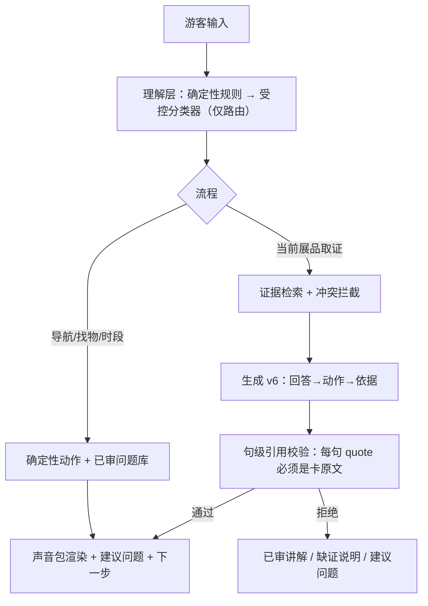

# 洛笙“靠谱 + 智能易用”总方案

2026-11-21 · 状态：待执行 · 前置：`2026-11-21-luosheng-optimization-execution.md`（下称“地基方案”）、ADR-006、ADR-007

> 本文件是总纲。**地基方案的 WP0–WP3 仍然有效**；地基方案的 WP4–WP6 被本文件的 INT-4、INT-6 和 Phase C 替代，不要重复执行。
> 执行代理不需要本次对话的上下文。代码事实以执行时代码为准，有出入先记录。

---

## 0. 结论：可以兼得，但有边界

“靠谱”和“聪明”不是同一条轴上的两端。真正互斥的是：

- **让模型决定事实** ↔ **保证不胡说** —— 这两件事不能兼得；
- **让模型决定怎么理解、怎么表达、怎么引导** ↔ **保证不胡说** —— 这两件事可以兼得，只要理解层只做路由、表达层只做措辞、引导层只从已审问题库里取。

所以本方案把“聪明”拆成五个不会产生事实的层：

| 层 | 智能从哪来 | 为什么不会破坏靠谱 |
| --- | --- | --- |
| 理解层 | 别名、槽位、否定、排除、受控分类器 | 只决定“去哪个流程”，不写事实 |
| 知识层 | 更多已签核证据卡、更多展品、知识地图 | 事实仍来自签核卡，模型不新增 |
| 表达层 | 声音包、结构化生成、观察/记录/不知道三分 | 每个事实句仍需引用原文子串 |
| 交互层 | 澄清按钮、建议问题、下一步看点、诚实进度 | 建议来自已审问题库，不是模型现编 |
| 反馈层 | 试用、匿名类别、离线评测、周度回灌 | 只影响下一轮内容与规则，不直接影响回答 |

**一句话：智能负责“听得懂、答得顺、带得动”，靠谱负责“说的每一句都能指回一张卡”。**

---

## 1. 总蓝图



三层门禁，任何一层失败都往下掉，不往上补：

1. 理解层失败 → 澄清或建议问题，不猜；
2. 证据层失败 → 明说缺什么，不借上一轮；
3. 表达层失败 → 用已审卡原文，不让模型自由发挥。

---

## 2. 执行方式：三个独立 goal，不要一次跑完

本方案总量约 3–4 周工程 + 2 周人工内容与试用。**必须分三次开 goal**，每次结束由人验收，再开下一次。

### Goal A：靠谱地基（约 1.5–2 周）

```text
在 C:\Users\Jie\Documents\博物馆 中执行洛笙“靠谱地基”。

必读：AGENTS.md、PROJECT_STATUS.md、docs/plans/2026-11-21-luosheng-optimization-execution.md、
docs/plans/2026-11-21-luosheng-smart-usable-master.md、ADR-006、ADR-007。

执行地基方案的 WP0 → WP1 → WP2 → WP3。不要执行地基方案的 WP4–WP6（已被总方案的 INT-4、INT-6、Phase C 替代）。
每个工作包：先写失败测试 → 最小实现 → 跑指定检查 → 在总方案 §9 记录 → 再进入下一包。

硬约束：工作树不干净先停；不启用向导；不调用真实模型；不新增依赖；不改公开 API；
不 commit / push / reset / 删除，除非用户逐次明确确认。

结束时按 AGENTS.md §7 汇报，并给出 WP1 的唯一结论：可复用，还是单件定制。
```

### Goal B：智能与易用（约 2 周，依赖 A）

```text
在 C:\Users\Jie\Documents\博物馆 中执行洛笙“智能与易用”改造。

必读：AGENTS.md、PROJECT_STATUS.md、本总方案、地基方案、上一轮 Goal A 的执行记录。
前置门禁：Goal A 已完成，WP1 结论、WP2 语料、WP3 句级校验的测试全部通过；`docs/plans/luosheng-copy/` 四份源文件已存在并完成馆方审阅；工作树干净。任一不满足则停止。

按 INT-1 → INT-2 → INT-5 → INT-3 → INT-4 顺序执行。
INT-2（受控分类器）和任何新增公共端点，在实现前必须先向用户说明请求/响应、限流、隐私影响，得到确认后才写代码。
每个工作包：先写失败测试 → 最小实现 → 跑指定检查 → 在 §9 记录 → 再进入下一包。

硬约束：智能功能一律默认关闭、可独立回滚；任何智能功能不得产生事实；内容卡只允许 DRAFT；
不调用真实模型做验收；不 commit / push，除非用户确认。
```

### Goal C：验证与发布门禁（约 1 周 + 人工）

```text
在 C:\Users\Jie\Documents\博物馆 中执行洛笙“验证与发布门禁”。

必读：本总方案、§7 指标、docs/plans/2026-11-21-luosheng-trial-kit.md（若尚不存在，先由 Goal B 生成）。
前置门禁：8 人试用结果已由人工填入模板；内容签核达到 §6 INT-4 的最低数量；工作树干净。

执行 INT-6：汇总试用与离线评测、补齐匿名 helpful 计数、生成周度回灌清单、逐条核对 §7 指标。
未达标项不得标记完成。最后输出发布门禁结论：可默认开启 / 仅灰度 / 不可发布，并附证据。
```

**如果只能跑一次 goal，跑 Goal A。** 地基不成立，智能层全是空中楼阁。

---

## 3. Goal A：靠谱地基（复用，不重写）

直接执行地基方案的 WP0–WP3：

| 工作包 | 内容 | 关键验收 |
| --- | --- | --- |
| WP0 | 工作树门禁、基线、执行日志 | 干净树 + 真实基线数字 |
| WP1 | 展品档案化 + 第二件藏品实验 | `grep -R "LS-DING-" backend/src/main/java` 为空；两展品参数化测试通过 |
| WP2 | 单一意图契约 + 金标语料 | 语料 100%；`answerSiteGuide` 归零；只有取证问题发 `/turns` |
| WP3 | 句级引用校验 | 每句 quote 必须是卡原文子串；拒绝率与假阳性率都有记录 |

**Goal A 结束后必须回答**：第二件藏品是否零改码跑通。若否，写 ADR-008 判定“单件定制”，并**停止 Goal B 中的平台化部分**（INT-1/INT-2 仍可做，因为它们服务于单件体验；INT-4 转为内容深度而不是展品数量）。

---

## 4. INT-1：语言资产数据化（3–4 天）

### 目标

把“鼎耳/耳朵/双耳”“明天/后天/11 月 23 日”“三个人/我们仨”“不想预约”这类语言知识，从散落的代码正则变成**可审阅、可扩展、可校验**的数据。理解力提升，但不引入模型。

### 影响范围

- 新增 `frontend/src/assets/guide/lexicon.zh-CN.json`
- 新增 `frontend/src/lib/luoshengLexicon.ts`（加载、校验、按展品取用）
- `frontend/src/lib/luoshengIntent.ts`（WP2 产物，改为消费 lexicon）
- `frontend/src/lib/luoshengSlots.ts`（相对日期词改为从 lexicon 取，日期数学保留）
- `frontend/src/lib/luoshengDiscovery.ts`（删除硬编码别名）
- 新增 `frontend/src/lib/luoshengLexicon.spec.ts`
- 新增 `docs/plans/luosheng-eval/sync-lexicon.mjs`（与证据包对账）

### 设计

1. 词表结构（示例）：
   ```json
   {
     "version": 1,
     "locale": "zh-CN",
     "exhibits": {
       "heluo-bronze-ding-3d": {
         "artifactSlug": "heluo-bronze-ding",
         "points": [
           { "stop": "ear", "labels": ["鼎耳", "耳朵", "双耳", "耳"], "view": "top" },
           { "stop": "feet", "labels": ["三足", "鼎足", "脚", "腿"], "view": "back" },
           { "stop": "motif", "labels": ["纹样", "花纹", "饕餮纹"], "view": "relief" }
         ],
         "clarifyOptions": [
           { "stop": "ear", "label": "鼎耳" },
           { "stop": "feet", "label": "三足" },
           { "stop": "motif", "label": "纹样" }
         ],
         "suggestedQuestions": {
           "ear": ["这两个把手是做什么的？", "鼎耳和鼎身是一起铸的吗？", "换个角度看鼎耳"],
           "feet": ["只看见两足，是不是少了一足？", "三足是怎么支撑鼎身的？", "看一眼背视图"],
           "motif": ["这些纹样象征什么？", "纹样是怎么做出来的？", "看纹样局部"]
         },
         "nextGlance": { "ear": "feet", "feet": "motif", "motif": "ear" }
       }
     },
     "relativeDates": { "今天": 0, "明天": 1, "后天": 2, "大后天": 3 },
     "exclusionMarkers": ["不想", "不用", "别", "不看", "不预约"],
     "peopleWords": { "一": 1, "两": 2, "三": 3, "仨": 3 }
   }
   ```
2. **单一事实来源**：`sync-lexicon.mjs --check` 读取已签核证据包，断言：
   - 每个 `stop` 对应的卡存在、已发布、修订号一致；
   - 卡里的 `aliases` 全部出现在 `labels` 中；
   - 没有多余的 `stop` 或指向不存在卡的条目；
   - 建议问题不得包含未签核事实的断言（只做检查清单，不自动判定语义）。
   不通过则构建失败。词表可以在前端打包，但它的事实来源仍是证据包。
3. `parseIntent` 的硬编码 `pointNames`、`relativeDays`、`peopleWords` 全部改为读词表。新增一个点只需要改词表 + 证据卡，不改代码。
4. 建议问题只从词表取，不由模型生成；点击后走正常提问流程。

### 验收

- [ ] `grep -R "pointNames\|relativeDays\|digits" frontend/src/lib` 不再出现硬编码词表（日期数学常量除外）。
- [ ] 新增一个测试展品的词表条目，`parseIntent` 无需改代码即可识别其别名（用参数化测试证明）。
- [ ] `node docs/plans/luosheng-eval/sync-lexicon.mjs --check` 绿；故意删除一张卡的 alias 时变红。
- [ ] 现有意图语料 100% 通过；新增 20 条别名/槽位用例。
- [ ] `typecheck`、`test`、`build` 全绿。

### 停止规则

- 如果词表需要包含任何“事实性解释”才能工作 → 停止。词表只放别名、槽位、问题，不放答案。
- 如果对账脚本需要联网或读取未签核内容 → 停止，改为只读本地已签核包。

---

## 5. INT-2：受控意图分类器（2–3 天，可选且默认关闭）

### 目标

只解决“规则完全没命中”的那一小部分问题。它只能返回**允许的意图枚举与槽位**，不能返回任何面向游客的文字，也不能选择证据卡。

### 前置确认（必须先问用户）

新增公共端点属于接口变更。实现前必须给出：

- 请求/响应示例；
- 限流、超时、日额度；
- 匿名与隐私说明（问题正文会发给模型服务，但不落库、不记日志正文）；
- 关闭开关与回滚方式。

得到确认后再写代码。

### 设计

1. 新端点 `POST /api/v1/guide/intent`，同源校验，匿名，无会话，`Cache-Control: no-store`。
2. 输入：归一化问题、当前上下文标志（是否在展品页、是否有已确认看点、是否有待查时段）、允许意图列表。
3. 输出严格 JSON：
   ```json
   { "kind": "discovery-search", "keyword": "玉器", "exclusions": ["鼎"] }
   ```
   只允许词表内的 `kind` 与字段；未知字段、自由文本、超过 80 字全部拒绝。
4. 超时 1.5 秒，每次游客输入最多调用 1 次，全局并发 1，日额度独立配置。失败即 `unknown`，不重试。
5. 只在确定性解析结果为 `unknown` 时调用；`clarify`、`slot-clarify` 等明确状态不调用。
6. 指标：`intent.classifier.called/resolved/rejected/timeout`，不记录问题正文。
7. 离线评测：120 条留出集，记录 top-1 准确率、错误路由率（尤其“非取证问题被送进取证”必须为 0）。
8. 开关：`VITE_GUIDE_INTENT_CLASSIFIER` / `MUSEUM_GUIDE_INTENT_CLASSIFIER`，默认关闭；关闭时行为与 Goal A 完全一致。

### 验收

- [ ] 关闭开关时，所有现有测试与行为不变。
- [ ] 开启时，只影响 `unknown`；明确意图不受影响。
- [ ] 留出集准确率提升 ≥20 个百分点，错误路由率 ≤2%，否则不启用。
- [ ] 请求体不含访次、Cookie、来源页；响应不含自由文本。
- [ ] 超时、限流、畸形输出各有测试，均降级为 `unknown`。
- [ ] 用户已确认端点变更（记录在执行日志）。

### 停止规则

- 留出集错误路由率 >2% → 不启用，保留代码但默认关闭，写结论。
- 需要把问题正文落库或关联访次 → 停止。

---

## 6. INT-3：声音包与生成 v6（3–4 天）

### 目标

让回答像“洛笙”而不是像模板，同时不放松任何事实约束。把口吻从 Java 字符串搬进可审阅的声音包。

### LANG-0：文案源包（已完成，执行代理只集成）

文案不再由执行端即兴创作。唯一源文件在 `docs/plans/luosheng-copy/`：

| 文件 | 用途 | 运行时落点 |
| --- | --- | --- |
| `COPY-GUIDE.md` | 语气标准、事实三分、禁用词、改写对照 | 不打包，供审阅与测试引用 |
| `voice.zh-CN.json` | 非事实文案：开场、过渡、缺证、澄清、降级 | `backend/src/main/resources/guide/voice.zh-CN.json` |
| `ui.zh-CN.json` | 界面文案与无障碍标签 | `frontend/src/assets/guide/ui.zh-CN.json` |
| `suggested-questions.zh-CN.json` | 建议问题库 | 合并进 `lexicon.zh-CN.json` 的 `suggestedQuestions` |
| `PROMPT-v6.md` | 生成提示词与输出契约 | `GuideStructuredGenerator` 的系统提示词 |

集成规则：

1. 运行时文件与源文件的 SHA-256 必须一致；增加测试比对，禁止在 Java/Vue 里改字。
2. 提示词 Java 文本块必须包含 `PROMPT-v6.md` 的关键段落；测试断言版本号 `luosheng-structured-v6` 与关键规则存在。
3. 文案改动一律回到源包，改完重新跑哈希测试；执行代理不得“顺手润色”。
4. 源包中的 `examples` 只用于校准语气，不是可复制答案；正式回答仍逐句过 quote 校验。

### 影响范围

- 新增 `backend/src/main/resources/guide/voice.zh-CN.json`
- 新增 `backend/src/main/java/com/heluo/museum/guide/GuideVoice.java`（加载与校验）
- `GuideStructuredGenerator.java`（提示词 v6、结构化输出）
- `GuideAnswerDelivery.java`（按声音包渲染缺证/澄清/动作引导）
- 新增 `frontend/src/assets/guide/ui.zh-CN.json`（界面文案，与后端声音包分开）
- `LuoshengSiteGuide.vue`（建议问题、澄清按钮、诚实进度）
- 新增测试：`GuideVoiceTests.java`、`luoshengSuggestions.spec.ts`

### 设计

1. 声音包只放**非事实**内容：开场、过渡、缺证说法、澄清说法、动作引导、禁用词、长度上限、示例。结构示例：
   ```json
   {
     "version": 1,
     "locale": "zh-CN",
     "tone": ["亲切但克制", "先回答再展开", "不替游客下结论"],
     "openers": ["你看到的这张图是数字模型。", "先说你眼前能确认的。"],
     "transitions": ["换个角度再看。", "这条依据来自已审展签。"],
     "insufficient": {
       "generic": "现有已审资料还不足以回答这一点。",
       "missing": { "PERIOD": "缺的是参考实物的断代资料。", "FIND_SPOT": "缺的是出土地记录。" }
     },
     "clarify": { "lookpoint": "你现在问的是鼎耳、三足，还是纹样？" },
     "actionLead": "你可以点下面的按钮亲手核对。",
     "maxSentences": 3,
     "bannedPhrases": ["一定是", "肯定是", "毫无疑问", "据我所知"]
   }
   ```
2. 生成 v6 的结构（仍是 JSON；**事实句原文照录**，与已落地的 v5 一致）：
   ```json
   {
     "sentences": [
       { "role": "answer", "slot": 1, "text": "证据卡中的完整连续句段。" },
       { "role": "action", "template": "plate", "stop": "feet" },
       { "role": "boundary", "slot": 1, "text": "证据卡中的另一句完整原文。" }
     ],
     "references": [1]
   }
   ```
   - `answer` 恰好一句且排第一；`boundary`、`action`、`connective` 各最多一句；总计 1–4 句。
   - **`answer` / `boundary` 的 `text` 必须是该 slot 证据的连续完整句段，不得改写或删限定语**（沿用 v5 的 `completeSpan`）。
   - `action` 不自写文字，只返回声音包内的模板编号与允许的 `stop`；由后端渲染。
   - `connective` 必须逐字来自声音包 `transitions`。
   - 总长 ≤300 码点，单句 ≤120 码点。
   - 不采用“自由措辞 + quote 支撑”：固定对照已证明它会放过“真引文配新事实”（v5 假阳性 0/3，旧式自由措辞为 3/3）。
3. 三类事实必须区分措辞，但**靠引用哪张卡区分，不靠前缀**：
   - 图版可见 → 引用无 `publicSource` 的观察卡；
   - 馆方记录 → 引用带 `publicSource` 的来源卡；
   - 本馆不知道 → 走缺证通道，用声音包的 `insufficient` 文案。
   **不在卡片句子前加“在这张图里，”这类前缀**：加了之后那句话就不再是卡片的连续完整句段，会被 v5/v6 的 `completeSpan` 校验拒绝。声音包只提供开场、过渡、动作模板与缺证模板，不提供任何事实性短语。
   离线评测抽样人工核对三类是否可区分。
4. 建议问题与下一步：
   - 空态：显示 3 个来自 `suggestedQuestions` 的问题；
   - 回答后：显示最多 2 个后续问题 + 1 个“更多”折叠；
   - 下一步看点：来自 `nextGlance`，只给一个，不自动切图。
5. 诚实进度：只用“正在核对资料…”一句，不伪造“正在查证第 2 步”之类的阶段。超过 2 秒显示；不改变请求。

### 验收

- [ ] `grep -n "现有资料不足\|洛笙的图版来自" backend/src/main/java/com/heluo/museum/guide` 不再命中用户可见常量（应改为声音包读取）。
- [ ] `voice.zh-CN.json`、`ui.zh-CN.json` 的运行时副本与 `docs/plans/luosheng-copy/` 源包 SHA-256 一致；故意改一个字时测试变红。
- [ ] `PROMPT-v6.md` 的关键段落（事实三分、quote 规则、connective 规则）在 Java 提示词中存在。
- [ ] 生成 v6：每句 quote 校验；connective 只能取自声音包；三类事实说法各有测试样例。
- [ ] 拒绝率与 Goal A 的 v5 对比，记录在案；拒绝率上升超过 20 个百分点需说明原因。
- [ ] 建议问题最多 3 个、全部来自词表；测试断言没有任何模型生成的建议。
- [ ] 390px / 1440px 双主题：建议问题不溢出、澄清按钮一按即答、焦点正确。
- [ ] `mvn -B test`、`typecheck`、`test`、`build` 全绿。

### 停止规则

- 如果为了“更自然”需要放宽 quote 校验 → 停止。自然度只能靠声音包和结构，不靠放开事实约束。
- 如果声音包开始承载事实（例如断代表述）→ 停止。事实只能来自证据卡。

---

## 7. INT-4：内容冲刺（工程 2 天 + 人工审签 1–2 周）

### 目标

知识面是“智能感”的最大来源。本工作包让执行代理产出**可审阅的草稿**和知识地图，不签核、不发布。

### 产出

1. 青铜鼎从 6 张扩到 20 张草稿，覆盖：
   - 器形与部位（耳、足、腹、纹样）；
   - 数字模型与原器的边界；
   - 参考馆藏身份、年代、尺寸；
   - 出土地（缺证要明说缺什么）；
   - 常见误解（“三足缺一足”“纹样寓意”“原器颜色”）；
   - 观看路线（先看什么、再看什么）；
   - 铸造与使用的一般背景（必须区分通识与已审事实，通识卡不得进入证答）。
2. 两件新展品的知识地图与各 6–8 张草稿：建议 `river-map-jade-bi`、`water-bird-bronze`。
3. 每张草稿必须包含：
   ```json
   {
     "id": "LS-DING-FORM-01",
     "revision": 1,
     "status": "DRAFT",
     "text": "……",
     "aliases": ["……"],
     "publicSource": "https://……",
     "claim": { "key": "period", "value": "商代安阳时期" },
     "evidenceLocator": "图版/来源中的具体位置",
     "canSupport": ["……"],
     "cannotInfer": ["……"],
     "reviewNotes": "需要馆方确认的点"
   }
   ```
4. 知识地图（每展品一份 markdown）：部位、事实、来源、常见问题、禁止推断、建议问题。
5. **优先级队列**：按“游客最可能问 + 现有覆盖最差”排序，先送签前 8 张，不要一次送 20 张。

### 验收

- [ ] 所有草稿通过现有 schema/claim/指纹预检；`status` 全部为 `DRAFT`。
- [ ] 每张草稿都有公开来源或明确标注“本馆观察”，没有来源的不得进入队列。
- [ ] 知识地图覆盖部位、事实、来源、禁止推断、建议问题五节。
- [ ] 不生成正式发布指纹，不修改已签核卡正文。
- [ ] 执行日志写明：草稿数量、待签数量、建议先签的 8 张及理由。

### 停止规则

- 如果某张卡找不到可靠公开来源 → 标记“待馆方提供”，不要用模型常识补。
- 如果草稿需要改动已签核内容 → 停止，另开版本。

---

## 8. INT-5：交互易用性（2–3 天）

### 目标

让“聪明”被感知到：少打字、少猜、少等待、少迷路。

### 设计

1. **澄清按钮化**：当 `parseIntent` 返回 `clarify` 且词表有 `clarifyOptions` 时，显示 2–3 个按钮（鼎耳 / 三足 / 纹样），点一下即发对应问题。没有选项时才用开放式澄清。
2. **建议问题**：
   - 空态 3 个；
   - 回答后 2 个 + “更多”；
   - 全部来自词表，点击走正常流程；
   - 不默认展开，不打断阅读。
3. **缺证状态**：不仅说“资料不足”，还要说“缺的是哪一类”，并给两个可继续问的问题。
4. **诚实进度**：请求超过 2 秒显示“正在核对资料…”，完成即消失；不显示虚假阶段。
5. **无障碍与移动**：
   - 回答区域 `aria-live="polite"`；
   - 澄清按钮可键盘操作；
   - 建议问题在 390px 自动换行、不横向滚动；
   - 焦点在答案更新后保持在合理位置，不抢输入框。
6. **不新增页面、不改路由**。

### 验收

- [ ] 澄清按钮：点击后一轮内得到对应主题回答；键盘 Enter/Space 可用。
- [ ] 建议问题：最多 3 个；全部来自词表；点击后与手输同一问题得到同一结果。
- [ ] 缺证回复包含“缺什么”与两个后续问题。
- [ ] 390px 深色 / 1440px 浅色浏览器测试：无溢出、无布局跳动、焦点正确。
- [ ] 现有 523 项测试不因 UI 调整而减少；新增用例覆盖上述行为。
- [ ] 关闭智能开关时，界面回到 Goal A 的最小形态。

### 停止规则

- 如果建议问题需要模型生成 → 停止，只用词表。
- 如果澄清按钮需要新增路由或页面 → 停止，页内解决。

---

## 9. INT-6：试用与学习闭环（1 天工程 + 人工执行）

### 目标

把“聪明”变成可测量、可回灌的循环，而不是一次性感觉。

### 设计

1. 试用：8 人、5 个任务（五分钟看一件 / 不预约只看鼎 / 另一只呢 / 我说的是脚 / 去预约再回来），每人 10–15 分钟。
2. 指标：
   - 任务成功率；
   - 澄清次数（同一歧义 ≤1）；
   - 动作到达率 ≥95%；
   - 返回成功率 ≥90%；
   - 主观“有帮助”比例；
   - 无依据断言率 = 0（抽样 50 条人工核对）。
3. 匿名 helpful 计数：回答后“有帮助 / 没帮助”两个按钮，只发枚举与回复类别，不发问题、不发访次、不带 Cookie/来源页。
4. 离线评测：把试用中出现的真实问法（征得同意、去标识后）加入金标语料；每轮改动前后各跑一次。
5. 周度回灌清单：本周 top 3 未命中类别 → 对应是加别名、加卡、改文案还是不改；每条有负责人和期限。

### 验收

- [ ] 试用结果模板已填（由人填，执行代理不得代填）。
- [ ] helpful 计数在成功/失败/关闭三种情况下不影响主流程。
- [ ] 请求体只含枚举，测试断言无正文、无访次、无 Cookie。
- [ ] 评测语料新增 ≥20 条真实问法（去标识）。
- [ ] 输出 top 3 回灌项与建议动作。
- [ ] 执行日志明确写“真人试用由人执行，代理未代替”。

### 停止规则

- 需要持久化访次或用户标识 → 停止。
- 试用样本不足 8 人 → 指标标记“样本不足”，不得声称达标。

---

## 10. Phase C：发布门禁

只有以下全部满足，才允许把向导从默认关闭改为灰度或默认开启：

- [ ] Goal A 的 WP1 结论明确；若为“单件定制”，发布范围只限该展品，不宣传平台能力。
- [ ] Goal A 的句级校验在固定证据集上假阳性通过率 = 0。
- [ ] INT-2 分类器（若启用）错误路由率 ≤2%，且默认关闭时行为不变。
- [ ] INT-4 至少 8 张卡完成双签，覆盖 top 10 问题中的 8 个。
- [ ] 8 人试用达到 §9 指标，或明确标记“样本不足、不达标”。
- [ ] 50 条抽样回答人工核对，无依据断言 = 0。
- [ ] 文案源包（`docs/plans/luosheng-copy/`）已由馆方审阅并冻结 SHA-256；运行时副本与源包一致。
- [ ] 默认关闭构建的隔离测试通过；开启构建在 390/1440、深浅主题下主路径通过。
- [ ] 暂停开关、撤回卡、迟到答复、模型超时/繁忙/额度/网络故障各复验一次。
- [ ] 回滚方案：关闭前端开关即可回到纯公开浏览；不依赖数据库回滚。
- [ ] 文档、状态、追踪表、ADR 已更新。

任一项不满足 → 只能灰度或保持关闭，不得默认开启。

---

## 11. 指标：什么算“既靠谱又聪明”

| 类别 | 指标 | 目标 | 来源 |
| --- | --- | --- | --- |
| 北极星 | 5 项试用任务完成率 | ≥80% | 8 人试用 |
| 靠谱 | 无依据断言率 | 0（50 条抽样） | 人工核对 |
| 靠谱 | 冲突证据被拦截 | 100% | 现有测试 |
| 靠谱 | 迟到/撤回/超时降级 | 100% | 现有测试 |
| 理解 | 金标语料通过率 | 100% | 离线 |
| 理解 | 留出集 unknown 率 | <10% | 离线 |
| 理解 | 分类器错误路由率 | ≤2% | 离线 |
| 表达 | 生成接受率 | ≥80% | 固定证据集 |
| 表达 | 回答平均句数 | 1–3 | 离线统计 |
| 交互 | 动作到达率 | ≥95% | 匿名计数 |
| 交互 | 返回成功率 | ≥90% | 匿名计数 |
| 交互 | 同一歧义重复澄清 | ≤5% | 匿名计数 |
| 内容 | top 10 问题覆盖率 | ≥80% | 内容队列 |
| 性能 | 非模型 p95 | ≤2.5s | 计时 |
| 性能 | 含模型 p95 | ≤8s | 计时 |

指标只用于判断“是否值得继续投”，不作为对外宣传口径。

---

## 12. 停止规则汇总（总）

| 触发 | 动作 |
| --- | --- |
| 工作树不干净 | 停止 |
| Goal A 未完成就开 Goal B | 拒绝 |
| 智能功能需要模型产生事实 | 停止，改设计 |
| 建议问题来自模型而非词表 | 停止 |
| 声音包承载事实 | 停止 |
| 分类器错误路由 >2% | 默认关闭，写结论 |
| 句级校验接受率 <60% | 停止，不放宽 |
| 内容草稿被标为 PUBLISHED | 回滚并报告 |
| 试用样本不足 | 标“样本不足”，不声称达标 |
| 需要真实模型/生产数据/新依赖/新端点未确认 | 停止，等用户确认 |
| 同一测试修两次仍失败 | 停止，附输出 |

---

## 13. 执行记录（由执行代理填写）

| 阶段 | 工作包 | 状态 | 分支/HEAD | 命令与结果 | 修改文件 | 备注 |
| --- | --- | --- | --- | --- | --- | --- |
| LANG | 文案源包 | 已交付 | | 已写 5 份源文件 | `docs/plans/luosheng-copy/*` | 待馆方审阅；执行端只集成 |
| A | WP0 | 通过 | `codex/feat-guide-baseline` / `38f574b` | 干净树；前端类型、524 项单测、默认构建和预算通过；Maven 153/158 通过、5 项按开关跳过；离线 62/62 | [基线日志](luosheng-eval/optimization-run-log.md)、本节、项目状态、追踪表 | 无真实模型或生产数据；无业务改动 |
| A | WP1 | 通过：可复用 | `codex/feat-guide-baseline` / `38f574b` + 未提交变更 | 红测 2 例 404/200 差异；绿测 Maven 159/164、5 跳过；默认构建和关闭态浏览器 1/1；Java 卡号硬编码归零 | [改动量与证据](luosheng-eval/optimization-run-log.md#2026-11-21--wp1-档案化实验) | 第二展项仅用合成卡、档案和 H2 数据，不改变公开 API |
| A | WP2 | 通过 | `codex/feat-guide-baseline` / `38f574b` + 未提交变更 | 117 条金标全过；组件测试确认仅取证发请求；前端类型、643 项单测、默认构建和预算全过 | [执行证据](luosheng-eval/optimization-run-log.md#2026-11-21--wp2-意图契约) | 旧入口零引用；未启用候选 |
| A | WP3 | 通过 | `codex/feat-guide-baseline` / `38f574b` + 未提交变更 | Maven 164/169 通过（5 跳过）；关闭态 Chrome 1/1；固定替身样本 v5 7/10 接受、3/10 拒绝、0/3 假阳性 | [对照与文件清单](luosheng-eval/optimization-run-log.md#2026-11-21--wp3-句级引用) | 仅内部协议调整，未测真实模型；未开启候选 |
| B | INT-1 | 通过 | `codex/feat-guide-baseline` + 未提交变更 | 词表通过 657 项前端测试、类型检查与 `--check` 一致性校验；删除卡片别名时校验以退出码 1 失败 | [执行记录](luosheng-eval/optimization-run-log.md#2026-11-21--int-1-语言资产数据化) | 仅前端；新增别名无需改码，新增看点仍受 `GuideStop` 约束 |
| B | INT-5 | 通过 | `codex/feat-guide-baseline` + 未提交变更 | 前端 82 文件 669 项、类型检查、构建与预算全过；缺证分类待服务端字段 | [执行记录](luosheng-eval/optimization-run-log.md#2026-11-21--int-5-交互易用性) | 未做 390/1440 实页观感 |
| B | INT-2 | 未开始 | | | | |
| B | INT-3 | 未开始 | | | | |
| B | INT-4 | 未开始 | | | | |
| B | INT-5 | 未开始 | | | | |
| C | INT-6 | 未开始 | | | | |
| C | 发布门禁 | 未开始 | | | | |

---

## 附录 A：智能功能的三条铁律

1. **理解层只路由。** 分类器输出枚举与槽位，不输出文字、不选证据。
2. **表达层只措辞。** 每个事实句必须有原文子串；过渡句只能来自声音包。
3. **引导层只取已审内容。** 建议问题、下一步、澄清选项全部来自词表；不现编。

违反任一条，智能就会变成“更会编”，本方案失去意义。

## 附录 B：内容冲刺优先级（建议）

1. 数字模型 vs 原器边界（已有，补强）；
2. 三足遮挡与“是不是缺一足”（已有，补强）；
3. 鼎耳用途的“不能推断”；
4. 纹样寓意的“不能推断”；
5. 断代（待签）；
6. 尺寸（待签）；
7. 出土地（缺证要说缺什么）；
8. 铸造方法（区分通识与已审）；
9. 观看路线；
10. 常见误解合集。

## 附录 C：试用任务卡（8 人）

| # | 任务 | 成功标准 | 观察点 |
| --- | --- | --- | --- |
| 1 | “我只有五分钟，带我看一件” | 给出具体展品 + 一个看点动作 | 是否又给四个入口 |
| 2 | “不想预约，只想看青铜鼎” | 不提预约，直达鼎 | 否定是否被理解 |
| 3 | 在侧视图问“另一只在哪” | 承接当前看点，给背视图 | 是否要求重说 |
| 4 | 说“我说的是脚” | 改按三足回答，画面不自动切 | 纠正是否生效 |
| 5 | 去预约页再回来 | 回到原展品与原看点 | 是否失忆 |
