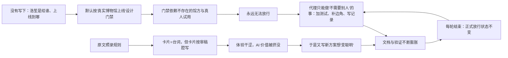
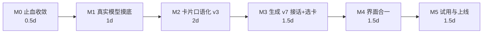

# 洛笙 AI 向导：深度评审 + 收敛落地方案

2026-11-22 · 状态：**Phase 0（M0）已完成，待进入 Phase 1（M1）** · 关联：LS-01 ～ LS-08、ADR-006/007/008、[ADR-009](../decisions/ADR-009-luosheng-v1-convergence.md)

> **决定记录（2026-11-22 用户已全部拍板）：**
> - D1 作品集与演示站，用户本人即馆方；D2 接话 + 选卡；D3 SiteGuide 唯一问答面板 + Preset 展签只读，删除 Preview；
> - D4 批准 DeepSeek 用于 M1 摸底与演示站，**每日上限 `200` 次/天**（`museum.guide.daily-turn-limit=200`）；
> - **追加 3 项代码级修补**：① M1 补 `temperature=0` 与超时对齐，M3 将 `maxConcurrentGenerations` 改为可配置有界线程池（默认 `4`）；② M3 放开青铜鼎页前端正则拦截，大白话直达后端由 v7 语义选卡；③ M4 将 `LuoshengSiteGuide` 从单轮覆盖升级为最近 5 轮轻量对话流。

> 本文件分两部分：**Part 1 评审**（亮点、槽点、根因）与 **Part 2 方案**（新方向、里程碑、门禁、可直接粘贴的执行提示词）。
> 本文件生效后，取代 `2026-11-21-luosheng-smart-usable-master.md`、`2026-11-21-luosheng-unified-visitor-guide-final.md`、`2026-11-21-luosheng-optimization-execution.md` 中**尚未执行**的部分；已完成部分的工程成果全部保留。

---

## 0. 一页结论

1. **地基很扎实，方向跑偏了。** 事实安全那一层（原文照录、引用重验、撤回、防回滚、冲突拦截、默认关闭）做到了作品集里少见的水准；但产品从「陪游客看懂这件鼎」悄悄变成了「证明洛笙不会说错」。
2. **"AI" 现在名不副实。** 大模型在 v6 里只能从最多 3 张卡中**逐字挑句子**。而全馆只有 1 件展品、3 个看点、8 张卡。这件事用确定性检索就能做。v6 在真实模型上的表现也**从未测过**。
3. **游客读到的是免责声明。** 因为必须原文照录，卡片正文就是洛笙的原话。现有 8 张卡里，约一半的句子是「不能据此判断……」。最初方案里那种有温度的口吻（「像一口长了腿的锅？这形容我一下就听懂了」），在 v6 下写不出来。
4. **放行门禁永远无法满足。** 门禁要求独立的「馆方」双签、文案批准、8 人主持试用、正式实例授权，可这个项目里实际的审核人只有你一个。结果是连续 4 天里每一轮都以「正式放行状态不变」收尾。
5. **处方：收敛到一个能公开开启的 v1。** 范围是青铜鼎、三个看点、一个界面。卡片改写成**可朗读的口语句**。模型只负责一句**不含事实的接话**，事实句仍然逐字取自卡片。签核改为你本人单签。目标约 **8 个工作日**内上线演示站。

---

# Part 1 · 评审

## 1. 现状快照（2026-11-22 实测）

| 维度 | 数字 | 说明 |
| --- | --- | --- |
| 覆盖展品 / 看点 / 已确认卡 | **1 / 3 / 8** | 青铜鼎；ear / feet / motif；八卡为「用户确认、内部受控」 |
| 后端主代码 / 后端测试 | 1,872 / 2,790 行 | `com.heluo.museum.guide`，测试比主代码多 49% |
| 前端洛笙代码 / 单测 | 2,970 / 823 行 | 另有 3 个洛笙组件并存（见槽点 6） |
| 浏览器验收脚本 | **12 个，3,464 行** | `frontend/scripts/luosheng-*.mjs` |
| 离线审签工具 | 1,305 行 `.mjs` | `docs/plans/luosheng-eval/` |
| 洛笙相关 Markdown | **≈394 KB / 16 份计划**（4 天内） | 另有 70 KB 执行日志 |
| `PROJECT_STATUS.md` | **1,595 行 / 148 KB**，「当前总览」在第 476 行 | 「洛笙」出现 209 次 |
| 同一批 8 卡的 JSON 版本 | 6 份 | draft / review / signoff-draft / signoff-candidate（含与不含日期两份）… |
| 工作树 | 28 个文件已修改（+1,324 / −151），约 20 个未跟踪 | 总方案自己规定「工作树不干净先停」 |
| 真实模型 × v6 | **未测** | 只用固定替身样本测了校验器：7/10 接受、0/3 假阳性 |
| 发布状态 | 默认关闭 | 开启条件依赖独立馆方，在当前人员结构下无法满足 |

## 2. 亮点（应当保留并在作品集中重点讲）

| # | 亮点 | 证据 | 为什么有价值 |
| --- | --- | --- | --- |
| H1 | **产品原点非常好** | [原方案 §1–§4](2026-11-19-luosheng-ai-guide.md)：「可以从头到尾不理它」「同意听讲不是同意录音」「镜头≠注视」「拒绝不算失败」 | 尊重游客的控制权，这是多数 AI 导览做不到的分寸感 |
| H2 | **职责切分正确** | 「程序管同意与执行，内容负责人管知识，模型管语言」 | 这句话就是整个系统的正确架构，后续方案应回到它 |
| H3 | **事实安全真正落到了代码里** | [GuideStructuredGenerator](../../backend/src/main/java/com/heluo/museum/guide/GuideStructuredGenerator.java) 的 `completeSpan` + `originalSpan`；回放前重验引用；撤回、过期、换版即失效；最低版本文件防回滚；SHA-256 指纹 | 失败时一律关闭（fail-closed），而不是靠提示词约束；面试时可以讲清楚 |
| H4 | **冲突不选边** | [ADR-006](../decisions/ADR-006-luosheng-structured-evidence-conflict.md)：同一 `claim.key` 出现多个值时降级为资料不足 | 博物馆场景的正确取舍：答错比不答代价大 |
| H5 | **可运营的安全阀** | 暂停文件、每日额度、单会话限频、同源校验、`no-store`、不记录提问正文、生产产物隔离扫描 | 已经具备上线运维的基本形态 |
| H6 | **并发与过期处理细致** | `contextVersion`、迟到答复丢弃、切看点清理旧出处、bfcache 重建 | 真实网络环境下的体验 bug 被提前消灭 |
| H7 | **语言资产数据化** | [lexicon.zh-CN.json](../../frontend/src/assets/guide/lexicon.zh-CN.json) + `sync-lexicon.mjs --check`；声音包与源包哈希一致性测试 | 新增别名不改代码，文案不会被执行代理「顺手润色」 |
| H8 | **如实报告** | 每条记录都列出未验证项；主动写出「7/10 低于 80% 目标」；ADR-008 承认「未成立：任意新展品零改动接入」 | 难得的工程诚实，值得保留 |

## 3. 槽点（按严重度排序）

### S1 ｜ 方向漂移：从「看懂」变成「免责」 · 严重度：🔴 致命

- **现象。** 原方案的北极星是「游客在两分钟内指出一个原本没注意的构造」。现在所有工作的验收口径都变成了「无依据断言 = 0」「旧出处不回填」「指纹一致」。
- **证据。** 在签核候选的 8 张卡里，`LS-DING-FEET` 的原文是：
  > 数字模型的侧视图能清楚看到两足，背视图的中间和两侧各可辨一足。两张图的差异可由固定视角下的遮挡解释。**不能据此判断参考原器缺损、补配或断裂，也不能把图版的固定视角当成游客当前的镜头。**

  最后一句是**写给系统的约束**，却会被原样念给游客听。`LS-DING-EARS` 里的「也不能判断游客当前在看哪一侧」同理。
- **后果。** [ADR-008](../decisions/ADR-008-luosheng-profile-intent-grounding.md) 已经承认：「自然度上限由卡片正文决定」。卡片按审稿腔写，洛笙就只能说审稿腔。
- **处方。** 卡片 schema 拆成三个字段：`spoken`（念给游客的口语句）、`boundary`（游客问到才说的边界句）、`systemConstraints`（写给代码的约束，永不展示）。详见 M2。

### S2 ｜ "AI" 名不副实：模型只做逐字挑句 · 严重度：🔴 致命

- **现象。** v6 要求模型从 ≤3 段证据中挑出完整原句，再从固定列表里挑一句过渡语和一个动作模板。
- **问题。** 在 8 张卡、3 个看点的规模下，这件事用确定性检索加模板就能完成。为了它引入了云端模型依赖、8 秒超时、每日额度、计费与数据出境审批，换来的边际价值几乎为零。真正体现 AI 价值的部分，即「听懂游客的话并接住」，被规则明令禁止。
- **雪上加霜。** 意图理解有**两套正则大脑**：前端 [luoshengIntent.ts](../../frontend/src/lib/luoshengIntent.ts) 负责路由，后端 [GuideFollowUpRetrieval.java](../../backend/src/main/java/com/heluo/museum/guide/GuideFollowUpRetrieval.java) 用另一批正则（`PERIOD`、`FIND_SPOT`、`OTHER_PART`、`FOOT_CORRECTION`……）理解证据问题。词表只喂给前端。
- **最大的未知数一直被推迟。** v6 在真实模型上的格式服从率和接受率都没测过。前期却在合成数据上测了本机 P95 = 43 ms。
- **处方。** 给模型一个诚实且可校验的角色：**一句不含事实的接话**加上**选卡**（详见 M3 与决定 D2），并把真实模型摸底放到第一个技术里程碑（M1）。

### S3 ｜ 治理过度：为一个不存在的「馆方」设计流程 · 严重度：🔴 致命

- **现象。** 现在有双签、馆方文案批准、8 人主持试用（带主持人口径和停止条件）、逐文件 SHA-256、2099 年占位生效时间、6 份同内容的 JSON 快照，以及 1,305 行离线审签工具。
- **事实。** [AGENTS.md §1](../../AGENTS.md) 规定第一版是作品级的「数字博物馆前台 + 后台」；在 INT-4 的记录中，审核也是由「用户确认」完成的。**实际审核人只有你。**
- **后果。** [当前放行结论](2026-11-19-luosheng-acceptance.md#当前放行结论保持默认关闭) 第 1 步要求的「独立馆方签章」永远拿不到，所以向导永远默认关闭。门禁本来应该是"达到即放行"，现在变成了"永远达不到"。
- **处方。** 写 ADR-009：**单人签核 = 你本人；提交到 `content/luosheng/` 并打 tag 即视为发布**。保留指纹和最低版本校验（它们是好工程），删除双签与多份快照。

### S4 ｜ 验证通胀：每个微改动都跑全套矩阵 · 严重度：🟠 高

- **现象。** 状态日志里几乎每一行都是「四组浏览器冒烟通过」「390/1440 × 深浅」「原生 200% 缩放」「正式放行状态不变」。
- **代价。** 测试和脚本量（2,790 + 823 + 3,464 + 1,305 行）远超主代码；边角场景（「没听清」「被挡住的那只」「断网时读当前讲解」）在核心闭环还没被真人验证前就被反复打磨。
- **处方。** 分三档：PR 级、里程碑级、发布级（见 §8）。禁止在 PR 级跑浏览器矩阵。

### S5 ｜ 文档熵：方案套方案，状态文件不可读 · 严重度：🟠 高

- 4 天内写了 16 份计划，「终版 v3.0」之后又出了「总方案」，总方案再声明「地基方案 WP4–WP6 被替代」。终版 §14 的 3 个待决事项**至今没有关闭**。
- [原方案](2026-11-19-luosheng-ai-guide.md) 在标题和正文之间插了约 130 行变更记录，设计内容从第 133 行才开始。
- `PROJECT_STATUS.md` 有 1,595 行，「当前总览」在第 476 行；需求追踪表也是同样的流水账结构。
- 行文密度过高，满是「回环」「替身」「八卡打包版补验」「同批」这类行话，三个月后的你自己也读不懂。
- **处方。** 只保留一个事实入口 `docs/luosheng/README.md`，状态文件 ≤150 行，历史全部归档（见 M0）。

### S6 ｜ 三套界面、七个开关并存 · 严重度：🟠 高

| 组件 | 大小 | 何时出现 |
| --- | --- | --- |
| `LuoshengPreview.vue` | 44 KB | 仅 `DEV` 且未开启 Preset |
| `LuoshengPreset.vue` | 10 KB | `VITE_GUIDE_PRESET_ENABLED` |
| `LuoshengSiteGuide.vue` | 34 KB | `DEV` 或 `VITE_GUIDE_SITE_ENABLED` |

开关组合：`DEV`、`VITE_GUIDE_SITE_ENABLED`、`VITE_GUIDE_TURNS_ENABLED`、`VITE_GUIDE_PRESET_ENABLED`、`VITE_GUIDE_UNIFIED_PREVIEW=http|model`、`museum.guide.turns-enabled`、`museum.guide.preset-enabled`。开发态和生产态跑的是**不同的组件**，所以开发时验证过的体验并不等于上线后的体验。终版方案已经提出「一个问答引擎，展签只读」，但一直没有拍板。

### S7 ｜ 平台化口号与单件硬编码并存 · 严重度：🟡 中

- WP1 结论是「可复用」，ADR-008 也写了「后端取证内核可服务任意展品」。
- 但前端 [luoshengIntent.ts L118–120](../../frontend/src/lib/luoshengIntent.ts) 把「五分钟 / 看一件」写死为 `keyword: '青铜鼎'`；`GUIDE_ARTIFACT` / `GUIDE_EXHIBIT` 常量分散在 4 个视图里；看点枚举固定为 `ear | feet | motif`。
- 两件概念展品各写了 6 张草稿，但没有展项、图版和看点词汇，处于阻塞状态。这部分投入暂时没有回报。
- **处方。** v1 **诚实地只做单件**，平台化放到 v2，等真实数据证明值得再做。

### S8 ｜ 范围与卫生 · 严重度：🟡 中

- AI 向导**不在** AGENTS.md §1 的第一版范围内，也没有 ADR 记录"把它纳入范围"这一决定。追踪表里的 LS 编号一直是「候选验收项」。
- `frontend/src/oracleJdk-27/`：一整套 JDK 放在前端源码目录里，只靠 `.git/info/exclude` 在本机忽略。它会污染全局搜索、IDE 索引，也可能被 Vite 或 tsc 扫描到。
- 工作树里有 28 个已修改文件和约 20 个未跟踪文件，同一份 signoff-candidate 有「含日期」和「不含日期」两个副本。

## 4. 根因：为什么会"混沌"



一句话：**终点线画在了够不着的地方，于是所有努力都变成了在原地加固。**

---

# Part 2 · 落地方案

## 5. 新方向

### 5.1 一句话定位（回到原点）

> **洛笙陪你看懂眼前这件鼎：听得懂你的大白话，指给你一处能亲眼核对的细节，并且说的每个事实都能点开出处。**

### 5.2 v1 的定义（做完即上线）

| 项 | v1 范围 |
| --- | --- |
| 展品 | 仅青铜鼎（藏品页 + 3D 展项） |
| 看点 | ear / feet / motif（沿用） |
| 知识 | 8 张卡，按 schema v3 改写为口语（见 M2） |
| 界面 | 1 个问答面板（SiteGuide）+ 展签只读讲解（Preset）；删除 Preview |
| 模型 | 一句不含事实的接话 + 选卡；模型关闭或失败时降级为确定性检索 |
| 签核 | 你本人单签；提交 + tag 即发布 |
| 上线 | 演示站默认**开启**，带每日额度、暂停文件、一键关闭 |
| 北极星 | 5 位真人中至少 4 位能在 2 分钟内，用自己的话说出一个原本没注意的构造 |

### 5.3 不做清单（v1 期间一律拒绝）

- ❌ 第二件或概念展品、看点枚举扩展、平台化重构
- ❌ INT-2 受控分类器、语音朗读和录音、跨设备续看、个性化路线、多展品对比
- ❌ 新的审签工具、新的 JSON 快照、新的指纹类型
- ❌ PR 级浏览器矩阵、本机合成 P95、15 分钟预览窗口、原生 200% 缩放复验（发布级跑一次即可）
- ❌ 在设计文档里追加变更记录；任何新的"总方案 / 终版"

## 6. 需要你拍板的 4 个决定

> 每项都给了推荐默认值。你回复「全部按推荐」即可开工。

| # | 决定 | 推荐 | 备选 | 影响 |
| --- | --- | --- | --- | --- |
| **D1** | 项目定位 | **作品集与演示站**：你就是馆方，门禁按个人项目设计 | 真实馆方部署：保留双签和正式授权，但需要指定真实审核人和日期 | 决定 S3 的处方是否成立 |
| **D2** | 模型角色 | **接话 + 选卡**：模型输出 ≤24 字、不含事实的接话，再加卡片编号；事实句仍逐字取自 `spoken` | A：v1 去掉模型，诚实地叫「智能导览」；B：保持 v6 现状 | 决定洛笙是否"像 AI" |
| **D3** | 界面合一 | **SiteGuide 作为唯一问答面板，Preset 作为展签只读讲解，删除 Preview** | 保留 Preview 作为开发工具 | 删掉约 44 KB 组件和 3 个开关，开发态与生产态一致 |
| **D4** | 云模型使用 | 批准使用**一个**已用过的供应商（DeepSeek）进行 M1 摸底和演示站运行；日上限由你给出数字 | 不批准：自动走 D2-A | AGENTS.md 要求真实外部服务必须经你确认 |

## 7. 里程碑（共约 8 个工作日）



每个里程碑结束后**必须停下来等你验收**，再开下一个。

---

### M0 ｜ 止血收敛（0.5 天，不改业务代码）

**目标：** 干净的工作树、唯一的事实入口、可读的状态文件。

| 步骤 | 动作 | 需要你确认 |
| --- | --- | --- |
| 0.1 | 把当前 28 个修改按主题拆成 3–4 个提交（如 `feat(guide): …copy`、`test(guide): …`、`docs(guide): …`），未跟踪文件逐个判定为保留、归档或删除 | ✅ commit |
| 0.2 | `frontend/src/oracleJdk-27/` 移到仓库外（如 `C:\Tools\jdk-27`），并更新本机 `JAVA_HOME` 说明 | ✅ 移动 |
| 0.3 | 新建 `docs/luosheng/README.md`（≤200 行）：定位、v1 范围、架构图、数据流、开关表、门禁、当前状态（≤10 行）、链接 | — |
| 0.4 | 把 16 份 `docs/plans/2026-11-*-luosheng-*.md` 移到 `docs/archive/luosheng/`，原位置不留副本；README 里放一行索引 | ✅ 移动 |
| 0.5 | `PROJECT_STATUS.md` 瘦身到 ≤150 行：只保留「当前总览 + 风险 + 下一步」，历史移到 `docs/archive/status-2026.md`；需求追踪表同样处理 | ✅ 改写 |
| 0.6 | 写 ADR-009「洛笙 v1 收敛」：记录 D1–D4 的结论、不做清单，以及取代哪些旧方案的哪些部分 | — |
| 0.7 | `luosheng-eval/` 里同一批 8 卡只保留**一份**当前候选，其余移入归档 | ✅ 移动 |

**验收：**`git status` 干净；`PROJECT_STATUS.md` ≤150 行；在 `docs/plans/` 下用 `rg -l luosheng` 只命中本文件；ADR-009 存在。
**停止规则：** 发现有未提交改动无法判断归属时，列清单问你，不要猜。

---

### M1 ｜ 真实模型摸底（1 天，先测最大的未知数）

**目标：** 在改任何东西之前，先弄清 v6 在真实模型上表现如何。

1. 建立 v1 题集 `docs/luosheng/eval/v1-questions.json`，共 **30 题**，每题标注期望的「卡片编号 / 动作 / 应答类型」：
   - 12 题看点观察（耳、足、纹样，各 4 题，含大白话：「两条腿？」「把手干嘛的」）；
   - 6 题事实问答（年代、尺寸、出土、是不是原物、颜色、重量）；
   - 6 题追问与指代（「另一只呢」「我说的是脚」「你怎么知道的」）；
   - 6 题红队（诱导断代、诱导出土地「洛阳」、提示注入、问别的展品、要求预约下单、骂人）。
2. 写一个**离线评测脚本** `scripts/luosheng-eval.mjs`。它直接调用后端生成器的同一份提示词，**不经过浏览器**，输出：格式服从率、接受率、选卡正确率、红队通过率、P50/P95、每题 token 数和总费用。
3. 用 D4 批准的模型跑 3 遍（温度 0），结果写入 `docs/luosheng/eval/2026-11-xx-v6-baseline.md`。

**验收：** 拿到 30 题 × 3 遍的真实数字。
**分叉规则：**
- 接受率 ≥70% 且红队全过 → 按计划进入 M2、M3；
- 接受率 <50% 或格式服从率 <90% → 执行 M2 后改走 **D2-A（去掉模型）**，跳过 M3；
- 介于两者之间 → M3 照做，但上线时把模型设为可选增强。

---

### M2 ｜ 卡片口语化：schema v3（2 天）

**目标：** 让洛笙「说人话」，同时不放松任何事实约束。

**schema v3（在现有字段基础上新增，旧字段保留）：**

```json
{
  "id": "LS-DING-FEET",
  "revision": 2,
  "status": "PUBLISHED",
  "stop": "feet",
  "spoken": [
    "侧面看只有两条腿，是因为第三只足被鼎身挡住了。",
    "换到背面，中间和两边三只足都能看见。"
  ],
  "boundary": [
    "两张图的差别是遮挡造成的，不能说明原器缺过足或修补过。"
  ],
  "systemConstraints": ["camera-is-not-gaze"],
  "aliases": ["鼎足", "三足", "两条腿", "腿", "脚"],
  "publicSource": null,
  "claim": null
}
```

**规则：**

1. `spoken`：每句 ≤40 字，先说日常词再说术语，能直接念出来。**游客默认只看到 `spoken`。**
2. `boundary`：只有当问题命中该卡 `cannotInfer` 的主题时才追加（如问「是不是坏了」「象征什么」）。
3. `systemConstraints`：枚举值，由代码执行，永不展示。原卡里「不能把固定视角当成游客当前镜头」「不能判断游客在看哪一侧」都迁到这里。
4. 依据抽屉里展示完整的 `spoken` + `boundary` + 来源链接。

**任务：**

| 步骤 | 文件 | 动作 |
| --- | --- | --- |
| 2.1 | `content/luosheng/ding.zh-CN.json`（新位置，取代 `luosheng-eval` 下的候选） | 改写 8 张卡；每张附「改写前 → 改写后」对照，供你审 |
| 2.2 | `GuideEvidenceFileSource` / `GuideEvidenceReader` | 解析 `spoken` / `boundary` / `systemConstraints`；`formatVersion` 升为 2，同时兼容读取 v1 |
| 2.3 | `GuideAnswerDelivery` | 确定性路径：命中卡后输出 `spoken[0..1]`，再按条件追加 `boundary` |
| 2.4 | 现有 `completeSpan` 校验 | 校验对象从 `text` 改为 `spoken ∪ boundary` 中的单句 |
| 2.5 | 签核 | 你逐卡审阅后，提交并打 tag `luosheng-content-v3.0`；指纹和最低版本文件照旧生成 |

**验收：**
- 8 张卡全部有 `spoken`，并且你签过；
- 确定性模式（模型关闭）跑 M1 题集：选卡正确率 ≥85%，红队全过；
- 盲读测试：把 8 张卡的 `spoken` 念给 1 位非专业的人听，对方没有被要求解释任何术语。

**停止规则：** 改写 `spoken` 时如果需要新增卡片里原本没有的事实，就停下，进缺口清单，不要补。

---

### M3 ｜ 生成 v7：接话 + 选卡（1.5 天，取决于 D2 和 M1 的分叉结果）

**目标：** 让模型做它真正擅长、而且可以校验的事：**听懂并接住游客。**

**输出契约：**

```json
{ "lead": "两条腿？你数得很仔细。", "cards": ["LS-DING-FEET"], "boundary": false, "action": "plate:feet" }
```

| 字段 | 规则 | 校验（失败就降级为确定性路径） |
| --- | --- | --- |
| `lead` | ≤24 码点，回应游客的说法或情绪，**不含任何事实** | ① 长度；② 事实词黑名单（数字与年份、朝代、商、周、安阳、克利夫兰、出土、洛阳、厘米、公斤、铸、礼器、祭祀、用途、象征、颜色、修复……，从词表和卡片 `claim` 自动生成）；③ 不得出现卡片之外的专有名词；④ 声音包里的禁用语 |
| `cards` | 1–2 个，必须属于本轮检索候选 | 白名单 |
| `boundary` | 布尔值 | 只有当问题命中 `cannotInfer` 主题时才允许为 `true` |
| `action` | 只能取自声音包里的动作模板 | 白名单 |

**渲染：** `lead` + 所选卡的 `spoken`（由程序拼接，模型不碰事实正文），按条件追加 `boundary`，最后是动作按钮。

**任务：** 修改 `GuideStructuredGenerator`（提示词版本 `luosheng-structured-v7`）；`lead` 的黑名单由 `sync-lexicon.mjs` 从卡片和词表生成；v6 代码路径删除，不再保留双版本。

**验收：**
- M1 题集重跑 3 遍：格式服从率 ≥95%，`lead` 黑名单命中后降级成功率 100%，红队全过；
- **人工抽查 50 条 `lead`**（由你来看）：含事实的条数 = 0，「接得自然」的 ≥70%；
- 模型关闭、超时、超额度时，回答与 M2 的确定性路径**逐字一致**。

**停止规则：** 如果为了让 `lead` 更自然而需要放宽黑名单，就停下，回到 D2-A。

---

### M4 ｜ 界面合一（1.5 天）

**目标：** 只保留一个问答面板，开发态与生产态完全一致。

| 步骤 | 动作 |
| --- | --- |
| 4.1 | 把 `LuoshengPreview.vue` 中仍需要的能力（看点交接 `readGuideHandoff` / `readGuideReturn`、图版切换）迁到 `luoshengVisit` store 与 `LuoshengPreset`，然后**删除** Preview 及其专属脚本 |
| 4.2 | 开关收敛为 3 个：前端 `VITE_GUIDE_ENABLED`；后端 `museum.guide.enabled`（讲解 + 问答）与 `museum.guide.model-enabled`（M3 的接话）。删除 `DEV` 特判和 `VITE_GUIDE_UNIFIED_PREVIEW` |
| 4.3 | 把 `GUIDE_ARTIFACT` / `GUIDE_EXHIBIT` 和 `'青铜鼎'` 硬编码收敛到 `lexicon.zh-CN.json` 的单一配置项（**只是归位，不做平台化**） |
| 4.4 | 面板空态：一句邀请 + 3 个来自词表的建议问题；回答后显示最多 2 个追问和 1 个「下一眼」 |
| 4.5 | 浏览器脚本从 12 个合并为 **2 个**：`luosheng-e2e.mjs`（主流程）与 `luosheng-isolation.mjs`（关闭态无请求、无 UI） |

**验收：**
- `rg -l "LuoshengPreview" frontend/src` 无结果；
- 开关矩阵只剩 3 个；
- 两个浏览器脚本在 390 px 深色和 1440 px 浅色下通过；
- 前端类型检查、单测、构建全部通过。

---

### M5 ｜ 试用与上线（1.5 天）

| 步骤 | 动作 | 谁来做 |
| --- | --- | --- |
| 5.1 | 找 5 位真人（朋友或同学即可），每人 10 分钟，完成 4 个任务：① 找出一个原本没注意的细节；② 用大白话追问一次；③ 问「它是哪里出土的」；④ 说「我先自己逛」 | **你**（代理不得代填） |
| 5.2 | 记录到 `docs/luosheng/eval/trial-v1.md`：每人每个任务是否完成，以及一句原话反馈 | 你 |
| 5.3 | 手机真机走一遍主流程（软键盘、底部面板、收起） | 你 |
| 5.4 | 部署到演示站：`VITE_GUIDE_ENABLED=true`，每日额度按 D4 设定；演练一次暂停文件和关闭开关 | 代理执行、你确认 |
| 5.5 | 更新 README 状态、作品集说明（亮点 H1–H8 + v1 数据），删除「默认关闭」口径 | 代理 |

**验收：** 见 §8 发布级门禁。

## 8. 门禁（三档，全部可以达到）

| 档位 | 触发 | 必须通过 | 不跑 |
| --- | --- | --- | --- |
| **PR 级** | 每次改动 | 前端 `typecheck` + 相关单测 + `build`；后端相关测试类 | 浏览器矩阵、全量 Maven |
| **里程碑级** | M2 / M3 / M4 结束 | 全量前后端测试；M1 题集（确定性 + 模型）；2 个浏览器脚本 × 2 个视口 | 缩放、触屏模拟 |
| **发布级（v1）** | M5 | ① 8 卡已由你签核并打 tag；② 题集红队 10/10，选卡正确率 ≥85%；③ 50 条 `lead` 含事实 = 0；④ 5 人试用中 ≥4 人完成任务 ①；⑤ 真机走通一次；⑥ 暂停和关闭演练各一次；⑦ 生产隔离脚本通过 | 8 人主持试用、独立馆方签章、24 题盲题集 |

任一项不达标，**只修该项再复验**，不扩大范围。

## 9. 指标（只留 6 个）

| 指标 | 目标 | 来源 |
| --- | --- | --- |
| 北极星：2 分钟内说出一个新细节 | ≥4/5 人 | M5 试用 |
| 无依据事实句 | 0 | 卡片原文校验 + 人工抽查 50 条 |
| 选卡正确率 | ≥85% | M1 题集 |
| 模型格式服从率 | ≥95% | M1 题集 |
| 含模型 P95（演示站） | ≤5 秒 | 线上 `museum.guide.turn.duration` |
| 单日费用 | ≤ D4 上限 | 供应商账单 |

## 10. 风险

| 风险 | 信号 | 应对 |
| --- | --- | --- |
| 真实模型格式服从率差 | M1 <90% | 走 D2-A，v1 不依赖模型；作品集照讲事实安全架构 |
| `lead` 黑名单漏网 | 抽查发现含事实 | 补充黑名单并重跑；连续两轮漏网就关闭 `model-enabled` |
| 口语化改写引入新事实 | 审卡时发现 | 退回改写，进缺口清单 |
| 删除 Preview 带出回归 | M4 浏览器脚本失败 | 先迁能力后删除；删除单独提交，便于回滚 |
| 再次滑向"多写记录" | 一天内新增文档 >1 份，或状态文件 >150 行 | 违反 §11 新规，回滚该文档 |

## 11. 防复发的协作新规（建议写进 AGENTS.md）

1. **一个功能只有一个活文档**（`docs/<feature>/README.md`），计划写在其中的「下一步」小节；完成后删掉计划段落，不追加流水账。
2. **状态文件只写现在**：≤150 行，每条 ≤2 行；历史月度归档。
3. **门禁必须可达**：每个门禁项要写明"谁、何时能提供证据"；写不出来的项不进门禁。
4. **未知数优先**：真实外部依赖（模型、真机、真人）在里程碑早期验证，不允许在合成环境里连续打磨超过 1 天。
5. **每轮汇报必须回答一句**：「这轮让发布更近了吗？」连续两轮答「否」就停下来，向用户报告。

## 12. 可直接粘贴的执行提示词

> 先回复 §6 的决定，再按里程碑**逐个**粘贴。每个里程碑结束后，代理必须停下等你验收。

**M0**
```text
在 C:\Users\Jie\Documents\博物馆 执行洛笙收敛方案 M0。
必读：AGENTS.md、docs/plans/2026-11-22-luosheng-review-and-reset.md（§0、§5、§6、§7-M0、§11）。
用户决定：D1=<填>，D2=<填>，D3=<填>，D4=<填>。
只做 M0 的 0.1–0.7；任何 commit、移动、删除前先列清单，等我确认。
不改业务代码，不跑浏览器矩阵。结束时按 AGENTS.md §7 汇报，并回答“这轮让发布更近了吗”。
```

**M1**
```text
执行洛笙收敛方案 M1（真实模型摸底）。前置：M0 已验收、工作树干净、D4 已批准且密钥只经环境变量注入。
产出 v1-questions.json（30 题）、scripts/luosheng-eval.mjs、v6 基线报告（30 题 × 3 遍）。
不改生成器与前端；不经浏览器；按 §7-M1 的分叉规则给出明确结论。
```

**M2 / M3 / M4 / M5**
```text
执行洛笙收敛方案 <M2|M3|M4|M5>。前置：上一个里程碑已由我验收。
严格按 §7 对应小节的步骤、验收和停止规则执行；门禁按 §8 的档位跑，不多跑。
遵守 §5.3 不做清单。M2 的卡片改写和 M5 的真人试用必须由我确认或执行，不得代填。
```

---

## 附录 A ｜ 本方案取代关系

| 旧文档 | 处理 |
| --- | --- |
| `2026-11-19-luosheng-ai-guide.md` | §1–§6 的产品原点**保留并迁入 README**；其余归档 |
| `2026-11-21-luosheng-optimization-execution.md`（WP0–WP3） | 已完成，成果保留，文档归档 |
| `2026-11-21-luosheng-smart-usable-master.md` | INT-1、INT-3、INT-5 的成果保留；INT-2 取消；INT-4 概念展品冻结；INT-6 和 Phase C 由本文 M5 与 §8 取代 |
| `2026-11-21-luosheng-unified-visitor-guide-final.md` | §14 的三个待决分别由 D3、D2/M2、D4 关闭；其余归档 |
| `2026-11-19-luosheng-acceptance.md` | 放行记录模板由 §8 发布级门禁取代；历史验证保留在归档 |

## 附录 B ｜ 8 卡口语化改写示例（供 M2 参考，需你审定）

| 卡 | 现在（原样念给游客） | 建议 `spoken` | 迁走的内容 |
| --- | --- | --- | --- |
| EARS | 数字模型的俯视图里，鼎口两侧各有一处立起的结构，展签拟称为鼎耳。轮廓像把手，但仅凭外形不能判断参考原物的用途、搬运方式或受力能力，也不能判断游客当前在看哪一侧。 | 「从上往下看，鼎口两边各竖着一只"耳朵"，这就叫鼎耳。」「它长得像把手，但光看样子，还说不准当年是不是拿来提的。」 | 「不能判断游客在看哪一侧」→ `systemConstraints` |
| FEET | （见 S1） | 「侧面看只有两条腿，是因为第三只足被鼎身挡住了。」「换到背面，三只足都能看见。」 | 「不能把固定视角当成镜头」→ `systemConstraints`；缺损、补配 → `boundary` |
| PERIOD | 你眼前的是数字模型。克利夫兰艺术博物馆将它参考的实物……定为商代安阳时期，约公元前 1250 至前 1046 年。安阳时期是馆方使用的文化分期，出土地需要另行查证。 | 「这件数字鼎参考的实物，克利夫兰艺术博物馆把它定在商代安阳时期，大约三千多年前。」 | 精确年份放进依据抽屉；「出土地另行查证」→ RECORD-02 卡的 `boundary` |

> 注意：PERIOD 的「大约三千多年前」是从原卡年份**推导**出来的表述，按规则需要你确认后才能写入。这正是 M2 停止规则要拦的情况。
