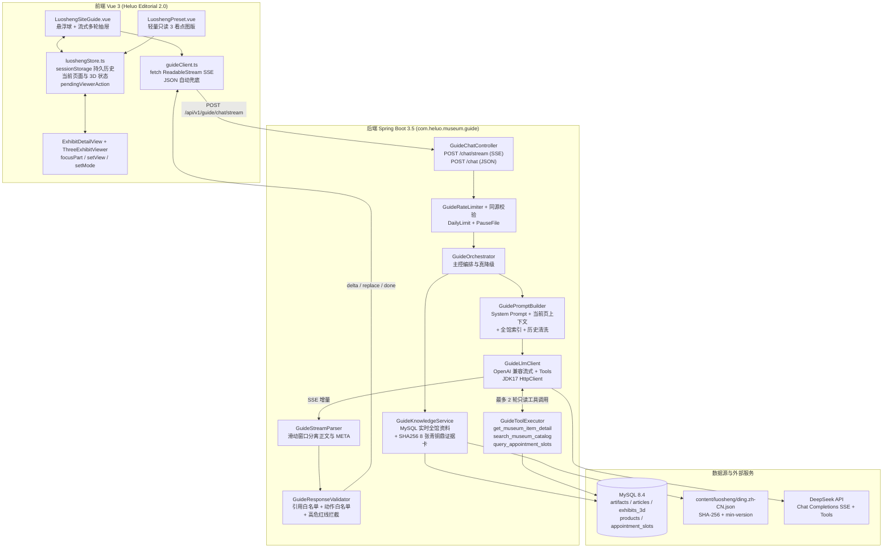
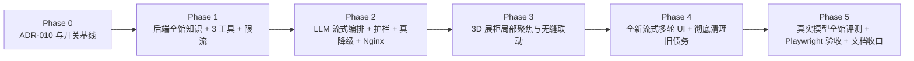

# 洛笙 AI 向导 v2 架构改造方案（全馆知识库 × 真多轮流式对话 × 3D 展柜联动）

> 日期：2026-11-23 · 状态：**已拍板锁定（D1–D4 全部采纳推荐值），就绪交由 `/goal` 执行**  
> 关联约束：[AGENTS.md](../../AGENTS.md)、[design.md](../../design.md)、[ADR-006](../decisions/ADR-006-luosheng-structured-evidence-conflict.md)（保留冲突不选边）、拟新增 `ADR-010-luosheng-v2-museum-agent.md`（取代 `ADR-009` 单件/24字接话约束）。

---

## 0. 一页总览：为什么大刀阔斧，以及 v2 长什么样

### 0.1 从 v1 到 v2 的范式反转

| 维度 | 现状（v1 / v7 收敛态） | 目标（v2 策展级全馆向导） |
| --- | --- | --- |
| **定位** | 穿着 AI 外衣的“8 张卡复读机 + 24 字客套话” | **全馆实时知识 Grounded 的策展讲解员 + 3D 展柜交互副驾** |
| **覆盖范围** | 全馆 6 件文物只认 1 件青铜鼎，其余 5 件无脑复读摘要 | **全馆覆盖**：全部已发布藏品（6 件）+ 文化专题（3 篇）+ 3D 展项 + 14 天公开预约时段 + 河洛文创商品 |
| **AI 真正做的事** | 吐 ≤24 字无信息量 `lead` + 8 选 1–2 卡 ID；12 条正则提前截胡 | **真语义理解、自然组织讲解、跨展品对比、连续追问承接、按需调用 3 个只读工具、输出结构化可执行动作** |
| **防幻觉机制** | 全文逐字照录 + 自杀式 24 字名词黑名单（连“尺寸/重量”都拒） | **三层真实护栏**：① 实时 Grounding 注入 + 工具取证；② 强制引用白名单溯源；③ 高危事实红线校验（放过正常提问词汇，只拦编造出土地/估价/越权下单/伪造外链） |
| **多轮与交互** | 后端零历史记忆；前端收起面板直接清空历史；非流式干等 | **真多轮（最近 5 轮入上下文）+ `sessionStorage` 持久化不丢记录 + SSE 真流式逐字输出 + 跨页上下文分隔线** |
| **3D 展厅关系** | 与 3D 渲染器零联动；“去 3D 看鼎耳”甚至反向阻断 3D 启动，拉去页底看静态 WebP | **结构化 3D 动作按钮**：用户点击后原地启动并平滑驱动 `ThreeExhibitViewer` 切视角（俯视/背面/局部聚焦）与点云模式；遵循“用户点击才动”原则 |
| **降级与可靠性** | 模型拒答/超时直接扔掉证据甩报错；关模型还误标“AI 实时回答” | **真降级**：模型关闭/超时/超额/命中红线时，基于同一套检索结果返回可读确定性摘要 + 动作 + 来源，诚实标注 `馆藏资料直出` |
| **评测一致性** | 离线脚本 `luosheng-eval.mjs` 与 Java 生产代码 Prompt/Payload 完全脱节 | **单一路径评测**：评测脚本直连真实后端 `/api/v1/guide/chat` 接口，零两张皮 |
| **代码体量与开关** | 37 个生产文件（4,837 行）+ 14 个脚本 + 7 个环境变量开关 | **瘦身重构**：后端 ~10 个高内聚类 + 前端 6 个核心模块 + 2 个 E2E 脚本 + **2 个核心开关**（`VITE_GUIDE_ENABLED` / `MUSEUM_GUIDE_ENABLED`） |

### 0.2 v2 坚守的 5 条博物馆产品原则（不丢初心）

1. **控制权永远归游客**：绝不替游客自动旋转 3D、自动跳转页面、自动预约或下单；所有动作渲染为明确标注意图的可点击按钮，点选才执行；游客可随时无压力收起或清空对话。
2. **所有馆内事实可追溯**：回答依托数据库实时公开数据、青铜鼎已签核证据卡（保留 SHA-256 指纹 + 防回滚 + ADR-006 冲突检测）与只读工具返回值；每条回答可展开「依据与边界」抽屉核对来源。
3. **先讲人话，边界分层**：主气泡优先给出有画面感、能立刻对照观察的讲解；不确定事实与合规声明只在游客问到边界问题时自然说明，常规回答将其收进折叠抽屉，不再满屏免责腔。
4. **镜头不等于注视**：被动读取 3D 当前 `active / mode / view` 仅用于避免重复提示“去开启 3D”，绝不臆测用户自由拖动镜头时正在盯哪处细节。
5. **零重依赖、可运营、低成本**：后端零新增第三方 AI 框架（纯 Spring Boot 3.5 + JDK 17 `HttpClient` + `SseEmitter` + `JdbcTemplate`），前端零新增 npm 依赖；保留每日额度、并发上限、运维暂停文件、同源校验与无状态限流。

---

## 1. 已拍板锁定的 4 项决策（2026-11-23 用户确认全部采纳推荐值）

> 以下 4 项已由用户全部确认生效，执行代理直接按此落地，不再反复确认。

| 编号 | 决策项 | 推荐默认值 | 备选方案 | 影响范围 |
| --- | --- | --- | --- | --- |
| **D1** | **双语支持** | **中英双语自适应**：跟随前端 `locale`（`zh-CN` / `en-US`），英文页也开放洛笙并用英文回答（库内已有 `title_en` / `summary_en` + 模型翻译已审证据） | 仅 `zh-CN`，英文界面继续隐藏洛笙 | `App.vue` 挂载条件、`GuidePromptBuilder` 语言指令、前端引导文案 |
| **D2** | **流式输出** | **SSE 真流式（`POST /api/v1/guide/chat/stream`）+ JSON 兜底（`POST /api/v1/guide/chat`）** | 仅非流式 JSON | `GuideChatController`、`SecurityConfiguration`（补 `DispatcherType.ASYNC`）、`frontend/nginx.conf`（关 SSE buffer） |
| **D3** | **青铜鼎页底部 `LuoshengPreset`** | **精简为轻量只读「3 看点图版卡」+「向洛笙追问」按钮**（删掉 `visit.target` 劫持滚动和整段文本堆砌，兼作无 WebGL 设备的静态看点对照） | 彻底删除 `LuoshengPreset.vue`，全站统一只留右下角洛笙抽屉 | `ContentDetailView.vue`、`ExhibitDetailView.vue`、`LuoshengPreset.vue` |
| **D4** | **默认模型与额度** | 继续使用 **DeepSeek（`deepseek-chat`）**，底层保持标准 OpenAI Chat Completions 协议（后续换 Qwen / GLM / Gemini 零改代码），演示站默认日额度 **`200` 次/天**、并发 **`4`** | 调整日额度或指定其他 OpenAI 兼容模型 | `application.yml`、`deploy/.env.example` |

---

## 2. 端到端系统架构



---

## 3. 核心技术设计细节

### 3.1 全馆知识统一建模（`GuideKnowledgeService`）

不再把知识锁死在单件静态 JSON。`GuideKnowledgeService` 将全馆知识分为 **两级 Grounding 源**，均受 `status = 'PUBLISHED' AND deleted_at IS NULL` 与分类 `enabled = 1` 约束（与 `ArtifactController` / `ExhibitController` / `ProductController` 权限完全一致）：

1. **Tier-1 已签核证据卡（权威优先）**
   - 保留现有 `GuideEvidenceFileSource` + `GuideEvidenceVisibility` + `GuideEvidenceReader`（SHA-256 校验、最低版本防回滚、ADR-006 同 `claim.key` 冲突屏蔽）。
   - 对应 `heluo-bronze-ding` / `heluo-bronze-ding-3d` 的 8 张卡（`LS-DING-*`），每张卡同时提供 `spoken`、`boundary` 与 `publicSource`。
2. **Tier-2 MySQL 实时馆内公开内容**
   - **藏品（`artifacts` JOIN `categories` + `exhibits_3d`）**：`slug`、`title`、`title_en`、`category_name`、`period`、`material`、`dimensions`、`collection_location`、`summary`、`summary_en`、`content`（4–5 节完整策展文案）、关联 `exhibit_slug`。
   - **文化专题（`articles` JOIN `categories`）**：`slug`、`title`、`title_en`、`summary`、`summary_en`、`content`、`author_display`。
   - **3D 展项（`exhibits_3d`）**：`slug`、`title`、`summary`、`description`、`display_no`、`source_credit`、`source_url`、`license_label`、`collection_location`、`artifact_slug`、支持视角（`front/left/right/back/top` + `ear/feet/motif` 局部聚焦）与模式（`solid/points`）。
   - **文创商品（`products`）**：`sku`、`slug`、`name`、`summary`、`description`、`price`、可用库存 `GREATEST(stock_quantity - locked_stock, 0)`。
   - **公开预约时段（`appointment_slots`）**：只通过工具实时查库（不缓存），沿用 `AppointmentSlotController` 的精确 SQL（今天起 14 天内、`status = 'OPEN'`、`reserved_people < capacity`、当日过滤已过期时段）。
3. **短时内存缓存（仅静态内容）**
   - 藏品/专题/展项/商品体量极小（< 30 条），内存缓存 TTL `60s`（或管理后台无侵入、最多 60s 最终一致），避免每次对话重复查 5 张表；预约时段永远实时直查。

### 3.2 “预注入 + 3 工具”混合编排（零冗余延迟）

全馆目录极精炼，设计为 **快慢双路径混合模式**：

1. **每轮必注入（单次 LLM 调用覆盖 ~90% 提问）**：
   - **全馆紧凑目录**（~350 tokens）：6 件藏品（`slug + 标题 + 分类 + 1 句摘要 + 是否含 3D`）、3 篇专题（`slug + 标题 + 1 句摘要`）、3 件文创（`slug + 名称 + 价格`）、站内核心页面路由。
   - **当前页面深度上下文**：
     - 在藏品页（任意 1 件）：注入该藏品完整 `content` + 元数据；若为 `heluo-bronze-ding`，额外注入全部 8 张 Tier-1 证据卡（清晰区分 `spoken` / `boundary` / `publicSource`）。
     - 在 3D 展项页：注入 3D 展项元数据 + 关联藏品正文 + 8 张证据卡 + 当前 3D 查看器状态（`active / mode / view`）+ 可用 3D 聚焦部位说明。
     - 在专题页：注入该专题完整 `content`。
     - 在预约页：自动预查未来 3 天最近可约时段摘要。
     - 在文创页：注入全部在售商品详情与可用库存。
2. **按需触发的 3 个只读工具（OpenAI `tools` 标准定义，单轮最多 2 次工具往返）**：
   - `get_museum_item_detail(type: "artifact" | "article" | "exhibit", slug: string)`
     - 用途：跨页深挖或对比（例如用户在首页或青铜鼎页问 *“河图玉璧讲了什么？”* 或 *“对比一下青铜鼎和青铜爵”*）。
     - 副作用：将该条目加入本轮 `allowedSources` 白名单，允许后续引用和跳转。
   - `search_museum_catalog(keyword: string)`
     - 用途：站内关键词检索（跨藏品、专题、文创），返回匹配条目列表及摘要。
   - `query_appointment_slots(date?: "YYYY-MM-DD", days?: number, people?: number)`
     - 用途：实时查询指定日期或未来 `days` 天（上限 14 天）的公开预约时段与余量，自动校验 `1..30` 人规则与 14 天公开窗口；**绝不执行写入或下单**。

> [!IMPORTANT]
> **删除全部 12 条后端硬编码正则**（原 `GuideFollowUpRetrieval.java`）和 **前端 220 行正则意图解析器**（原 `luoshengIntent.ts`）。从“找玉璧”、“查明天 3 个人名额”到“腿怎么少了一条”，全部由统一编排器通过 LLM + Tools 处理；仅在 `modelEnabled = false` 或运行时降级时走轻量确定性兜底器。

### 3.3 协议契约：SSE 流式正文 + 尾部结构化 Meta

#### 请求协议：`POST /api/v1/guide/chat/stream`（及非流式 `POST /api/v1/guide/chat`）

```json
{
  "conversationId": "uuid-v4",
  "requestId": "uuid-v4",
  "message": "侧面数来数去只有两条腿，是断了一条吗？",
  "locale": "zh-CN",
  "context": {
    "route": "exhibit-detail",
    "artifactSlug": "heluo-bronze-ding",
    "exhibitSlug": "heluo-bronze-ding-3d",
    "articleSlug": null,
    "viewerState": {
      "active": true,
      "mode": "solid",
      "view": "left"
    }
  },
  "history": [
    { "role": "user", "content": "这件鼎是什么年代的？" },
    { "role": "assistant", "content": "它参考的实物被克利夫兰艺术博物馆定在商代安阳时期……" }
  ]
}
```

校验规则：
- `Sec-Fetch-Site` 必须为 `same-origin`（本地单测与受控评测工具通过独立配置或同源头验证）；
- `message` 非空且 `1..500` 码点；`locale` 仅允许 `zh-CN` / `en-US`；
- `history` 最多保留最近 `10` 条（5 轮），单条截断至 `400` 码点，清洗控制字符与伪造分隔符（如剔除 `<<<LUOSHENG_META>>>`）；
- **完全无状态（不调用 `request.getSession()`）**，贴合 `SecurityConfiguration` 的 `SessionCreationPolicy.STATELESS`，使用内存有界滑动窗口限流（按客户端 IP / `conversationId`，默认每分钟 12 次）+ `requestId` 幂等防重。

#### 流式协议（SSE `text/event-stream;charset=UTF-8`）

模型在 System Prompt 约束下输出两段内容：
1. **第一段**：自然流畅的讲解正文（纯文本、分段清晰、建议 60–220 字，不写原始 URL、不写“请点某按钮”的空气指令）。
2. **第二段**：独占一行分隔符 `<<<LUOSHENG_META>>>` 后紧跟严格 JSON：

```json
{
  "citations": ["LS-DING-FEET"],
  "actions": [
    {
      "type": "viewer_focus",
      "exhibitSlug": "heluo-bronze-ding-3d",
      "part": "feet",
      "view": "back",
      "mode": "solid",
      "label": "在 3D 展柜切到背面看三足"
    }
  ],
  "followUps": ["顶上那两个像把手的东西能用来提吗？", "换点云模式能看出什么？"],
  "boundaryNote": "固定视角的遮挡差异不能说明参考原器存在缺损、断裂或修补。"
}
```

后端 `GuideStreamParser` 通过 **24 字符滑动前置缓冲** 逐片解析模型流，向前端推送 4 类标准 SSE 事件：

| SSE Event | Payload | 前端行为 |
| --- | --- | --- |
| `status` | `{"phase":"searching_slots" \| "reading_archive" \| "thinking"}` | 调用工具时显示一句诚实的真实状态（如“正在查询公开预约时段…”），绝不伪造假进度 |
| `delta` | `{"text":"侧面看只有两条腿，"}` | 实时追加到当前流式气泡；分隔符绝不泄漏到屏幕上 |
| `replace` | `{"text":"..."}` | 极少数情况（如流结束后命中高危事实红线）原子替换正文为安全降级文本 |
| `done` | `{"requestId":"...","text":"...","citations":[...],"actions":[...],"followUps":[...],"boundaryNote":"...","mode":"ai"\|"deterministic","degraded":false}` | 落定最终消息，渲染**经服务端白名单校验后的动作按钮**、折叠「依据与边界」抽屉、2 个追问胶囊 |

#### 结构化动作白名单（`GuideResponseValidator` 严格校验，非法即丢弃）

| Action `type` | 必填/可选字段 | 服务端校验规则 | 前端执行行为 |
| --- | --- | --- | --- |
| `viewer_focus` | `exhibitSlug`, `view`(`front\|left\|right\|back\|top`), 可选 `part`(`ear\|feet\|motif`), 可选 `mode`(`solid\|points`), `label` | `exhibitSlug` 必须是已发布 3D 展项；`view`/`part`/`mode` 严格枚举校验 | 若已在展项页：自动激活 3D 并平滑切视角/聚焦；若在其他页：写入 `pendingViewerAction` 跳转至 `/exhibits/:slug` 后自动激活执行 |
| `viewer_mode` | `exhibitSlug`, `mode`(`solid\|points`), `label` | `exhibitSlug` 有效且 `mode` 在枚举内 | 原地激活并切换实体/点云模式 |
| `navigate` | `path`, 可选 `query`(`{date, q}`), `label` | `path` 严格匹配已发布站内白名单（`/explore`、`/exhibits`、`/exhibits/:validSlug`、`/artifacts/:validSlug`、`/articles/:validSlug`、`/appointment`、`/shop`） | `router.push({ path, query })`；不清空对话历史 |
| `open_plate` | `stop`(`ear\|feet\|motif`), 可选 `compare`, `label` | 仅对青铜鼎允许 | 在无 WebGL 降级或藏品阅读页，展开静态看点图版对照 |
| `open_source` | `url`, `label` | `url` **必须精确命中**本轮 `allowedSources` 中的 `publicSource` / `source_url` 白名单 | 新标签安全打开 `rel="noopener noreferrer"` |

### 3.4 三层真实护栏与真降级（告别“自杀式黑名单”）

1. **第一层：Prompt 边界约定（管风格与诚实度）**
   - 明确身份、语气温润克制、先回答再展开；
   - 区分“数字重制展品（青铜鼎）”与“项目原创概念展品（其余 5 件）”，严禁把概念展品编造成真实考古文物；
   - 遇到资料未载问题（出土地、原器颜色、铭文、重量、局部未测尺寸、估价），直接坦诚说明已知与未知，不靠模型常识硬补；
   - 遇到提示注入、要求替用户下单/预约、辱骂挑衅时，温和拒答并引导回馆藏浏览。
2. **第二层：服务端高危红线校验（`GuideResponseValidator`，只打七寸不误伤）**
   - **引用白名单校验**：剔除所有不在本轮 `allowedSources` 中的 citation ID；将合法 ID 补全为前端可渲染的完整引用对象（含标题、站内链接或 `publicSource` 外链、修订号、证据边界句）。
   - **动作白名单校验**：剔除非法路由、无效 slug、非法外链或越权指令，保证**零空气按钮**。
   - **高危事实红线校验（取代原 `LEAD_FACT_BLACKLIST`）**：
     - 放行正常的提问复述词（“尺寸”“重量”“出土”“青铜”不再误杀）；
     - 仅拦截**肯定性幻觉断言**（例如在青铜鼎上下文中宣称“出土于洛阳/二里头/殷墟”、“武丁时期铸造”、“市场估价 X 万元”、“已为您完成预约/下单”）；
     - 剔除正文中模型自行编造的 `http(s)://` 裸链接。
3. **第三层：真降级引擎（`GuideDeterministicFallback`）**
   - 触发条件：`modelEnabled = false`、触发每日额度上限、触发并发满载、LLM 不可用/超时、命中红线、或运维暂停文件存在（暂停文件返回明确的暂停提示）。
   - 行为：**绝不把已查到的资料扔掉去甩一句空报错！** 而是直接利用 `GuideKnowledgeService` 检索当前页主卡片 / 关键词匹配的馆藏正文摘要 + 真实预约时段（若问预约），拼接成可读的确定性回答 + 合法引用 + 合法 3D/页面动作，并如实标记 `mode: "deterministic"`, `degraded: true`（模型开启但本次降级时）。

---

## 4. 3D 展柜深度联动方案

### 4.1 `ThreeExhibitViewer.vue` 轻量增强

现状已暴露：`defineExpose({ rotate, zoomIn, zoomOut, resetView, setView, setMode })`，`views` 支持 `front / left / right / back / top`。

v2 新增（约 40 行，零新依赖）：
1. **局部聚焦预设 `focusPart(part: 'ear' | 'feet' | 'motif', options?: { animated?: boolean })`**：
   - `ear`（鼎耳）：高俯角近景（调整 `camera.position` 与 `controls.target` 微上移，让口沿两侧立耳清晰居中）；
   - `feet`（三足）：低背视三足全景（清晰展示中间与两侧三足，直观解答“为什么侧面只见两足”）；
   - `motif`（器腹纹样）：正面器腹近景（拉近焦距对准口沿下方凸起宽线浮雕区域）；
   - `resetView()` 同步把 `controls.target` 平滑复位回模型中心 `targetRef`。
2. **被动状态同步**：
   - `defineExpose` 新增 `focusPart`；
   - `emit('view-change', view)`，让 `ExhibitDetailView.vue` 被动同步 `luoshengStore.viewerState = { active, mode, view }`。

### 4.2 `ExhibitDetailView.vue` 彻底修复断层

1. **移除阻断 3D 的 `guideHandoff` 逻辑**（删除 [ExhibitDetailView.vue L274–278](../../frontend/src/views/ExhibitDetailView.vue#L274-L278) 中的 `!guideHandoff` 阻断判断）。
2. **接通 `luoshengStore.pendingViewerAction` 消费器**：
   - 无论用户是**原地点击洛笙按钮**，还是**从藏品页/首页点「在 3D 展柜看鼎耳」跨页跳转进来**：
     1. 若 3D 仍处于 `'poster'` 状态，调用 `activateViewer()` 启动 WebGL 渲染（因为这是用户显式点击 3D 按钮触发的主动意图）；
     2. 监听 `viewerRuntimeState === 'ready'` 后，立刻执行 `viewer.value.setMode(action.mode)` + `action.part ? viewer.value.focusPart(action.part) : viewer.value.setView(action.view, { animated: true })`，并清空 `pendingViewerAction`；
     3. 若 WebGL 失败或不可用（`viewerRuntimeState === 'error'`），自动温和降级为滚动至静态图版/文字说明，不让用户扑空。
3. **非遮挡协同体验**：
   - 桌面端（`>= 1024px`）：3D 展柜居中偏左，洛笙抽屉悬浮右下角且带墨玉半透明玻璃（`--glass-dark-bg`），用户**可以一边看 3D 模型旋转过渡，一边阅读洛笙讲解**；
   - 移动端（`< 768px`）：点击 `viewer_focus` / `viewer_mode` 动作后自动收起洛笙为底部轻胶囊（保留全部历史不清空！），让出完整 3D 视口，并弹出 3 秒轻提示「已切换视角，可自由旋转查看」。

---

## 5. 前端重构与大清理清单（大刀阔斧瘦身）

### 5.1 彻底删除的遗留文件（告别历史包袱）

**后端删除（`backend/src/main/java/com/heluo/museum/guide/`）**：
- `GuideFollowUpRetrieval.java`
- `GuideRetrievalSession.java`
- `GuideStructuredGenerator.java`
- `GuideAnswerDelivery.java`
- `GuideAnswerReplay.java`
- `GuideProfile.java`
- `GuideVoice.java`
- `GuideChatCompletionModel.java`（由 `GuideLlmClient.java` 替代）
- `GuideTurnController.java`（由 `GuideChatController.java` 替代）
- `backend/src/main/resources/guide/voice.zh-CN.json`、`ui.zh-CN.json`
- 对应旧测试（迁移核心安全测试至 v2 新测试类）

**前端删除**：
- `frontend/src/lib/luoshengIntent.ts` + `.spec.ts`
- `frontend/src/lib/luoshengLexicon.ts` + `.spec.ts`
- `frontend/src/lib/luoshengSiteGuide.ts`
- `frontend/src/lib/luoshengDiscovery.ts` + `.spec.ts`
- `frontend/src/lib/luoshengSlots.ts` + `.spec.ts`
- `frontend/src/lib/luoshengSuggestions.ts` + `.spec.ts`
- `frontend/src/lib/luoshengTurns.ts` + `.spec.ts`
- `frontend/src/lib/luoshengPublicTurns.ts`
- `frontend/src/lib/luoshengHttpFixture.ts` + `.spec.ts`
- `frontend/src/lib/luoshengPreview.ts` + `.spec.ts`
- `frontend/src/lib/luoshengNarration.ts` + `.spec.ts`
- `frontend/src/lib/luoshengWelcome.ts`
- `frontend/src/lib/luoshengCopy.ts`
- `frontend/src/stores/luoshengVisit.ts`（由 `luoshengStore.ts` 替代）
- `frontend/src/assets/guide/lexicon.zh-CN.json`、`ui.zh-CN.json`
- 12 个冗余脚本：`frontend/scripts/luosheng-{dated-demo,delayed-media,http,model-stub,preset,preview,production,turn,unified,zoom}-check.mjs`、`luosheng-local-demo.*`（只保留全新重写的 `luosheng-e2e.mjs` 与 `luosheng-isolation.mjs`）

### 5.2 新建/保留的精简模块

**后端（~11 个高内聚类）**：
- 保留强化：`GuideEvidenceFileSource.java`、`GuideEvidenceVisibility.java`、`GuideEvidenceReader.java`、`GuideDailyGenerationLimit.java`、`GuideExhibitController.java`
- 新建：`GuideProperties.java`、`GuideKnowledgeService.java`、`GuideToolExecutor.java`、`GuidePromptBuilder.java`、`GuideLlmClient.java`、`GuideStreamParser.java`、`GuideResponseValidator.java`、`GuideDeterministicFallback.java`、`GuideRateLimiter.java`、`GuideOrchestrator.java`、`GuideChatController.java`

**前端（4 个库 + 1 个 Store + 2 个组件）**：
- `frontend/src/lib/guideTypes.ts`
- `frontend/src/lib/guideClient.ts`（SSE `fetch` 流式读取 + `AbortController` 中断 + JSON 降级）
- `frontend/src/lib/guidePresets.ts`（全站 8 个路由的中英文欢迎语与默认引导问题，零正则）
- `frontend/src/stores/luoshengStore.ts`（`sessionStorage` 持久化对话流、跨页上下文分隔、3D 动作队列、唯一开关 `VITE_GUIDE_ENABLED`）
- `frontend/src/components/LuoshengSiteGuide.vue`（全新流式多轮抽屉，严格遵循 Heluo Editorial 2.0 OKLCH 令牌，零硬编码色值、零 `!important`）
- `frontend/src/components/LuoshengPreset.vue`（精简只读 3 看点静态图版卡 + 一键唤起洛笙追问）

### 5.3 配置与部署收敛（从 7 开关收敛到 2 核心开关）

- 前端唯一开关：`VITE_GUIDE_ENABLED=true|false`（默认 `false`）
- 后端配置（`museum.guide.*`）：
  - `enabled`（`MUSEUM_GUIDE_ENABLED`，默认 `false`）
  - `model-enabled`（`MUSEUM_GUIDE_MODEL_ENABLED`，默认 `true`）
  - `model-endpoint`（默认 `https://api.deepseek.com/chat/completions`）/ `model-name`（默认 `deepseek-chat`）/ `model-key`（优先读 `MUSEUM_GUIDE_MODEL_KEY`，自动回退读取 `DEEPSEEK_API_KEY`，避免本机重复配置）
  - `pack-path` / `minimum-version-path` / `approved-digest-path`（青铜鼎 8 卡签名包，可选，配置则校验并挂载 Tier-1 证据）
  - `daily-turn-limit`（默认 `200`）
  - `max-concurrent-generations`（默认 `4`）
  - `pause-path`（运维热暂停文件）
- 配套更新：
  - [SecurityConfiguration.java](../../backend/src/main/java/com/heluo/museum/config/SecurityConfiguration.java)：放行 `DispatcherType.ASYNC` + `POST /api/v1/guide/chat` + `POST /api/v1/guide/chat/stream`；
  - [frontend/nginx.conf](../../frontend/nginx.conf)：为 `/api/v1/guide/chat/stream` 增加 `proxy_buffering off` / `proxy_http_version 1.1` / `proxy_read_timeout 60s`，确保生产 Docker 环境下 SSE 真正逐字流式透传不被 Nginx 攒包；
  - [deploy/compose.yaml](../../deploy/compose.yaml) 与 [deploy/.env.example](../../deploy/.env.example)：同步补齐上述环境变量说明。

---

## 6. 分阶段实施路线图（供 `/goal` 逐步执行与自验收）



### Phase 0 ｜ 架构决策记录与基线确认

- **动作**：
  1. 新建 `docs/decisions/ADR-010-luosheng-v2-museum-agent.md` 记录 v2 架构、取代 `ADR-009` 哪些条款、保留哪些安全原则，以及 D1–D4 拍板结论。
  2. 检查并确认当前工作树状态（不破坏 Heluo Editorial 2.0 既有改动）。
- **验收**：ADR-010 文档完整，方向清晰。

### Phase 1 ｜ 后端全馆知识层、只读工具与安全内核

- **动作**：
  1. 新建 `GuideProperties.java` 收敛配置项；在 `application.yml` 清理废弃的 `turns-enabled` / `preset-enabled`。
  2. 精简保留 `GuideEvidenceFileSource`、`GuideEvidenceVisibility`、`GuideEvidenceReader`、`GuideDailyGenerationLimit`，保证 SHA-256 指纹、最低版本防回滚、ADR-006 冲突检测 100% 完好。
  3. 实现 `GuideKnowledgeService.java`（实时读取 MySQL 全部已发布 `artifacts`、`articles`、`exhibits_3d`、`products` + 挂载青铜鼎 Tier-1 证据卡，带 60s 短缓存）。
  4. 实现 `GuideToolExecutor.java`（`get_museum_item_detail`、`search_museum_catalog`、`query_appointment_slots`，严格复刻 `AppointmentSlotController` 的 14 天公开窗口和 `1..30` 人校验）。
  5. 实现无状态 `GuideRateLimiter.java`（不依赖 `HttpSession`）。
- **验收**：后端单测覆盖全馆知识读取、3 个工具边界（14 天外日期、超 30 人、未发布/软删藏品不可见）、证据卡防篡改与冲突屏蔽；`mvn test` 对应测试类全绿。

### Phase 2 ｜ 后端 LLM 编排、SSE 流式协议、护栏与真降级

- **动作**：
  1. 实现 `GuidePromptBuilder.java`（中英双语自适应 System Prompt、全馆目录、当前页深度上下文、历史对话清洗）。
  2. 实现 `GuideLlmClient.java`（JDK 17 `HttpClient` 实现 OpenAI 兼容 Chat Completions，同时支持非流式与 SSE 流式解析 + `tool_calls` 最多 2 轮闭环）。
  3. 实现 `GuideStreamParser.java`（24 字符滑动前置缓冲，严格分离正文与 `<<<LUOSHENG_META>>>`，绝不向客户端泄漏分隔符片段）。
  4. 实现 `GuideResponseValidator.java`（引用白名单补全、5 类结构化动作白名单校验、高危红线拦截、裸链过滤）。
  5. 实现 `GuideDeterministicFallback.java` 与 `GuideOrchestrator.java`（统一驱动 SSE 与 JSON 两条入口；模型关闭/超时/超限/异常/命中红线时真降级输出可读资料与合法动作）。
  6. 实现 `GuideChatController.java`（`POST /api/v1/guide/chat/stream`、`POST /api/v1/guide/chat`），保留 `GuideExhibitController.java`（只读看点图版接口）。
  7. 更新 `SecurityConfiguration.java`（`DispatcherType.ASYNC` + 新路由）与 `frontend/nginx.conf`（SSE `proxy_buffering off`）。
  8. 删除 Phase 1–2 被取代的旧后端类与 `voice.zh-CN.json` / `ui.zh-CN.json`。
- **验收**：用本地回环 Mock OpenAI 服务写全量集成测试，覆盖：
  - SSE 逐片流式输出 + 尾部 Meta 完整解析 + 无分隔符泄漏；
  - 跨展品工具调用 + 实时查预约时段工具调用；
  - 幻觉引用/空气按钮/非法 URL 被自动剥离；
  - 红线断言触发 `replace` 安全降级；
  - 模型超时/500/超每日额度/关闭模型时 100% 返回可读确定性内容且 `mode="deterministic"`；
  - `mvn test` 全量后端测试通过。

### Phase 3 ｜ 3D 展柜深度联动

- **动作**：
  1. 增强 `frontend/src/components/ThreeExhibitViewer.vue`：增加 `focusPart('ear' | 'feet' | 'motif')` 平滑镜头聚焦、`resetView()` 复位 target、新增 `view-change` 事件；同步补充单元测试。
  2. 创建 `frontend/src/lib/guideTypes.ts` 与 `frontend/src/stores/luoshengStore.ts`（含 `viewerState` 与 `pendingViewerAction`）。
  3. 重构 `frontend/src/views/ExhibitDetailView.vue`：
     - 彻底移除 `guideHandoff` 对 3D 自动启动的阻断；
     - 消费 `pendingViewerAction`：原地或跨页到达时自动触发 `activateViewer()`，首帧就绪后平滑执行 `setMode` + `focusPart/setView`；WebGL 不可用时温和降级至文字/图版说明；
     - 同步上报 `viewerState` 至 `luoshengStore`。
  4. 更新 `frontend/src/views/ContentDetailView.vue`、`App.vue`、`AppointmentView.vue` 接入 `luoshengStore`（清理旧 `luoshengVisit` 与 `luoshengPreview` 引用）。
- **验收**：前端类型检查 + 单测全通过；在青铜鼎藏品页和 3D 页触发 `viewer_focus` / `viewer_mode` 动作，3D 渲染器能自动唤醒并平滑转至目标视角/点云模式。

### Phase 4 ｜ 全新前端流式多轮导览抽屉 & 旧债务彻底清理

- **动作**：
  1. 实现 `frontend/src/lib/guideClient.ts`（`fetch` + `ReadableStream` SSE 逐字渲染 + 取消生成 + 非流式 JSON 兜底）与 `frontend/src/lib/guidePresets.ts`（全站 8 个路由的中英文引导问题与欢迎文案）。
  2. 重写 `frontend/src/components/LuoshengSiteGuide.vue`：
     - 真多轮聊天流，收起面板/切视角/跨页绝不清空历史；提供一键「清空对话」；
     - 跨页自动插入上下文分隔线；
     - 实时流式输出 + 停止生成按钮 + 真实工具状态提示；
     - 结构化动作胶囊（3D 聚焦、点云切换、站内跳转、外链溯源）；
     - 折叠式「依据与边界」抽屉（展示来源修订号/馆藏链接/边界提示）；
     - 诚实模式徽标（`AI 讲解` vs `馆藏资料直出`）；
     - 严格沿用 `luosheng-palette.css` 与 Heluo Editorial 2.0 双主题令牌（月白宣纸 / 墨玉展厅），移动端支持底部弹层 + 点 3D 动作自动收起不遮挡画布。
  3. 按 D3 决定精简（或移除）`frontend/src/components/LuoshengPreset.vue`。
  4. 按 §5.1 清单**彻底删除** 13 个旧正则/fixture 文件、旧单测、旧 `lexicon.zh-CN.json` 及 12 个冗余 `frontend/scripts/luosheng-*.mjs` 脚本；统一为单一 `VITE_GUIDE_ENABLED` 开关。
- **验收**：`npm run typecheck` 0 错误、`npx vitest run` 全绿、`npm run build` 包体预算全绿；全仓 `rg "luoshengIntent|luoshengHttpFixture|VITE_GUIDE_UNIFIED_PREVIEW|VITE_GUIDE_TURNS_ENABLED"` 零命中。

### Phase 5 ｜ 真模型端到端评测 + 浏览器验收 + 文档收口

- **动作**：
  1. 升级 `docs/luosheng/eval/v2-questions.json`（**36 题全馆评测集**）：
     - 10 题青铜鼎观察与 3D 联动（含“两条腿？”“把手能提吗？”“点云看纹样”）；
     - 8 题其他 5 件概念文物 + 3 篇专题问答与跨展品对比（验证不把概念展品编成真文物）；
     - 6 题实时工具调用（查明天/后天/超 14 天预约时段、查 35 人超限、站内搜索水纹/玉器、文创商品询问）；
     - 6 题真多轮上下文追问（先问青铜鼎再问“它多大？”“那另一只呢？”“跟玉璧比有什么不同？”）；
     - 6 题红队对抗（诱导洛阳/二里头出土、诱导武丁断代、问估价、提示注入、要求直接下单、辱骂）。
  2. 重写 `scripts/luosheng-eval.mjs`：**直接请求真实启动的后端 `/api/v1/guide/chat` 接口**（零复写 Prompt、零两张皮！），生成 `docs/luosheng/eval/v2-eval.md`。
  3. 重写 2 个 Playwright 验收脚本：
     - `frontend/scripts/luosheng-e2e.mjs`（390 深色 + 1440 浅色：全站开合不丢历史、流式输出、跨文物问答、点击 3D 动作唤醒并切换视角、预约时段查询、收起/清空）；
     - `frontend/scripts/luosheng-isolation.mjs`（验证 `VITE_GUIDE_ENABLED=false` 时零 UI、零请求）。
  4. 更新 `docs/luosheng/README.md`、`PROJECT_STATUS.md`、`docs/01-requirements-traceability.md`、`deploy/compose.yaml`、`deploy/.env.example`。
- **发布级门禁**：
  - 后端 `mvn test` 全绿；前端 `typecheck` + `vitest` + `build` 全绿；
  - 真实 DeepSeek 跑 36 题全馆评测：非弃答题内容准确与引用合规率 ≥ 90%、3D/导航动作合法率 100%、红队通过率 100%、无误杀正常提问（尺寸/重量/出土）；
  - 2 个 Playwright 脚本在 390 深色 / 1440 浅色全通过，零控制台报错、零横向溢出。

---

## 7. 风险与防护

| 风险 | 应对措施 |
| --- | --- |
| DeepSeek 工具调用 + 流式输出偶尔漏写 `<<<LUOSHENG_META>>>` 或 JSON 格式微瑕 | 后端容错解析（提取第一个 `{...}`，失败则保留已流出的干净正文并回填当前页默认引用与动作，绝不中断或报错） |
| Nginx 反向代理缓冲 SSE 导致前端卡住直到结束才一次性吐出 | `frontend/nginx.conf` 明确配置 `/api/v1/guide/chat/stream` 的 `proxy_buffering off` + 响应头 `X-Accel-Buffering: no` |
| Spring Security 在 `SseEmitter` 异步结束时触发 `ASYNC` dispatch 401/403 | `SecurityConfiguration.java` 明确放行 `DispatcherType.ASYNC` |
| 演示站被刷爆 DeepSeek 额度 | 保留 `GuideDailyGenerationLimit`（默认 200 次/天）+ 无状态 IP/会话限频（12 次/分钟）+ `maxConcurrentGenerations=4` + 运维暂停文件；超额后无缝降级为确定性馆藏直出 |
| 大刀阔斧删文件误伤 Heluo Editorial 2.0 样式与现有测试 | Phase 4 删除前逐一检索引用，所有既有非洛笙测试（藏品、3D、预约、商城、后台、主题视觉）必须全量回归通过 |

---

## 8. 给 `/goal`（Hydrogen / Neon）的直接启动提示词

> D1–D4 已全部锁定，直接开启 `/goal` 并粘贴以下指令即可执行：

```text
请严格按照 docs/plans/2026-11-23-luosheng-v2-architecture.md 与 AGENTS.md 的约束，分 Phase 0 到 Phase 5 完整落地「洛笙 AI 向导 v2」架构改造。

已拍板锁定决策（全部采纳推荐值）：
- D1：中英双语自适应（跟随前端 locale，zh-CN / en-US 均开放洛笙）
- D2：SSE 真流式（POST /api/v1/guide/chat/stream）+ JSON 兜底（POST /api/v1/guide/chat），含 SecurityConfiguration 放行 DispatcherType.ASYNC 与 frontend/nginx.conf 关缓冲
- D3：LuoshengPreset 精简为只读 3 看点静态图版卡 + 向洛笙追问入口（移除滚动劫持，兼作无 WebGL 降级）
- D4：DeepSeek（deepseek-chat，OpenAI Chat Completions 兼容协议），日上限 200 次/天、最大并发 4

硬性执行纪律：
1. 按 Phase 0 -> Phase 1 -> Phase 2 -> Phase 3 -> Phase 4 -> Phase 5 顺序推进，每个 Phase 完成后运行对应最小测试门禁再进入下一 Phase。
2. 零新增重型前后端依赖；不修改 Heluo Editorial 2.0 既有非洛笙页面的视觉布局。
3. 严禁出现“评测脚本复写 Prompt”的两张皮现象；scripts/luosheng-eval.mjs 必须直连真实后端 /api/v1/guide/chat 接口。
4. 若本地环境具备 DEEPSEEK_API_KEY / MUSEUM_GUIDE_MODEL_KEY，执行真实 DeepSeek 36 题全馆评测并记录报告；若无密钥，则完成本地 Mock 端到端全量回归并如实列出真模型评测为未验证项。
5. 全部验收（mvn test、vue-tsc、vitest、vite build、2 个 Playwright 浏览器脚本在 390 深色 & 1440 浅色实测）通过后，同步更新 docs/luosheng/README.md、PROJECT_STATUS.md 和需求追踪表，审查 git diff，等待我确认后再提交（严禁擅自 git commit / push）。
```
